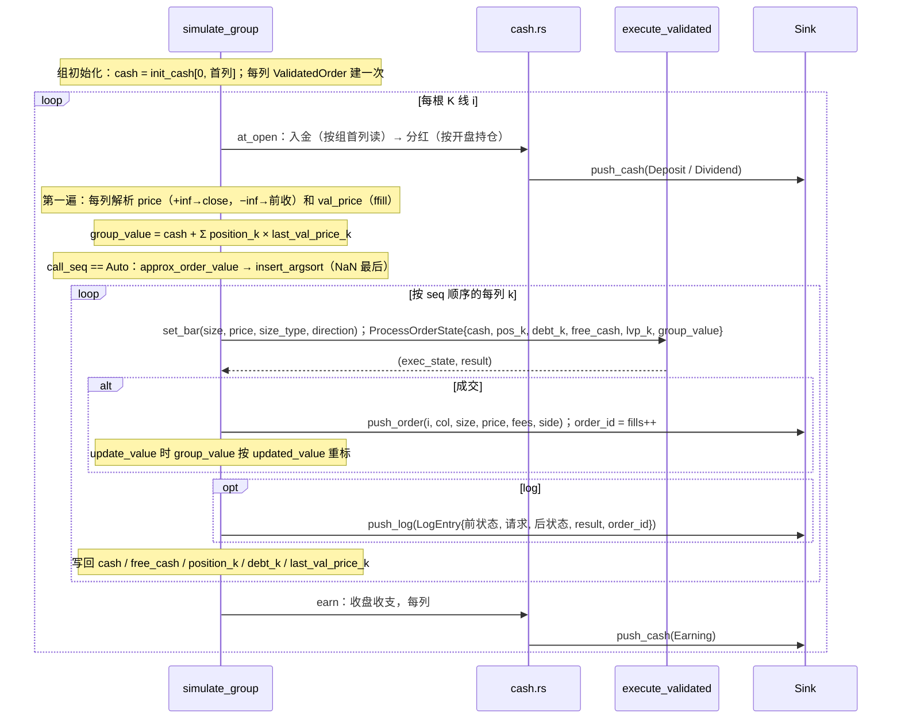

# from_orders 的一根 K 线

`from_orders` 的 `simulate_group` 一次处理一个账户组：每根 K 线先做开盘现金流，再分两遍——第一遍解析全组的价格与估值、算出 `group_value`，第二遍按[调用顺序](../algorithms/call-seq-auto.md)把每列的订单交给[撮合内核](../crates/phasor-exec.md)，最后入账收盘收支。它也是 [from_signals 的决策顺序](../algorithms/prepare-order.md)所在循环的模板。

## 位置

- [`crates/phasor-sim/src/from_orders.rs:328-591`](https://github.com/nivalume/vbt/blob/81a1d5f238f2d583bad187a9ab6e1e6170316f11/crates/phasor-sim/src/from_orders.rs#L328-L591)（`simulate_group`）
- [`crates/phasor-sim/src/from_orders.rs:305-312`](https://github.com/nivalume/vbt/blob/81a1d5f238f2d583bad187a9ab6e1e6170316f11/crates/phasor-sim/src/from_orders.rs#L305-L312)（为什么分两遍的注释）
- [`crates/phasor-sim/src/from_orders.rs:254-275`](https://github.com/nivalume/vbt/blob/81a1d5f238f2d583bad187a9ab6e1e6170316f11/crates/phasor-sim/src/from_orders.rs#L254-L275)（`updated_value`）

## 一根 K 线的时序

图中的 `ValidatedOrder` 见 [ValidatedOrder：按列提升参数校验](../concepts/validated-order.md)，`execute_validated` 内部的步骤见 [execute_order 的固定顺序](../algorithms/execute-order-pipeline.md)，开盘与收盘的现金流见[成交之外的现金流](../concepts/cash-flows.md)。

## 两遍扫描与穿线的 value

为什么分两遍（`from_orders.rs:305-312`）：组的净值依赖所有列的估值价，而执行顺序可能与布局顺序不同，所以必须先把所有列的价格解析完、算出 `group_value`，再按 `seq` 执行。
`value` 是**穿线**的，不是每笔成交后重算：一根 K 线内所有订单都以开盘时的净值定大小，只有 `update_value=true` 时用 `updated_value`（254–275）按成交价重标：`value' = value + Δcash + (position' × price − position × val_price)`。

## 记录缓冲的容量

预分配：`S::with_capacity(fill_bound)`，`fill_bound` 数"size 非 0 非 NaN 的格子"而不是 `n_rows × n_cols`（100k × 2000 会是 8 GB）。

## 相关

- [phasor-sim：模拟循环](../crates/phasor-sim.md)：所属 crate，两条循环与四种入口。
- [call_seq=auto：共享账户内的执行顺序](../algorithms/call-seq-auto.md)：第一遍末尾决定第二遍的 `seq`。
- [成交之外的现金流](../concepts/cash-flows.md)：`at_open` 与 `earn` 在一根 K 线里的位置。
- [execute_order 的固定顺序](../algorithms/execute-order-pipeline.md)：第二遍每列调用的内核。
- [按账户组并行与确定性合并](../algorithms/parallel-simulation.md)：多个 `simulate_group` 怎样分到线程上、记录怎样合并。
- [from_signals 的决策顺序](../algorithms/prepare-order.md)：`from_signals` 在同一结构里每列多出的一步 `prepare_order`。
