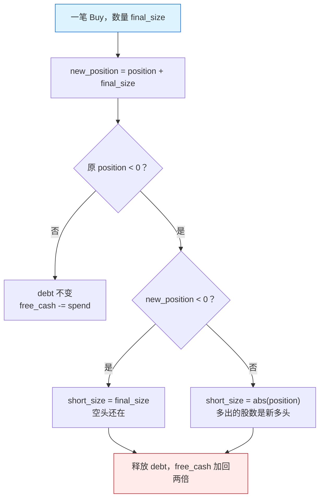
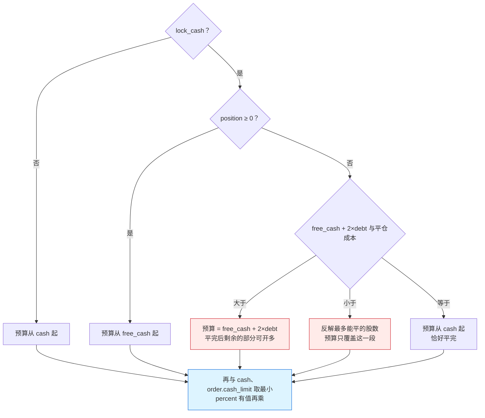

# buy：买入、平空与 lock_cash 预算

换算后 `order_size > 0` 的订单都走 `buy`。它先算出这笔单最多能花多少钱，再决定买多少股、付多少费用，最后更新现金、持仓和空头记账；持仓为负时，同一笔买单先平空，多出来的股数才是新多头。

## 位置

- [`crates/phasor-exec/src/kernel.rs:48-221`](https://github.com/nivalume/vbt/blob/81a1d5f238f2d583bad187a9ab6e1e6170316f11/crates/phasor-exec/src/kernel.rs#L48-L221)：`buy`
- [`crates/phasor-exec/src/kernel.rs:58-91`](https://github.com/nivalume/vbt/blob/81a1d5f238f2d583bad187a9ab6e1e6170316f11/crates/phasor-exec/src/kernel.rs#L58-L91)：现金预算与 `lock_cash`
- [`crates/phasor-exec/src/kernel.rs:72-79`](https://github.com/nivalume/vbt/blob/81a1d5f238f2d583bad187a9ab6e1e6170316f11/crates/phasor-exec/src/kernel.rs#L72-L79)：不够平空时的求解
- [`crates/phasor-exec/src/kernel.rs:144`](https://github.com/nivalume/vbt/blob/81a1d5f238f2d583bad187a9ab6e1e6170316f11/crates/phasor-exec/src/kernel.rs#L144)：买得起判断
- [`crates/phasor-exec/src/kernel.rs:193`](https://github.com/nivalume/vbt/blob/81a1d5f238f2d583bad187a9ab6e1e6170316f11/crates/phasor-exec/src/kernel.rs#L193)、[`crates/phasor-exec/src/kernel.rs:212-219`](https://github.com/nivalume/vbt/blob/81a1d5f238f2d583bad187a9ab6e1e6170316f11/crates/phasor-exec/src/kernel.rs#L212-L219)：一笔成交里平空
- [`crates/phasor-sim/src/from_orders.rs:520-522`](https://github.com/nivalume/vbt/blob/81a1d5f238f2d583bad187a9ab6e1e6170316f11/crates/phasor-sim/src/from_orders.rs#L520-L522)：模拟循环只 `push_order` 一次

## 伪代码

输入 `size > 0`（可为 `+inf`）、`percent`（NaN 表示没有）。

```text
adj_price = price × (1 + slippage)

cash_limit =
  if lock_cash:
     position ≥ 0 → free_cash
     position < 0 → 先算"平掉空头要多少钱" cover_req；
                    够平且有余 → free_cash + 2·debt
                    不够平     → 解出最多能平多少（见下）
                    恰好够     → cash
  else: cash
cash_limit = min(cash_limit, cash, order.cash_limit)        # cash_limit 是 phasor 新增，参考实现没有
if percent 给定: cash_limit = min(cash_limit, percent × cash_limit)

LongOnly/Both:  cash_limit == 0 → Rejected·NoCashLong
                size 与 cash_limit 都是 inf → Err（无限做多）
ShortOnly:      position == 0 → Rejected·NoOpenPosition   # 只能平空，不能开多

adj_size = ShortOnly ? min(-position, size) : size
adj_size == 0            → Ignored·SizeZero
adj_size > max_size      → allow_partial ? adj_size = max_size : Rejected·MaxSizeExceeded
有粒度                    → adj_size = floor(adj_size / g) × g

req_cash  = adj_size × adj_price
req_fees  = req_cash × fees + fixed_fees
total     = req_cash + req_fees

if is_close_or_less(total, cash_limit):                      # 买得起
    final = adj_size, fees_paid = req_fees, spend = total
else:                                                        # 买不起：反解
    max_req_cash = add(cash_limit, -fixed_fees) / (1 + fees)
    max_req_cash ≤ 0 → Rejected·CantCoverFees
    max_acq_size = max_req_cash / adj_price
    无粒度 → final = max_acq_size, fees_paid = cash_limit − max_req_cash, spend = cash_limit
    有粒度 → final = floor(max_acq_size / g) × g，重算 req_cash 与 fees   # 粒度第二次生效

is_close(adj_size, 0)                 → Ignored·SizeZero      # 注意测的是 adj_size 不是 final
is_less(final, min_size)              → Rejected·MinSizeNotReached
size 有限 且 final < size 且 !allow_partial → Rejected·PartialFill

new_cash     = add(cash, -spend)
new_position = add(position, final)
position < 0（在平空）：
    short_size = new_position < 0 ? final : |position|
    avg_entry  = debt / |position|
    debt_diff  = short_size × avg_entry
    new_debt      = add(debt, -debt_diff)
    new_free_cash = add(free_cash + 2·debt_diff, -spend)      # 释放的保证金是 2 倍
否则：new_free_cash = add(free_cash, -spend)
```

## 平空就在这一笔买单里

**平空就在这一笔买单里。** 同一列只有一个带符号的持仓，`new_position = add(position, final_size)`（`kernel.rs:193`）。函数只返回一个 `OrderResult::filled(..., Buy)`（`kernel.rs:212-219`）；模拟循环对它 `push_order` 一次（[`crates/phasor-sim/src/from_orders.rs:520-522`](https://github.com/nivalume/vbt/blob/81a1d5f238f2d583bad187a9ab6e1e6170316f11/crates/phasor-sim/src/from_orders.rs#L520-L522)）。`short_size` 只用来减 `debt`，不再执行第二张订单。



持仓 −5、买得起 8 股：订单记录是买 8，持仓变成 3，`short_size = 5`。买 3 股则持仓变成 −2，`short_size = 3`，没有新多头。`ShortOnly` 在更前面就把数量截成不超过当前空头（`kernel.rs:113-117`），所以走不到"买穿"。统计上要把这一笔拆成"已平的空头"和"新多头的开仓"，是[三种交易视图](../algorithms/trade-views.md)里的 `exit_trades`（[`crates/phasor-records/src/trades.rs:580-606`](https://github.com/nivalume/vbt/blob/81a1d5f238f2d583bad187a9ab6e1e6170316f11/crates/phasor-records/src/trades.rs#L580-L606)）：它立刻写下已平的那一段，剩下的股数要等以后的卖出或收盘标记才另成一条记录。

## 费用反解

**费用反解**为什么是 `(cash_limit − fixed_fees) / (1 + fees)`：费用在上限*之内*。设可花名义金额 `x`，则 `x + x·fees + fixed = cash_limit`，解得 `x = (cash_limit − fixed)/(1 + fees)`。
例：现金 100、`fees=0.1`、`fixed_fees=1`、`price=10`、`size=+inf` → `x = 99/1.1 = 90`，买 9 股，付费 10，现金归零。这就是[阅读路线](../guides/reading-roadmap.md)自测题的答案。

## lock_cash 预算

**`lock_cash` 决定这笔单能不能动用空头保证金。** 保证金本身在 `sell` 里记账，与这个开关无关（[空头保证金](../concepts/short-margin.md)）。开关打开时，买单的预算从 `free_cash` 起算，而不是从 `cash` 起算（`kernel.rs:58-91`）。当前是空头时，平仓会把这一列的两份预留还回来，所以"够平"的预算是 `free_cash + 2·debt`，再拿去和整笔平仓成本比。这三路比较是精确比较。



沿用[空头保证金](../concepts/short-margin.md)的账户：现金 100 空 5 股 @10 之后，`cash = 150`、`debt = 50`、`free_cash = 50`，于是 `free_cash + 2·debt = 150`。其中 50 用来平空，剩下 100 可以开多。单列、没有其他空头时，`free_cash + 2·debt` 等于当时的 `cash`。同组里别的列也有空头时，组现金里还含着它们的 `2·debt`，这一列只加回自己的一份（共享方式见 [phasor-sim](../crates/phasor-sim.md)）。

不够平完时（`kernel.rs:72-79`）：设最多能平 `s` 股，花费 `s·p·(1+fees) + fixed`，每平 1 股释放 `2·avg_entry`，于是
`free_cash + 2·avg_entry·s = s·p·(1+fees) + fixed` → `s = (free_cash − fixed) / (p(1+fees) − 2·avg_entry)`。
解出来的 `s` 小于整笔空头，这笔买单不会开多。

## 相关

- [phasor-exec：撮合内核](../crates/phasor-exec.md)：`buy` 是 `execute_validated` 的两个分支之一。
- [空头保证金：debt 与 free_cash](../concepts/short-margin.md)：平空释放的 `debt`、`lock_cash` 遵守的预留是在哪里记下的。
- [sell：卖出与开空](../algorithms/sell-leg.md)：另一个分支；卖穿 0 时开空。
- [数量换算链与 percent](../algorithms/size-cascade.md)：`percent` 从哪来，为什么只有 `Percent` 会设置它。
- [浮点容差与零钉](../concepts/float-tolerance.md)：买得起判断用 `is_close_or_less`，余额更新用 `add`。
- [三种交易视图](../algorithms/trade-views.md)：`exit_trades` 把平空加开多的一笔成交拆成两段。
- [拒单原因 StatusInfo](../reference/status-info.md)：`NoCashLong`、`CantCoverFees`、`MinSizeNotReached` 等在 `buy` 里的位置。
