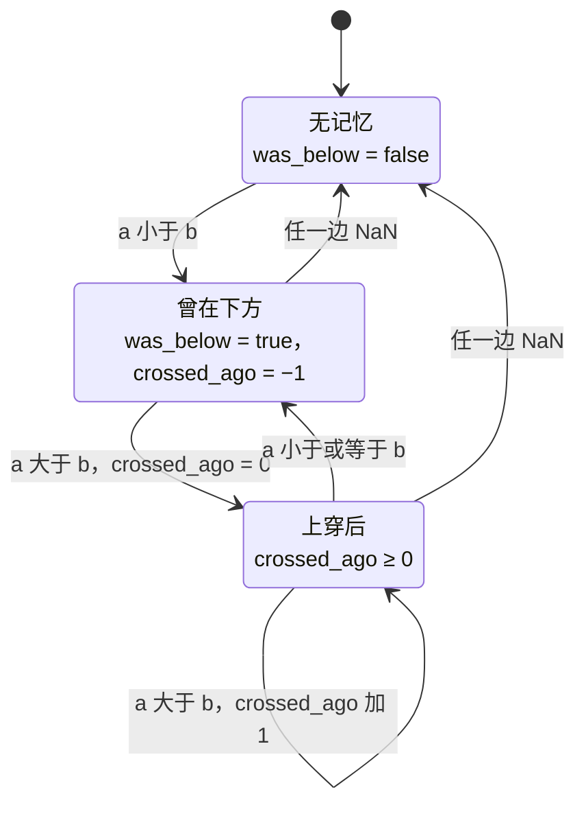

# crossed_above 的交叉规则

`crossed_above_1d` 在 [phasor-generic](../crates/phasor-generic.md) 的 `elementwise.rs` 里，也是 Python `phasor.crossed_above` 背后的实现（[`@phasor.strategy` 的参数扫描](../algorithms/strategy-sweep.md) 的示例用它把两条均线变成进出场）。文档里的三条规则就是整个函数。

## 位置

- [`crates/phasor-generic/src/elementwise.rs:110-156`](https://github.com/nivalume/vbt/blob/81a1d5f238f2d583bad187a9ab6e1e6170316f11/crates/phasor-generic/src/elementwise.rs#L110-L156)（文档与 `crossed_above_1d`）
- [`crates/phasor-generic/src/elementwise.rs:158-162`](https://github.com/nivalume/vbt/blob/81a1d5f238f2d583bad187a9ab6e1e6170316f11/crates/phasor-generic/src/elementwise.rs#L158-L162)（`crossed_below_1d`：交换两个参数）
- [`crates/phasor-py/src/expr.rs:15`](https://github.com/nivalume/vbt/blob/81a1d5f238f2d583bad187a9ab6e1e6170316f11/crates/phasor-py/src/expr.rs#L15)（Python 绑定：逐列调用 `crossed_above_1d`，`wait = 0`）
- [`crates/phasor-py/python/phasor/strategy.py:45-57`](https://github.com/nivalume/vbt/blob/81a1d5f238f2d583bad187a9ab6e1e6170316f11/crates/phasor-py/python/phasor/strategy.py#L45-L57)（`phasor.crossed_above`）

## 状态与三条规则

**`crossed_above_1d`**（`elementwise.rs:131-156`）：状态 `was_below`、`crossed_ago`。任一边 NaN → 两个都清；`a > b` 且曾在下方 → `crossed_ago += 1`，`== wait` 时输出 true；`a == b` → 计数清零但记忆保留；`a < b` → `was_below = true`。三条规则：**严格**（开头就在上方永远不算交叉）；**相等**（触碰后再上穿算，上方触碰重启等待）；**只有 NaN 清除记忆**（缺口不能制造交叉）。

代码里"清零"是把 `crossed_ago` 设回 −1（"当前不在一次上穿之后"），所以下一根 `a > b` 加到 0，`wait = 0` 时当根就输出。三个状态与它们之间的转移；`crossed_ago` 变成 `wait` 的那一根输出 true，图上没画的组合（无记忆时 `a ≥ b`、曾在下方时 `a ≤ b`）状态不变：

`a == b` 是一个独立状态而不是近似：函数带 `#[allow(clippy::float_cmp)]` 和理由（两条序列相触既不在上也不在下，容差会造出一条两个分支都不走的带子）。

## 相关

- [phasor-generic：通用窗口算子](../crates/phasor-generic.md)：所属 crate；`clippy::float_cmp` 的精确相等守卫是它的阅读陷阱之一。
- [@phasor.strategy 的参数扫描](../algorithms/strategy-sweep.md)：`crossed_above` 在 Python 里的用法，以及信号如何再延迟一根。
- [浮点容差与零钉](../concepts/float-tolerance.md)：全仓库为什么禁止浮点 `==`，以及这里为什么是例外。
- [信号清洗与出场生成](../algorithms/signal-generation.md)：交叉产生的进出场进入模拟前可以用 `clean_enex` 整理成严格交替。
- [延迟与前视偏差](../concepts/look-ahead.md)：交叉本身是因果的，但用收盘价算出的交叉仍要延迟一根再交易。
