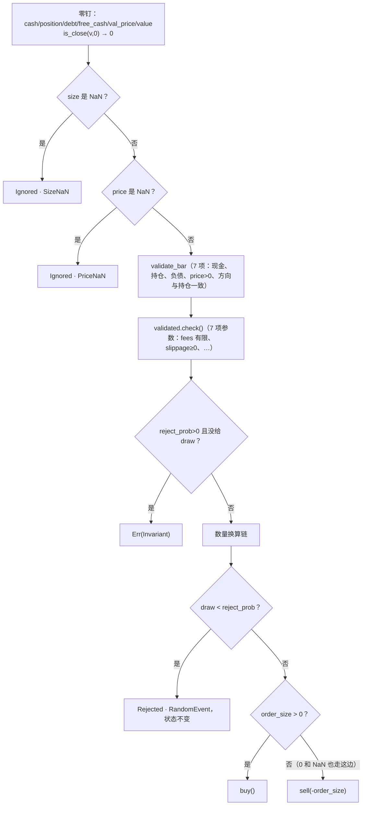

# execute_order 的固定顺序

`execute_order` 只是把订单包成 `ValidatedOrder` 再交给 `execute_validated`，真正的工作在后者里按固定顺序完成。这个顺序决定了一笔同时有几处毛病的订单最终是被忽略、被拒绝还是报错。

## 位置

- [`crates/phasor-exec/src/kernel.rs:559-701`](https://github.com/nivalume/vbt/blob/81a1d5f238f2d583bad187a9ab6e1e6170316f11/crates/phasor-exec/src/kernel.rs#L559-L701)：`execute_validated`
- [`crates/phasor-exec/src/kernel.rs:583-596`](https://github.com/nivalume/vbt/blob/81a1d5f238f2d583bad187a9ab6e1e6170316f11/crates/phasor-exec/src/kernel.rs#L583-L596)：忽略检查
- [`crates/phasor-exec/src/kernel.rs:598-602`](https://github.com/nivalume/vbt/blob/81a1d5f238f2d583bad187a9ab6e1e6170316f11/crates/phasor-exec/src/kernel.rs#L598-L602)：先 bar 后参数
- [`crates/phasor-exec/src/kernel.rs:679-693`](https://github.com/nivalume/vbt/blob/81a1d5f238f2d583bad187a9ab6e1e6170316f11/crates/phasor-exec/src/kernel.rs#L679-L693)：随机拒单

## `execute_validated` 的固定顺序

顺序不能换，每一步都有 fixture 钉住。

换算链的每一级见[数量换算链与 percent](../algorithms/size-cascade.md)；最后的两个分支见 [buy](../algorithms/buy-leg.md) 和 [sell](../algorithms/sell-leg.md)。

## 三个容易漏掉的点

三个容易漏掉的点：

1. **忽略检查在校验之前**（`kernel.rs:583-596`）。一列全是 NaN 的 size 配上非法的 fees，结果是整列 Ignored 而不是报错。这正是 [`ValidatedOrder`](../concepts/validated-order.md) 把违例"带着走"而不是构造时就报错的原因（`kernel.rs:468-474`）。
2. **先 bar 后参数**（`kernel.rs:598-602`）。两组校验独立，但一个订单同时违反两边时报哪条消息由顺序决定，测试 `a_bad_state_outranks_a_bad_parameter` 钉住。
3. **随机拒单在分发之前**（`kernel.rs:679-693`）。参考实现是在买卖之后覆盖结果；这里提前决定，省掉回滚。唯一的可观测差异：被随机拒掉的订单不会再触发"无限做多/做空"那两个 `Err`。

## 相关

- [phasor-exec：撮合内核](../crates/phasor-exec.md)：`execute_order` 是这个 crate 的唯一入口。
- [数量换算链与 percent](../algorithms/size-cascade.md)：流程图里“数量换算链”那一步的展开。
- [ValidatedOrder：按列提升参数校验](../concepts/validated-order.md)：参数校验那一半为什么能提到循环外、为什么违例要带着走。
- [错误与拒单](../concepts/errors-vs-rejections.md)：哪些出口是 `Err`，哪些是 `Ignored` / `Rejected`。
- [拒单原因 StatusInfo](../reference/status-info.md)：每个出口对应的原因和代码行。
- [无状态随机数 SplitMix64](../concepts/stateless-rng.md)：随机拒单用的 `draw` 由 `(seed, row, col)` 决定。
