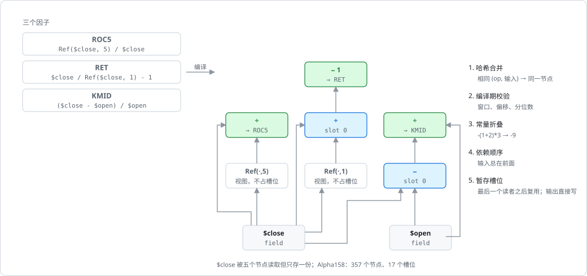

# 依赖图编译：哈希合并、Ref 视图与槽位调度

[解析](../algorithms/pratt-parser.md)出来的每个因子是一棵树；`graph.rs` 把整组因子的树合并成一张去重的有向无环图，再决定哪些节点根本不用算、哪些要占暂存槽位，为[原生求值](../algorithms/native-evaluation.md)准备好一份按依赖序排好的执行计划。

## 位置

- [`crates/phasor-expr/src/graph.rs:37-154`](https://github.com/nivalume/vbt/blob/81a1d5f238f2d583bad187a9ab6e1e6170316f11/crates/phasor-expr/src/graph.rs#L37-L154)：类型（`Graph`、`Node`、`Op`）
- [`crates/phasor-expr/src/graph.rs:288-451`](https://github.com/nivalume/vbt/blob/81a1d5f238f2d583bad187a9ab6e1e6170316f11/crates/phasor-expr/src/graph.rs#L288-L451)：`Builder::node`/`call`
- [`crates/phasor-expr/src/graph.rs:251-286`](https://github.com/nivalume/vbt/blob/81a1d5f238f2d583bad187a9ab6e1e6170316f11/crates/phasor-expr/src/graph.rs#L251-L286)：`intern`（251–270）与 `fold`（273–286）
- [`crates/phasor-expr/src/graph.rs:185-240`](https://github.com/nivalume/vbt/blob/81a1d5f238f2d583bad187a9ab6e1e6170316f11/crates/phasor-expr/src/graph.rs#L185-L240)：`schedule`
- [`crates/phasor-expr/src/graph.rs:541-629`](https://github.com/nivalume/vbt/blob/81a1d5f238f2d583bad187a9ab6e1e6170316f11/crates/phasor-expr/src/graph.rs#L541-L629)：5 个测试（调度器最清楚的规格）



## 哈希合并

**哈希合并**（`intern`，251–270）：键是 `(Op, Vec<NodeId>)`。`Op` 把所有参数都带在身上（`Const(bits)`、`Ref(k)`、`Rolling(kind, Window)`、`Quantile(bits)`），操作数是已经 intern 过的节点 id，所以"结构相同"就是"同一个节点"。`a+b` 和 `Add(a,b)` 是一个节点；Alpha158 里几十个因子共用的 `Ref($close,1)` 只算一次。依赖序是免费的：节点在它的输入之后才被 push（后序）。

## 常量折叠

**常量折叠**（`fold`，273–286）：`Unary`/`Binary`/`If` 的输入全是 `Const` 时，用运行时同一套标量函数算出来再 intern 成 `Const`。滚动/`Ref`/`EMA`/`Pair` 不折叠（运行时物化成常量序列）。

## 调度：视图、活跃性与槽位

**调度**（`schedule`，185–240），三趟：

```text
① 视图解析：Op::Ref(k ≥ 0) 且输入不是 Const
      输入本身是视图 (base, s) → view = (base, s + k)      视图可以复合：Ref(Ref(x,1),2) = x 平移 3
      否则                     → view = (input, k)
   k < 0（读未来）永远不是视图，正常计算
② 活跃性：对每个节点的每个输入：read = true；last_read[base(input)] = 当前节点    读视图 = 读它的底座
③ 槽位：线性扫描
      computed = 不是 Field/Const 且不是视图
      computed && read  → 从 free 栈弹一个槽，否则 slots += 1         ← 先分配，再释放本节点的输入
      computed && !read → 不要槽：直接写进自己的输出列
      然后：对每个 last_read == 当前节点 的输入底座，把它的槽 push 回 free
```

"先分配再释放"保证节点永远不会写进自己正在读的槽（测试 `slots_are_reused_after_the_last_read`）；这个不变量在 `run_column` 里是承重的（`std::mem::take` 会把目标槽掏空）。
`Window::All` 到运行时才解析成 `n_rows.max(1)`，所以图与形状无关。

## 实测：节点与槽位

实测（本知识库作者在未改动的副本上验证）：

| 特征集 | 节点 | 槽位 | 直写输出 | 视图 | 字段 |
|---|---:|---:|---:|---:|---|
| Alpha158 | 357 | 17 | 148 | 7 | close high low open vwap volume |
| Alpha360 | 722 | 1 | 360 | 354 | 同上 |

Alpha158 里不直写的 10 个输出是 `CNTP{d}`/`CNTN{d}`，因为 `CNTD{d} = CNTP − CNTN` 还要读它们。Alpha360 的 722 = 6 字段 + 354 视图 + 360 除法 + `1e-12` + `$volume + 1e-12`；唯一的槽是 `$volume + 1e-12`（被 60 个节点读）。所以 Alpha360 每个因子一趟、每个标的约 20 KB 暂存。

两套特征集本身怎样生成见 [Alpha158 与 Alpha360](../concepts/alpha-feature-sets.md)。

## 相关

- [phasor-expr：因子表达式引擎](../crates/phasor-expr.md)：所属 crate；编译是四个阶段里的第二个，阅读陷阱第 8、9 条都出自这里。
- [Pratt 解析器](../algorithms/pratt-parser.md)：上一阶段，产出被合并的 `Expression` 树。
- [原生求值：按标的并行走图](../algorithms/native-evaluation.md)：下一阶段，`run_column` 按这里排好的节点顺序和槽位执行。
- [Alpha158 与 Alpha360](../concepts/alpha-feature-sets.md)：上面实测表里的两套特征集。
- [O(1) 滚动累加器](../algorithms/rolling-accumulators.md)：`Rolling(kind, Window)` 节点在运行时调用的核。
