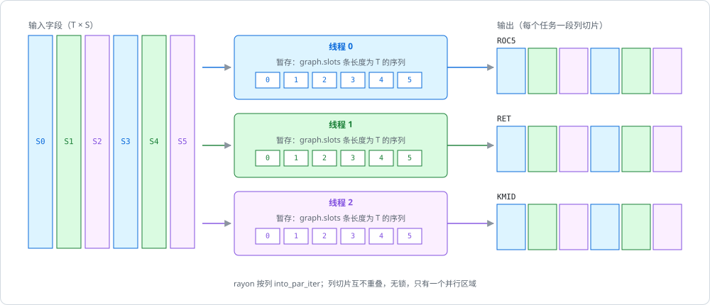

# 原生求值：按标的并行走图

[编译](../algorithms/factor-graph.md)好的图在这里执行：一个标的的所有因子只依赖这个标的自己的历史，所以标的之间天然独立，按列并行既不需要锁也不需要 `unsafe`。

## 位置

- [`crates/phasor-expr/src/eval.rs:169-216`](https://github.com/nivalume/vbt/blob/81a1d5f238f2d583bad187a9ab6e1e6170316f11/crates/phasor-expr/src/eval.rs#L169-L216)：`evaluate`
- [`crates/phasor-expr/src/eval.rs:318-403`](https://github.com/nivalume/vbt/blob/81a1d5f238f2d583bad187a9ab6e1e6170316f11/crates/phasor-expr/src/eval.rs#L318-L403)：`run_column`
- [`crates/phasor-expr/src/eval.rs:238-315`](https://github.com/nivalume/vbt/blob/81a1d5f238f2d583bad187a9ab6e1e6170316f11/crates/phasor-expr/src/eval.rs#L238-L315)：`Arg`/`Seg`/`segments`
- [`crates/phasor-expr/src/eval.rs:420-472`](https://github.com/nivalume/vbt/blob/81a1d5f238f2d583bad187a9ab6e1e6170316f11/crates/phasor-expr/src/eval.rs#L420-L472)：`step`
- [`crates/phasor-expr/src/eval.rs:510-546`](https://github.com/nivalume/vbt/blob/81a1d5f238f2d583bad187a9ab6e1e6170316f11/crates/phasor-expr/src/eval.rs#L510-L546)：`binary_series`
- [`crates/phasor-expr/src/eval.rs:556-588`](https://github.com/nivalume/vbt/blob/81a1d5f238f2d583bad187a9ab6e1e6170316f11/crates/phasor-expr/src/eval.rs#L556-L588)：`rolling_into`



## 求值流程

```text
evaluate(graph, inputs):
    ① 先解析全部字段 → 缺字段在此报错；并行区没有错误路径
    ② 每个输出单独 vec![0.0; n_rows × n_cols]（不是克隆一个零缓冲），让写它的线程首次触碰页
    ③ 把每个输出 chunks_mut(n_rows) 切成 n_cols 个 &mut [f64]，第 c 个塞进 columns[c]
       → 任务 c 拥有**每个输出**的第 c 列；借用检查器证明不重叠，没有 unsafe
    ④ columns.into_par_iter().for_each_init(|| Scratch::new(slots, n_rows), |scratch, (col, out)| run_column(...))
       Scratch = slots 个暂存序列 + 2 个备用，每个 rayon 任务初始化一次、跨列复用
run_column：按 nodes 顺序走
    源节点（Field/Const/视图）：不算；只有当它本身是输出时才物化到 out[first]，再 split_at_mut 复制到其他输出位
    计算节点：收集 ≤ 3 个 Arg；有槽 → step(op, args, 槽) 再复制到输出位；无槽 → step 直接写 out[first]
Arg = Scalar | Series(&[f64]) | Shifted{values, offset}
segments：每个 Shifted 操作数在 offset 处"换形"（之前是 NaN 标量，之后是切片）；按所有切点分段，
          每段内每个操作数都是纯标量或纯切片 → 逐元素算子不物化平移序列（Alpha360 的收益来源）
binary_series：dispatch! 宏对每个 BinaryOp 展开一个 match 臂，臂内对 (Slice|Scalar)² 四种组合各一个紧循环
          → 算子和操作数形态都在行循环**之外**解决，每个 case 编译成可自动向量化的直线循环
step：Ref(k<0) 复制 column[|k|..] 再 NaN 填尾；Delta(k) = Sub(x, x.shifted(k))；Ema/Rolling 先物化到 spare[0]；
      Pair 两边物化后 zip 成 Vec<(f64,f64)>
rolling_into：Mean/Max/Min 转给 phasor_generic；其余 → window.rs 累加器 / order.rs / rolling_arg_extreme_into
```

`rolling_into` 转出去的核分别见 [O(1) 滚动累加器](../algorithms/rolling-accumulators.md)、[单调队列](../algorithms/monotonic-queue.md)和[顺序统计量](../algorithms/order-statistics.md)。

## 代价与内存

每列代价 Σ 节点 O(n_rows)（例外：`EMA(x,0)` O(n²)，树状数组路径 O(n log n)）。内存由输出主导（所有输出同时在内存，2520 × 500 的 Alpha158 ≈ 1.6 GB）。

## 相关

- [phasor-expr：因子表达式引擎](../crates/phasor-expr.md)：所属 crate；阅读陷阱第 9 条说的就是 `run_column` 对调度器不变量的依赖。
- [依赖图编译：哈希合并、Ref 视图与槽位调度](../algorithms/factor-graph.md)：`nodes` 的顺序、槽位与视图都在那里决定。
- [O(1) 滚动累加器](../algorithms/rolling-accumulators.md)：`rolling_into` 调用的大部分核。
- [顺序统计量：有序环与树状数组](../algorithms/order-statistics.md)：`Quantile`/`Med`/`Rank`/`Mad` 的核，以及 O(n log n) 的树状数组路径。
- [按账户组并行与确定性合并](../algorithms/parallel-simulation.md)：模拟器的另一种并行切分（按账户组而不是按标的）。
- [列轴与列主序](../concepts/column-axis.md)：`chunks_mut(n_rows)` 能按列切开，靠的是列主序布局。
