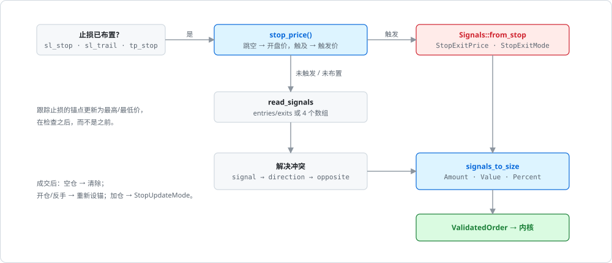
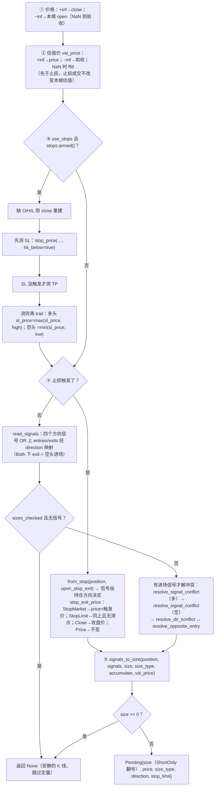

# from_signals 的决策顺序

`from_signals` 的循环结构与 [from_orders 的一根 K 线](../algorithms/bar-loop.md)相同，只是第一遍每列多做一步 `prepare_order`：把这根 K 线的价格、估值价、止损状态和四个布尔信号收敛成一个待执行的 `Pending`（或者 `None`，表示这一列这根 K 线什么也不做）。下面的流程图就是它的全部决策顺序。

## 位置

- [`crates/phasor-sim/src/from_signals.rs:502-704`](https://github.com/nivalume/vbt/blob/81a1d5f238f2d583bad187a9ab6e1e6170316f11/crates/phasor-sim/src/from_signals.rs#L502-L704)（`prepare_order`）
- [`crates/phasor-sim/src/from_signals.rs:356-385`](https://github.com/nivalume/vbt/blob/81a1d5f238f2d583bad187a9ab6e1e6170316f11/crates/phasor-sim/src/from_signals.rs#L356-L385)（`read_signals`）
- [`crates/phasor-sim/src/from_signals.rs:711-993`](https://github.com/nivalume/vbt/blob/81a1d5f238f2d583bad187a9ab6e1e6170316f11/crates/phasor-sim/src/from_signals.rs#L711-L993)（`simulate_group`，调用 `prepare_order` 并执行 `Pending`）

## 决策流程

③④ 两步（`stop_price`、先测后 trail、成交后的重新布防与止损单的滑点）展开在[止损引擎：触发、跟踪与重新布防](../algorithms/stop-engine.md)；冲突解析与 ⑤ `signals_to_size` 的规则表在[信号冲突解析链与 signals_to_size](../algorithms/signal-conflicts.md)。

## 相关

- [phasor-sim：模拟循环](../crates/phasor-sim.md)：所属 crate；`Pending`、`Signals`、`Stops` 的类图与 `−inf` 价格、`exits` 语义等阅读陷阱。
- [止损引擎：触发、跟踪与重新布防](../algorithms/stop-engine.md)：流程图 ③④ 的细节。
- [信号冲突解析链与 signals_to_size](../algorithms/signal-conflicts.md)：流程图里 `from_stop`、`resolve_*` 与 ⑤ 的纯函数。
- [from_orders 的一根 K 线](../algorithms/bar-loop.md)：`prepare_order` 之后的排序与执行沿用同一结构。
- [数量换算链与 percent](../algorithms/size-cascade.md)：`Pending` 交给内核后 `size_type` 怎样换算成数量。
