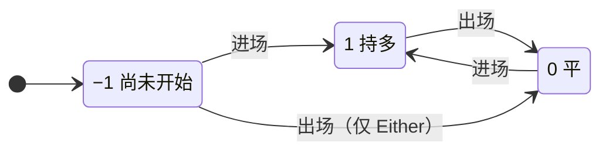

# 信号清洗与出场生成

[phasor-signals](../crates/phasor-signals.md) 里两个最常用的变换：`clean_enex` 把一列进场和出场整理成严格交替的序列，`generate_exits` 从进场生成出场。两者都不替模拟器解冲突——同一根上的进出冲突属于 `from_signals`，那里有持仓可以对照（见 [信号冲突解析链与 signals_to_size](../algorithms/signal-conflicts.md)）。

## 位置

- [`crates/phasor-signals/src/clean.rs:12-62`](https://github.com/nivalume/vbt/blob/81a1d5f238f2d583bad187a9ab6e1e6170316f11/crates/phasor-signals/src/clean.rs#L12-L62)（`FirstSignal`、`clean_enex_1d`）
- [`crates/phasor-signals/src/generate.rs:25-59`](https://github.com/nivalume/vbt/blob/81a1d5f238f2d583bad187a9ab6e1e6170316f11/crates/phasor-signals/src/generate.rs#L25-L59)（`ExitChoice`、`ExitWindow`）
- [`crates/phasor-signals/src/generate.rs:72-133`](https://github.com/nivalume/vbt/blob/81a1d5f238f2d583bad187a9ab6e1e6170316f11/crates/phasor-signals/src/generate.rs#L72-L133)（`generate_exits`）
- [`crates/phasor-signals/src/generate.rs:144`](https://github.com/nivalume/vbt/blob/81a1d5f238f2d583bad187a9ab6e1e6170316f11/crates/phasor-signals/src/generate.rs#L144)、`167`（`exit_after`、`exit_on`）
- [`crates/phasor-signals/src/generate.rs:201-249`](https://github.com/nivalume/vbt/blob/81a1d5f238f2d583bad187a9ab6e1e6170316f11/crates/phasor-signals/src/generate.rs#L201-L249)（`generate_alternating`）

## 清洗：`clean_enex_1d`

**`clean_enex_1d`**（`clean.rs:37-62`）：`phase ∈ {−1 尚未开始, 1 持多, 0 平}`。同一根同时有进有出 → `continue`，**两个都不发**（不在这里替 `from_signals` 解冲突）；进场只在 `phase ∈ {−1, 0}` 时接受，出场只在 `phase == 1`（或 `Either` 且 `phase == −1`）时接受。输出严格交替，连续信号坍缩成第一根；`EntryFirst` 丢掉开头的出场。

`phase` 的转移（`clean.rs:46-60`）；没画出的组合——持多（1）时的进场、平（0）时或 `EntryFirst` 下尚未开始（−1）时的出场、同根双信号——都不改变状态也不输出：

## 出场生成：`generate_exits` 与 `generate_alternating`

**`generate_exits`**（`generate.rs:72-133`）：每个进场在 `[row + wait, to)` 里请 `choice` 挑出场，`to` 由 `ExitWindow` 决定：`UntilNextEntry` 到下一个进场（每个出场只属于一个进场，`to ≤ from` 的进场没有出场）；`ToEnd` 窗口可重叠；`ToEndSkippingResolved` 落在活窗口里的进场被跳过。`exit_after(bars)` 的 choice 返回 `from`（等待就是持有期）；`exit_on` 返回第一个满足条件的行。`generate_alternating` 用两个 choice 交替生成进出场，每次只取第一个，`from` 强制 ≥ `row + 1` 防零等待死循环——止损类出场需要这个形状，因为止损依赖刚选出的进场。

## 相关

- [phasor-signals：信号工具箱](../crates/phasor-signals.md)：所属 crate；`clean_enex` 丢掉同根双信号是它的阅读陷阱之一。
- [信号冲突解析链与 signals_to_size](../algorithms/signal-conflicts.md)：同一根进出冲突真正被解决的地方。
- [SignalSweep：因子到信号列](../algorithms/signal-sweep.md)：另一条信号路径，根本不清洗。
- [crossed_above 的交叉规则](../algorithms/crossover.md)：最常见的进出场来源。
- [止损引擎：触发、跟踪与重新布防](../algorithms/stop-engine.md)：模拟器里的止损，对照 `generate_alternating` 生成的止损类出场。
