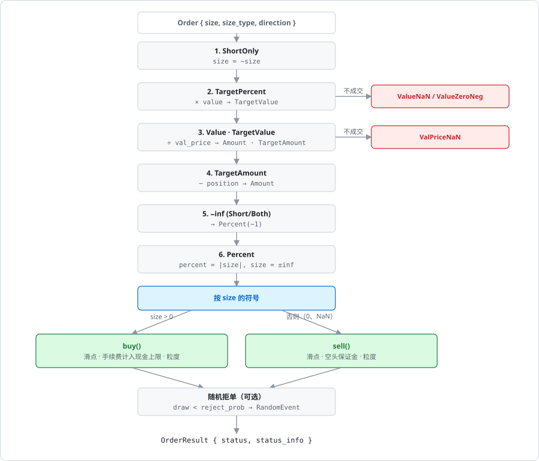
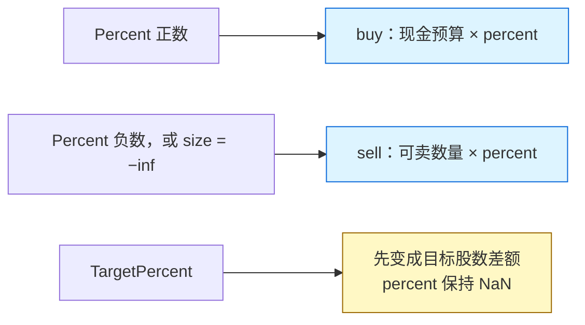

# 数量换算链与 percent

订单的 `size` 可以是股数、金额、比例或目标值。[execute_order](../algorithms/execute-order-pipeline.md) 在校验之后、分发之前用一条换算链把它们统一成股数；`Percent` 例外，它留到 [buy](../algorithms/buy-leg.md) 和 [sell](../algorithms/sell-leg.md) 里按可用资源去乘。

## 位置

- [`crates/phasor-exec/src/kernel.rs:610-677`](https://github.com/nivalume/vbt/blob/81a1d5f238f2d583bad187a9ab6e1e6170316f11/crates/phasor-exec/src/kernel.rs#L610-L677)：换算链
- [`crates/phasor-exec/src/kernel.rs:25-33`](https://github.com/nivalume/vbt/blob/81a1d5f238f2d583bad187a9ab6e1e6170316f11/crates/phasor-exec/src/kernel.rs#L25-L33)：NumPy 语义的 `sign`
- [`crates/phasor-exec/src/kernel.rs:89-91`](https://github.com/nivalume/vbt/blob/81a1d5f238f2d583bad187a9ab6e1e6170316f11/crates/phasor-exec/src/kernel.rs#L89-L91)：`buy` 里乘 `percent`
- [`crates/phasor-exec/src/kernel.rs:268-291`](https://github.com/nivalume/vbt/blob/81a1d5f238f2d583bad187a9ab6e1e6170316f11/crates/phasor-exec/src/kernel.rs#L268-L291)：`sell` 里乘 `percent`

## 换算链

每一步都把 `size_type` 改写成更"低级"的类型，最终只有 `Amount` 到达买卖分支。

| 步骤 | 条件 | 变换 | 可能的提前返回 |
|---|---|---|---|
| 0 | `direction == ShortOnly` | `size = -size`（空头列里正数表示"再空一些"） | — |
| 1 | `TargetPercent` | `size *= value`；类型 → `TargetValue` | `value` NaN → Ignored·ValueNaN；`value <= 0` → Rejected·ValueZeroNeg |
| 2 | `Value` 或 `TargetValue` | `size /= val_price`；`Value` → `Amount`，`TargetValue` → `TargetAmount` | `val_price` 无限或 ≤ 0 → Err；NaN → Ignored·ValPriceNaN |
| 3 | `TargetAmount` | `size -= position`；→ `Amount` | — |
| 4 | `Amount` 且可做空且 `size == -inf` | `size = -1`；→ `Percent`（"空掉全部资源"） | — |
| 5 | `Percent` | `percent = \|size\|`；`size = sign(size) × inf` | `sign(0) × inf = NaN`，后面走 sell 分支并以 SizeZero 被忽略 |

注意 `sign` 是 NumPy 语义（`kernel.rs:25-33`）：`sign(NaN) = 0`，所以 `0 × inf = NaN` 和参考实现一致。

## percent 用在哪里

**`percent` 是可用资源的比例，不是目标仓位。** 只有上表第 5 步会把它设成 `|size|`；其它类型保持 `NaN`，`buy` / `sell` 都不看它。`TargetPercent` 在第 1 步已经乘进组合净值，后面按目标股数和当前持仓的差额成交。

正比例进 `buy`（`kernel.rs:89-91`）。乘法发生在预算已经和 `cash`、`order.cash_limit`、以及 `lock_cash` 算出的上限取过最小之后。现金 100、`cash_limit = 60`、`percent = 0.5` 时最多花 30。此时请求量是 `+inf`，股数由这笔钱反推。

负比例进 `sell`（`kernel.rs:268-291`）。`LongOnly` 的基数是当前持仓。允许做空时，基数是卖掉多头之后 `free_cash` 还能新开的空头。`lock_cash` 为真时，比例在这个上限里面乘掉，随后把 `percent` 置成 `NaN`，避免函数后面再乘一次。`size = −inf` 被第 4 步改写成 `Percent(−1)`，也就是把这份资源全部拿去卖或开空。

## 相关

- [phasor-exec：撮合内核](../crates/phasor-exec.md)：换算链是 `execute_validated` 的中段。
- [execute_order 的固定顺序](../algorithms/execute-order-pipeline.md)：换算链前后的步骤，以及换算后按符号分发。
- [buy：买入、平空与 lock_cash 预算](../algorithms/buy-leg.md)：正比例在现金预算上乘。
- [sell：卖出与开空](../algorithms/sell-leg.md)：负比例在可卖数量上乘。
- [拒单原因 StatusInfo](../reference/status-info.md)：`ValueNaN`、`ValueZeroNeg`、`ValPriceNaN` 都在换算链里触发。
- [from_signals 的决策顺序](../algorithms/prepare-order.md)：`ShortOnly` 列的符号在 `prepare_order` 里还要再翻一次。
