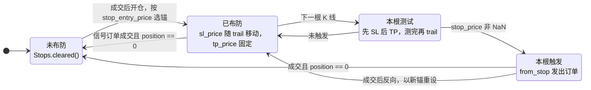

# 止损引擎：触发、跟踪与重新布防

`from_signals` 的止损（SL）与止盈（TP）是每列一份 `Stops` 状态：[决策顺序](../algorithms/prepare-order.md)的第 ③ 步用它测试本根 K 线是否触发，第 ④ 步把触发变成 `from_stop` 信号；成交写回之后，`simulate_group` 再决定是清空、重设还是保留它。这一页把这几处代码放在一起读。

## 位置

- [`crates/phasor-sim/src/from_signals.rs:276-316`](https://github.com/nivalume/vbt/blob/81a1d5f238f2d583bad187a9ab6e1e6170316f11/crates/phasor-sim/src/from_signals.rs#L276-L316)（`stop_price`）
- [`crates/phasor-sim/src/from_signals.rs:318-353`](https://github.com/nivalume/vbt/blob/81a1d5f238f2d583bad187a9ab6e1e6170316f11/crates/phasor-sim/src/from_signals.rs#L318-L353)（`should_update_stop`、`Stops`、`armed`）
- [`crates/phasor-sim/src/from_signals.rs:548-602`](https://github.com/nivalume/vbt/blob/81a1d5f238f2d583bad187a9ab6e1e6170316f11/crates/phasor-sim/src/from_signals.rs#L548-L602)（`prepare_order` 里的止损测试，trail 在 595–601）
- [`crates/phasor-sim/src/from_signals.rs:902-943`](https://github.com/nivalume/vbt/blob/81a1d5f238f2d583bad187a9ab6e1e6170316f11/crates/phasor-sim/src/from_signals.rs#L902-L943)（`simulate_group` 里的重新布防）
- [`crates/phasor-sim/src/from_signals.rs:737-744`](https://github.com/nivalume/vbt/blob/81a1d5f238f2d583bad187a9ab6e1e6170316f11/crates/phasor-sim/src/from_signals.rs#L737-L744)（两个 `ValidatedOrder`）

## 止损状态的一生

下图把下面几节串成一列的止损状态机。"已布防"指 `Stops::armed()` 为真（`sl_stop` 或 `tp_stop` 非 NaN）；"本根测试""本根触发"是一根 K 线之内的步骤，不是存下来的状态。布防与清空只发生在成交写回时，所以布防的那根 K 线不会被测试。



图中省略了停留在已布防的三种成交：信号订单反向时以新锚重设，加仓按 `upon_stop_update` 更新锚，减仓未平不动；以及触发后订单没有成交的情形（仍是已布防，止损留到下一根继续测）。

## stop_price：触发价与跳空

**`stop_price`**（276–316）：

```text
downward = (多头 & SL) 或 (空头 & TP)：level = anchor × (1 − stop)
    open ≤ level            → 跳空：按 open 成交
    low ≤ level ≤ high      → 触及：按 level 成交
    否则                     → NaN
upward   = (空头 & SL) 或 (多头 & TP)：level = anchor × (1 + stop)，对称
```

去掉跳空分支，所有跳空都会变成"完美执行的止损"（260–269 行注释）。

## 先测后 trail

**先测后 trail**（595–601）：本根 K 线用上一根为止的峰值判定；先 trail 的话，一根创新高又回落的 K 线会在当根就把自己打出来。测试 `a_trailing_stop_follows_the_high_but_only_from_the_next_bar`（1224–1251）。

## 重新布防

**重新布防**（`simulate_group` 902–943）：只在成交后。`position == 0` → 清空；新开仓或反向 → 以 `stop_entry_price` 选的锚（`ValPrice` / `Price` / `FillPrice` / `Close`）重设 SL 与 TP；加仓 → 按 `upon_stop_update`（`Keep` 不动 / `Override` 新值非 NaN 才覆盖 / `OverrideNaN` 总是覆盖，NaN 可清除）；减仓未平 → 不动。止损在成交的**下一根**才开始被测试。

## 两个 ValidatedOrder

**两个 `ValidatedOrder`**（737–744）：普通一个，再一个 `slippage = 0` 的给挂在止损价上的限价单用（`StopLimit` 无滑点，`StopMarket` 有）。参数为什么按列提升成 `ValidatedOrder` 见 [ValidatedOrder：按列提升参数校验](../concepts/validated-order.md)。

## 相关

- [phasor-sim：模拟循环](../crates/phasor-sim.md)：所属 crate；`Stops` 的字段与 vectorbt 内联 SL/TP 逻辑的对应。
- [from_signals 的决策顺序](../algorithms/prepare-order.md)：止损测试与 `from_stop` 在整条决策流程里的位置。
- [信号冲突解析链与 signals_to_size](../algorithms/signal-conflicts.md)：`from_stop` 按 `upon_stop_exit` 发出的信号怎样变成数量。
- [ValidatedOrder：按列提升参数校验](../concepts/validated-order.md)：止损单那份 `slippage = 0` 的校验结果。
- [execute_order 的固定顺序](../algorithms/execute-order-pipeline.md)：止损订单进入内核后与普通订单走同一流程。
