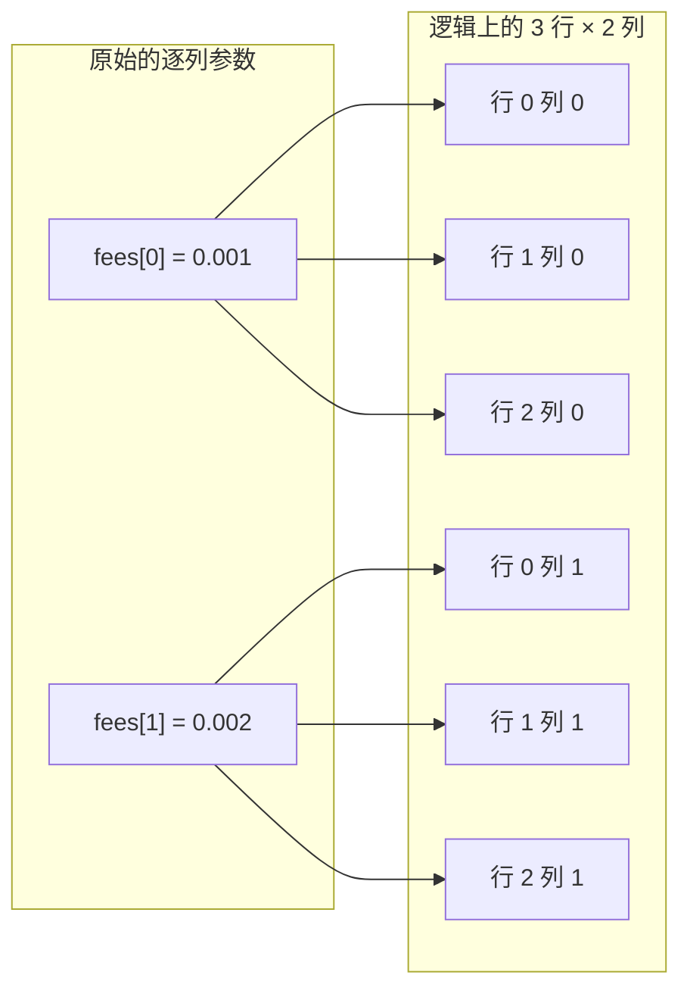
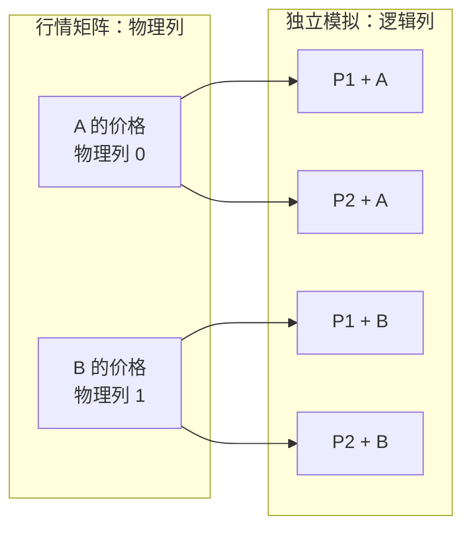

# FlexArray 广播与列映射

模拟的每个参数（手续费、滑点、止损……）都可能是标量、按列、按行或整张矩阵。[phasor-core](../crates/phasor-core.md) 的 `FlexArray` 不把它们展开成 `T × C` 的矩阵，而是借用调用者给的形状，在 `get(row, col)` 里做下标运算；[phasor-sim](../crates/phasor-sim.md) 的两条模拟循环每根 K 线都这样读参数。

## 位置

- [`crates/phasor-core/src/flex.rs:29-49`](https://github.com/nivalume/vbt/blob/81a1d5f238f2d583bad187a9ab6e1e6170316f11/crates/phasor-core/src/flex.rs#L29-L49)：五个变体
- [`crates/phasor-core/src/flex.rs:61-73`](https://github.com/nivalume/vbt/blob/81a1d5f238f2d583bad187a9ab6e1e6170316f11/crates/phasor-core/src/flex.rs#L61-L73)：`get`
- [`crates/phasor-core/src/flex.rs:80-85`](https://github.com/nivalume/vbt/blob/81a1d5f238f2d583bad187a9ab6e1e6170316f11/crates/phasor-core/src/flex.rs#L80-L85)：`varies_by_row`
- [`crates/phasor-core/src/flex.rs:90-109`](https://github.com/nivalume/vbt/blob/81a1d5f238f2d583bad187a9ab6e1e6170316f11/crates/phasor-core/src/flex.rs#L90-L109)：`mapped`
- [`crates/phasor-sim/src/lib.rs:58-92`](https://github.com/nivalume/vbt/blob/81a1d5f238f2d583bad187a9ab6e1e6170316f11/crates/phasor-sim/src/lib.rs#L58-L92)：`count_where` 对 `MappedColumns` 的特殊处理

## 广播规则（`flex.rs:61-73, 90-109`）

```text
get(row, col):
    Scalar(v)                         → v                       不访存
    PerColumn(v)                      → v[col]
    PerRow(v)                         → v[row]
    MappedColumns{data,n_rows,columns}→ data[columns[col] * n_rows + row]
    Full{data,n_rows}                 → data[col * n_rows + row]
varies_by_row() = PerRow | Full | MappedColumns
```

**逐列广播**：两个手续费值被逻辑上复用到 3 × 2 个格子里；每个格子读取时仍指向原来的列值。



动机（ARCHITECTURE §3.3）：100k × 2,000 的参数矩阵是 1.6 GB，而模拟有十几个这样的参数，物化不可行。`FlexArray` 只借用调用者给的形状，由 `get` 做下标运算。
`varies_by_row()` 让循环把按列不变的参数提到 bar 循环外（`from_orders.rs:148-159`、`from_signals.rs:419-426` 用它决定是否每根 K 线重建 `ValidatedOrder`）。

## `MappedColumns`：逻辑列到物理列

`MappedColumns` 把**逻辑模拟列**映射到行情矩阵的**物理数据列**。例如有两个标的 A、B 和两组参数 P1、P2，模拟要跑四条独立路径：P1+A、P1+B、P2+A、P2+B。参数会不同，但同一标的在两组参数下读的价格相同：



因此映射是 `columns = [0, 1, 0, 1]`。读取逻辑列 2 的第 `row` 行时，`get` 先找到 `columns[2] == 0`，再从原行情矩阵读取 A 的第 `row` 行。P1+A 与 P2+A 的仓位、成交和收益仍分别计算；共享的只有相同的价格输入。

扩展到 50 组参数 × 100 个标的，会有 5,000 个逻辑模拟列，但行情物理矩阵仍只有 100 列。单个 100k × 100 的 `f64` 行情字段约 80 MB；复制 50 份约 4 GB，而 `MappedColumns` 只需原矩阵和列映射。它省掉的是重复存储与复制，不会省掉 5,000 条模拟路径本身的计算。[`phasor-sim/src/lib.rs:58-92`](https://github.com/nivalume/vbt/blob/81a1d5f238f2d583bad187a9ab6e1e6170316f11/crates/phasor-sim/src/lib.rs#L58-L92) 的 `count_where` 对它特殊处理，每个物理列只数一次。

## 细节

细节：枚举里**不存 `n_cols`**，逻辑宽度由调用方隐含；`mapped` 用 `checked_mul` 校验形状（96 行），`full` 没有（157 行）。`T: Copy` 而不是只支持 `f64`，因为 `phasor-sim` 把枚举也当参数传：`FlexArray::Scalar(StopEntryPrice::Close)`。

## 相关

- [phasor-core：基础类型](../crates/phasor-core.md)：`FlexArray` 所在的 crate。
- [列轴与列主序](../concepts/column-axis.md)：`Full` 和 `MappedColumns` 用的列主序索引公式。
- [ValidatedOrder：按列提升参数校验](../concepts/validated-order.md)：`varies_by_row()` 决定是否每根 K 线重建它。
- [from_orders 的一根 K 线](../algorithms/bar-loop.md)：模拟循环在哪里按 `(row, col)` 读参数。
- [Python 边界：F 序与一维的三种含义](../concepts/python-boundary.md)：Python 的 `column_map` 在这里变成 `FlexArray::mapped`。
- [@phasor.strategy 的参数扫描](../algorithms/strategy-sweep.md)：用 `column_map = tile(arange(S), n_params)` 扫描参数而不复制价格。
