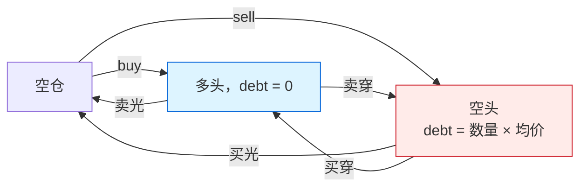

# 空头保证金：debt 与 free_cash

`ExecuteOrderState` 除了 `cash` 和带符号的 `position`，还多带两个字段：`debt` 是未平空头的开仓所得（按平均入场价），`free_cash` 是扣掉空头占用之后的现金。开空的记账在 [sell](../algorithms/sell-leg.md) 里，平空的释放和 `lock_cash` 的预算在 [buy](../algorithms/buy-leg.md) 里，本页把两边的共同部分放在一起。

## 位置

- [`crates/phasor-exec/src/types.rs:5-17`](https://github.com/nivalume/vbt/blob/81a1d5f238f2d583bad187a9ab6e1e6170316f11/crates/phasor-exec/src/types.rs#L5-L17)：`ExecuteOrderState` 里 `debt` / `free_cash` 的注释
- [`crates/phasor-exec/src/kernel.rs:349-366`](https://github.com/nivalume/vbt/blob/81a1d5f238f2d583bad187a9ab6e1e6170316f11/crates/phasor-exec/src/kernel.rs#L349-L366)：`sell` 开空时记 `debt`、扣 `free_cash`
- [`crates/phasor-exec/src/kernel.rs:195-209`](https://github.com/nivalume/vbt/blob/81a1d5f238f2d583bad187a9ab6e1e6170316f11/crates/phasor-exec/src/kernel.rs#L195-L209)：`buy` 平空时按 `debt / |position|` 释放
- [`crates/phasor-exec/src/kernel.rs:883-897`](https://github.com/nivalume/vbt/blob/81a1d5f238f2d583bad187a9ab6e1e6170316f11/crates/phasor-exec/src/kernel.rs#L883-L897)：测试 `shorting_records_debt_and_reserves_margin`

## 持仓的三种状态

同一列的持仓在空仓、多头、空头之间移动。加多、减多、加空、减空都留在原来的状态里。买穿或卖穿是同一笔成交穿过 0，只按穿过的那一段改 `debt`。

## 为什么是 `2 × short_value`

**为什么是 `2 × short_value`**（`types.rs:9-17`）：开空收到 `short_value` 的现金，同时为"将来买回"预留等值现金，再为空头敞口占用一次。`free_cash` 的变化是 `proceeds − 2·short_value`。这段记账在 `new_position < 0` 的分支里总会发生，不看 `lock_cash`。`lock_cash` 只决定以后的订单是否遵守已经记下的预留（[buy](../algorithms/buy-leg.md)）。平空按 `debt / |position|` 对称释放。预留取决于每次开空的价格，只靠 `cash` 和 `position` 推不出来，所以 `debt` 和 `free_cash` 是显式状态。共享现金组里这两个现金字段是整组一份，`debt` 跟 `position` 一样每列一份（[phasor-sim](../crates/phasor-sim.md)）。
测试 `shorting_records_debt_and_reserves_margin`（`kernel.rs:883-897`）：100 现金、空 5 股 @10 → `cash=150, debt=50, free_cash=50`。

## 代码里的注释

[`crates/phasor-exec/src/types.rs:5-17`](https://github.com/nivalume/vbt/blob/81a1d5f238f2d583bad187a9ab6e1e6170316f11/crates/phasor-exec/src/types.rs#L5-L17)：

> `debt` and `free_cash` are the two fields that are easy to get wrong.
>
> - `debt` is the proceeds of open short sales, held at their average entry
>   price. It is what a short position "owes" back.
> - `free_cash` is cash net of the margin those shorts tie up. Opening or
>   extending a short moves it by `proceeds - 2 * short_value`: once for the
>   position's own value and once for the round-trip reservation. Closing
>   unwinds it symmetrically through `debt / |position|`.
>
> Carrying only `cash` and `position` and deriving the rest does not work —
> the reservation is path-dependent.

## 相关

- [phasor-exec：撮合内核](../crates/phasor-exec.md)：`ExecuteOrderState` 所在的 crate。
- [sell：卖出与开空](../algorithms/sell-leg.md)：`new_position < 0` 分支记下 `debt` 并扣掉 `2 × short_value`。
- [buy：买入、平空与 lock_cash 预算](../algorithms/buy-leg.md)：平空按均价释放 `debt`；`lock_cash` 让买单只用 `free_cash + 2·debt`。
- [拒单原因 StatusInfo](../reference/status-info.md)：`NoCashShort` 是 `free_cash` 不够再开空时的拒单。
- [phasor-sim：模拟循环](../crates/phasor-sim.md)：共享现金组里 `cash` / `free_cash` 整组一份，`debt` 每列一份。
- [from_orders 的一根 K 线](../algorithms/bar-loop.md)：每次成交后循环如何写回 `cash`、`free_cash`、`debt`。
