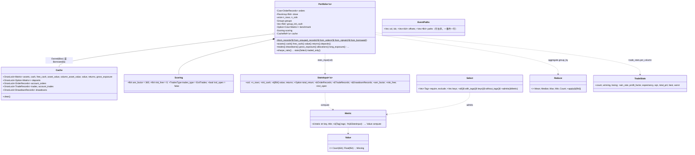

# phasor-analysis：分析层

分析层只读[记录](../crates/phasor-records.md)，不读任何模拟参数：`Portfolio` 把订单与现金记录、借来的收盘价和分组交给一条惰性重建链，所有序列、指标和统计表都从这条链派生并缓存。

## 定位

`phasor-analysis` 只做一件事：**从记录重建一切**。`Portfolio` 存的只有订单记录、借来的收盘价、形状、账户组、初始现金和评分设置；现金、持仓、净值、收益、回撤、交易、指标都是按需从记录派生并缓存在 `OnceLock` 里。
这是["记录是唯一来源"](../guides/conventions.md)这条约定的落地：凡是改变现金或持仓的事情（成交、入金、分红、收支）都已经是记录，分析层不需要知道模拟层的任何参数。

内容分五块：[重建链](../algorithms/rebuild-chain.md)（`series.rs`、`portfolio.rs`）、[指标](../reference/metrics.md)（`metrics.rs`、`benchmark.rs`、`rolling.rs`、`trade_stats.rs`）、[统计表注册表](../concepts/stats-registry.md)（`stats.rs`）、[扫描结果汇总](../concepts/sweep-aggregation.md)（`aggregate.rs`）、独立的[稳健性](../algorithms/overfitting-stats.md)与[事件研究](../algorithms/event-study.md)（`robust.rs`、`events.rs`）。

## 文件与阅读顺序

| 顺序 | 文件 | 行数 | 读什么 | 第一遍可跳过 |
|---|---|---:|---|---|
| 1 | [`src/series.rs`](https://github.com/nivalume/vbt/blob/81a1d5f238f2d583bad187a9ab6e1e6170316f11/crates/phasor-analysis/src/series.rs) | 597 | 6–11 行的链路图；然后按顺序 `asset_flow`→`assets`→`cash_flow`→`cash`→`asset_value`→`value`→`period_return`→`returns_with_deposits`（74–380） | `free_cash_flow` 191–242（回放负债） |
| 2 | [`src/portfolio.rs`](https://github.com/nivalume/vbt/blob/81a1d5f238f2d583bad187a9ab6e1e6170316f11/crates/phasor-analysis/src/portfolio.rs) | 1,252 | `Scoring` 56–88、`Cache` 98–112、`Portfolio` 146–157、`build` 263–314、链路方法 534–662、`trades`/`drawdowns` 773–819、`stats_input` 948–974、敞口 664–764 | `from_borrowed` 240–260（[PyPortfolio 的跨调用缓存](../concepts/portfolio-cache.md)再看） |
| 3 | [`src/metrics.rs`](https://github.com/nivalume/vbt/blob/81a1d5f238f2d583bad187a9ab6e1e6170316f11/crates/phasor-analysis/src/metrics.rs) + [`src/percentile.rs`](https://github.com/nivalume/vbt/blob/81a1d5f238f2d583bad187a9ab6e1e6170316f11/crates/phasor-analysis/src/percentile.rs) | 535 + 237 | 每个指标的公式；`percentile` 43–79 的 Numba 拼写 | `extreme_with_infinities` 117–147 |
| 4 | [`src/trade_stats.rs`](https://github.com/nivalume/vbt/blob/81a1d5f238f2d583bad187a9ab6e1e6170316f11/crates/phasor-analysis/src/trade_stats.rs) | 185 | 51–98 | — |
| 5 | [`src/stats.rs`](https://github.com/nivalume/vbt/blob/81a1d5f238f2d583bad187a9ab6e1e6170316f11/crates/phasor-analysis/src/stats.rs) | 939 | 类型与 `Select` 45–235；注册表 323–557 | 单元测试 |
| 6 | [`src/benchmark.rs`](https://github.com/nivalume/vbt/blob/81a1d5f238f2d583bad187a9ab6e1e6170316f11/crates/phasor-analysis/src/benchmark.rs)、[`src/rolling.rs`](https://github.com/nivalume/vbt/blob/81a1d5f238f2d583bad187a9ab6e1e6170316f11/crates/phasor-analysis/src/rolling.rs) | 269、364 | 公式；`rolling_apply_1d` 在 [`phasor-generic/src/rolling.rs:71-99`](https://github.com/nivalume/vbt/blob/81a1d5f238f2d583bad187a9ab6e1e6170316f11/crates/phasor-generic/src/rolling.rs#L71-L99) | 宏体 |
| 7 | [`src/aggregate.rs`](https://github.com/nivalume/vbt/blob/81a1d5f238f2d583bad187a9ab6e1e6170316f11/crates/phasor-analysis/src/aggregate.rs) | 262 | 16–37 行的 +inf 陷阱；`group_by`、`best_column` | — |
| 8 | [`src/robust.rs`](https://github.com/nivalume/vbt/blob/81a1d5f238f2d583bad187a9ab6e1e6170316f11/crates/phasor-analysis/src/robust.rs)、[`src/events.rs`](https://github.com/nivalume/vbt/blob/81a1d5f238f2d583bad187a9ab6e1e6170316f11/crates/phasor-analysis/src/events.rs) | 562、334 | 独立模块，只依赖 `nanmean`/`nanstd` | `erfc` 内部 62–89 |
| 9 | [`tests/cash_flows.rs`](https://github.com/nivalume/vbt/blob/81a1d5f238f2d583bad187a9ab6e1e6170316f11/crates/phasor-analysis/tests/cash_flows.rs)、[`tests/exposure.rs`](https://github.com/nivalume/vbt/blob/81a1d5f238f2d583bad187a9ab6e1e6170316f11/crates/phasor-analysis/tests/exposure.rs)、[`tests/shared_accounts.rs`](https://github.com/nivalume/vbt/blob/81a1d5f238f2d583bad187a9ab6e1e6170316f11/crates/phasor-analysis/tests/shared_accounts.rs) | — | 手算账户、守恒检查 | — |

## 类图



## 核心算法与概念

- [从记录重建净值](../algorithms/rebuild-chain.md)：`asset_flow → assets`、`cash_flow → cash`、`value → returns` 的惰性链，含入金调整、`free_cash_flow` 的负债回放与敞口家族。
- [统计表注册表](../concepts/stats-registry.md)：28 行 `DEFAULT_METRICS` 加 `Select` 过滤，未入选的指标不计算。
- [扫描结果汇总与 +inf 陷阱](../concepts/sweep-aggregation.md)：`group_by` / `best_column` 汇总扫描，零交易列的 Sharpe `+inf` 要先用 `traded_only` 屏蔽。
- [过拟合检验：PSR、DSR、PBO](../algorithms/overfitting-stats.md)：每根 Sharpe 上的 PSR、期望最大 Sharpe 与 DSR，以及 CSCV 枚举划分得到的 PBO。
- [事件研究](../algorithms/event-study.md)：`forward_paths` 记录事件前后的收益路径并按偏移聚合；它读未来，只做分析。
- [指标公式表](../reference/metrics.md)（参考页）：每个收益、基准与交易指标的公式和边界情况。

## 调用链

```text
simulate_* ──记录──▶ Portfolio::from_orders / from_signals（threads > 1 走并行）
                     └─ from_grouped_records：共享组则 sort_by_column
                          └─ build：校验分组、ColMap、行数、现金记录；group_init_cash 取组首列
Cache（OnceLock，每个序列只算一次）：
  assets ← series::assets(orders)
  cash   ← series::cash(sum_groups(cash_flow(orders)), group_init_cash)
  column_asset_value ← close × assets（共享时 assets==0 处钉 0）
  asset_value ← 共享 ? sum_groups(column_asset_value) : column_asset_value
  value ← cash + asset_value；deposits ← sum_groups(series::deposits)
  returns ← returns_with_deposits(value, init, deposits)
  trades ← 按 scoring.trades_type；account_trades ← 共享时 col ↦ group
  drawdowns ← find_drawdowns(有入金 ? compounded_value : value)
每账户指标：map_returns(metrics::*)；trade_stats::per_column(account_trades)
stats_input(col) → stats::stats(&input, &Select) → Vec<(title, Value)>
扫描：Vec<f64> → traded_only → aggregate::group_by / best_column
```

Python 层走另一个入口 `from_borrowed(&OrderRecords, &Cache)`（`portfolio.rs:240-260`），它借用 Python 对象拥有的记录与缓存而不是持有它们，细节见 [PyPortfolio 的跨调用缓存与 GIL](../concepts/portfolio-cache.md)。

## 阅读陷阱

1. **`ann_factor` 默认 365**（加密货币），股票约 252。
2. `annualized_return` 的指数分母**含 NaN 根**；`cond_value_at_risk` 的 cutoff 也数 NaN 根，但 `value_at_risk` 去掉它们。
3. `max_drawdown` 是唯一传播 NaN 的指标；`percentile` 任一 NaN 就 NaN。
4. `beta` 对方差 < 1e-30 返回 NaN 而不是 +inf（那条 inf 分支不可达）。
5. 统计表里 `Max Drawdown [%]` 是正数，其余回撤数字是负数。
6. `buy_and_hold()` 按标的列，`with_benchmark` 要的是每**组**一列。
7. 共享组无入金时 `account_total_return` 用 `(end − init)/init`（跨缺失估值根保住 PnL），有入金时连乘。
8. [记录层](../crates/phasor-records.md#阅读陷阱)的所有记录陷阱（隐式 id、视图不一致、未平仓标记）在这里都会表现为"数字对不上"。

## 与参考实现的对应

参考实现是 vectorbt 1.1.0；fixture 列里的生成脚本在 [`tests/parity/`](https://github.com/nivalume/vbt/tree/81a1d5f238f2d583bad187a9ab6e1e6170316f11/tests/parity)，见[差分测试与 fixture](../tooling/parity-testing.md)。

| phasor | vectorbt | fixture |
|---|---|---|
| `series::asset_flow / assets / cash_flow / cash / asset_value / value` | `portfolio/nb.py::asset_flow_nb / cumsum / cash_flow_nb / cash_nb / asset_value_nb / value_nb` | `generate_analysis.py` |
| `series::returns` | `returns/nb.py::returns_nb` | 同上 |
| `metrics::*` | `returns/nb.py::{annualized_return, annualized_volatility, max_drawdown, sharpe_ratio, sortino_ratio, calmar_ratio, downside_risk, ...}_nb`（血统是 Quantopian 的 empyrical） | `generate_metrics.py` |
| `rolling::rolling_*`（18 个） | `returns/nb.py::rolling_*_nb` | 同上 |
| `stats::DEFAULT_METRICS` | `Portfolio.stats()` 的 28 行 | `generate_stats.py` |
| `percentile` | Numba 编译的 `np.percentile` | `percentile.rs:9-22` |
| `CashRecords` 相关、敞口家族（除 `gross_exposure`）、`robust.rs`、`events.rs` | 无 | 手算测试 |
| `Value::Missing`、`Start`/`End` 为 bar 下标、`ann_factor` 代替 `freq` | 形式差异 | — |

## 延伸资料

- Bailey & López de Prado, "The Sharpe Ratio Efficient Frontier"（*Journal of Risk*, 2012）—— PSR。
- Bailey & López de Prado, "The Deflated Sharpe Ratio: Correcting for Selection Bias, Backtest Overfitting and Non-Normality"（*Journal of Portfolio Management*, 2014）—— E[max SR] 与 DSR。
- Bailey, Borwein, López de Prado & Zhu, "The Probability of Backtest Overfitting"（*Journal of Computational Finance*, 2017；SSRN 2014）—— CSCV 与 PBO。
- López de Prado, *Advances in Financial Machine Learning*（Wiley, 2018）第 11–14 章。作者在 SSRN 上有配套的 Cornell ORIE 5256 课程幻灯片（"Advances in Financial Machine Learning: Lecture 1/10" 等，共 9 讲）；同作者的《面向资产管理者的机器学习》有机械工业出版社中译本（2021）。
- Peter J. Acklam, "An algorithm for computing the inverse normal cumulative distribution function"（2003，网页）；Abramowitz & Stegun §7.1（erf/erfc）；Numerical Recipes §6.2。
- Keating & Shadwick, "A Universal Performance Measure"（2002）—— Omega；Sortino & van der Meer (1991)；Terry Young, "Calmar Ratio"（*Futures*, 1991）；Rockafellar & Uryasev (2000) —— CVaR。
- Van Tharp, *Trade Your Way to Financial Freedom* —— SQN 与期望值；中译本《通向财务自由之路》。
- MacKinlay, "Event Studies in Economics and Finance"（*JEL*, 1997）。
- Hyndman & Fan, "Sample Quantiles in Statistical Packages"（*American Statistician*, 1996）—— `percentile` 的 type 7。
- empyrical 源码（Quantopian）：`vectorbt.returns.nb` 的公式出处。
- 更多见[延伸资料](../reference/further-reading.md)的 E 节（分析）。

## 自测

1. 两根 K 线、收盘 `[10, 12]`、`init_cash = 100`、第 0 根买 5@10（无费用）：手工写出 `assets`、`cash`、`value`、`returns`。
2. 同上，但第 1 根开盘入金 50：`returns[1]` 是多少？总收益是多少？
3. 为什么 `pbo_cscv` 的样本内赢家用平均收益而不是 Sharpe？
4. 1,000 组参数、每根 Sharpe 的方差 0.01：`E[max SR]` 约等于多少？（用 `norm_ppf(0.999) ≈ 3.09`、`norm_ppf(1 − 1/(1000e)) ≈ 2.78` 估算。）
5. 一列从未交易，`sharpe_ratio` 返回什么？`group_by(Mean)` 会怎样？怎么避免？
