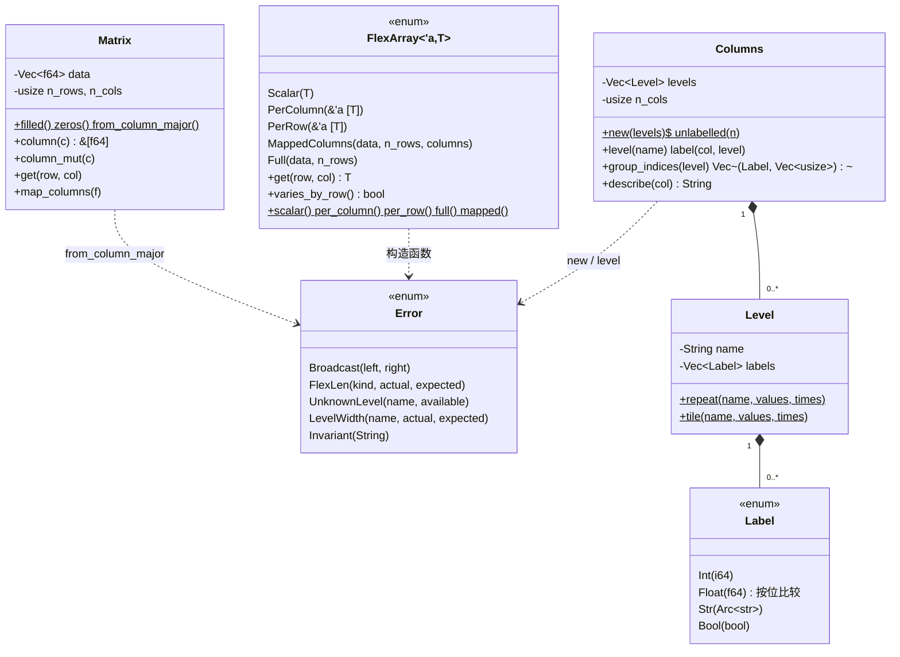

# phasor-core：基础类型

phasor 工作区的地基，没有外部依赖，其余每个 crate 都直接或间接用到它。本页给出文件清单、类图、阅读陷阱和自测；四样核心内容和错误类型各有一个概念页，列在[核心算法与概念](#核心算法与概念)。

## 定位

`phasor-core` 没有任何外部依赖，定义了所有 crate 共用的四样东西：**数组长什么样**（`Matrix`）、**参数怎么广播**（`FlexArray`）、**列怎么贴标签**（`Columns`）、**浮点怎么比较**（`math`）。
领域词汇（撮合枚举、标识、面板）放在它之上的 [phasor-model：领域模型](../crates/phasor-model.md)。

两个 crate 合计约 2,000 行，其中一半是测试。读完本页和 [phasor-model](../crates/phasor-model.md)，后面每个 crate 里的 `get(row, col)`、`is_close`、`Level::repeat` 都不用再查。

## 文件与阅读顺序

| 顺序 | 文件 | 行数 | 读什么 | 第一遍可跳过 |
|---|---|---:|---|---|
| 1 | [`phasor-core/src/error.rs`](https://github.com/nivalume/vbt/blob/81a1d5f238f2d583bad187a9ab6e1e6170316f11/crates/phasor-core/src/error.rs) | 117 | 模块文档 1–11 行："`Error` 是不变量被破坏，拒单永远不是 `Err`" | `Display` 实现 |
| 2 | [`phasor-core/src/math.rs`](https://github.com/nivalume/vbt/blob/81a1d5f238f2d583bad187a9ab6e1e6170316f11/crates/phasor-core/src/math.rs) | 256 | 文档 1–20 行、`is_close_tol` 52–64、`add`/`is_addition_zero`/`sign` 94–135；**测试 142–255 行就是规格** | — |
| 3 | [`phasor-core/src/matrix.rs`](https://github.com/nivalume/vbt/blob/81a1d5f238f2d583bad187a9ab6e1e6170316f11/crates/phasor-core/src/matrix.rs) | 162 | 第 113 行 `data[col * n_rows + row]`、第 85 行 `column()` | `map_columns` |
| 4 | [`phasor-core/src/flex.rs`](https://github.com/nivalume/vbt/blob/81a1d5f238f2d583bad187a9ab6e1e6170316f11/crates/phasor-core/src/flex.rs) | 236 | 五个变体 29–49、`get` 61–73、`varies_by_row` 80–85、`mapped` 90–109 | — |
| 5 | [`phasor-core/src/columns.rs`](https://github.com/nivalume/vbt/blob/81a1d5f238f2d583bad187a9ab6e1e6170316f11/crates/phasor-core/src/columns.rs) | 461 | `Label` 按位相等 54–88、`Level::repeat`/`tile` 151–179、`group_indices` 305–325；对照测试夹具 `sweep()` 350–358 | `Display`/`From` 实现 90–129 |

## 类图

`math` 是一组自由函数：`is_close`、`is_close_tol`、`is_close_or_less`、`is_less`、`add`、`is_addition_zero`（私有 `sign`）。

`phasor-model` 的类型（`OhlcvPanel`、`InstrumentId`、`BarType`、`Price`、`Quantity`）画在 [phasor-model 的类图](../crates/phasor-model.md#类图)。

## 核心算法与概念

- [浮点容差与零钉](../concepts/float-tolerance.md)：`is_close` 让 NaN 和 ±inf 永远不“接近”，`add` 把应该归零的余额钉成 0；撮合内核是它们最要紧的使用者。
- [列轴与列主序](../concepts/column-axis.md)：`(row, col)` 存在 `data[col * n_rows + row]`，参数重复、标的平铺，一组参数占相邻的列。
- [FlexArray 广播与列映射](../concepts/flex-array.md)：五种变体共用一个 `get(row, col)`，参数不物化；`MappedColumns` 让参数扫描复用同一份行情列。
- [列标签：Columns、Level 与 group_indices](../concepts/column-labels.md)：给每列贴分层标签而不复制数据，浮点标签按位相等，`group_indices` 支撑按参数聚合。
- [错误与拒单](../concepts/errors-vs-rejections.md)：`Error` 只表示不变量被破坏；成交不了的订单是正常结果，永远不是 `Err`。

## 阅读陷阱

1. `is_close(x, f64::INFINITY)` 永远是 `false`；判断无限要用 `is_infinite()`。
2. `add` 会把相对差 `1e-9` 以内的结果钉成 0，只用于余额，不要当通用加法。
3. `Matrix::from_column_major` 会接受长度正确的 C 序缓冲区并产出转置的垃圾；[Python 边界](../concepts/python-boundary.md)因此拒绝 C 序数组而不是转置。
4. `FlexArray` 的公开变体可以绕过检查构造，长度错了在模拟中途 panic 而不是返回 `Error`。
5. `Label::Float(-0.0)` 和 `Float(0.0)` 是两个组。
6. `Columns::new(vec![])` 得到 `n_cols = 0`，不是错误。
7. `phasor-data` 不用 `phasor_core::Error`，用 `ArrowError`（[phasor-data](../crates/phasor-data.md)）。

## 与参考实现的对应

| phasor | vectorbt 1.1.0 | NautilusTrader |
|---|---|---|
| `math::is_close_tol`、`is_close_or_less`、`is_less`、`add`、`is_addition_zero` | `utils/math_.py` 的 `is_close_nb`、`is_close_or_less_nb`、`is_less_nb`、`add_nb`、`is_addition_zero_nb`，同公式同容差 | — |
| `FlexArray::get(row, col)` | `base/reshape_fns.py` 的 `flex_select_nb` / `flex_select_auto_nb`、`broadcast(keep_raw=True)`；`MappedColumns` 无对应 | — |
| `Level::repeat` / `tile`、`Columns::group_indices` | `base/index_fns.py` 的 `repeat_index` / `tile_index`；pandas `MultiIndex` 与 `groupby(level).indices` | — |

## 延伸资料

- PEP 485：<https://peps.python.org/pep-0485/>（相对容差为什么取两者绝对值的最大值；为什么零附近需要绝对容差）。
- IEEE 754 的 NaN 非自反、有符号零、`total_cmp`：Rust 文档 `f64::total_cmp`；David Goldberg, "What Every Computer Scientist Should Know About Floating-Point Arithmetic"（1991），§灾难性抵消。
- 行主序 / 列主序：Wikipedia "Row- and column-major order"；NumPy 文档 "Internal memory layout of an ndarray"（`order="F"`、`flags.f_contiguous`）。
- NumPy 广播与 `as_strided`：NumPy 文档 "Broadcasting"；vectorbt 文档 `base.reshape_fns`。
- 中文：《Rust 语言圣经》的"枚举与模式匹配"、"生命周期"章节（`FlexArray<'a, T>` 的借用）；OI Wiki 无直接对应，本页与 [phasor-model](../crates/phasor-model.md) 不涉及算法竞赛结构。
- 更多见 [延伸资料](../reference/further-reading.md)。

数据布局（结构体数组与数组结构体）和 NautilusTrader 的资料随 `OhlcvPanel`、`BarType` 放在 [phasor-model 的延伸资料](../crates/phasor-model.md#延伸资料)。

## 自测

1. 不看代码写出 `is_close_tol` 的四行，并说明为什么 inf 的检查在 `a == b` 之前。
2. `add(0.0, -0.0)` 走哪个分支？返回什么？（提示：`sign` 对两个零都返回 0，同号分支，`is_close(0.0, 0.0)` 为真 → `0.0`。）
3. 3 组参数 × 4 个标的，列 7 是哪组参数、哪个标的？共享账户的 `group_lens` 应该是什么？
4. `FlexArray::MappedColumns` 的 `columns` 数组长度是逻辑列数还是物理列数？
5. 为什么 `Label::Float` 要按位比较而不是按值？举一个按值比较会出错的例子。
