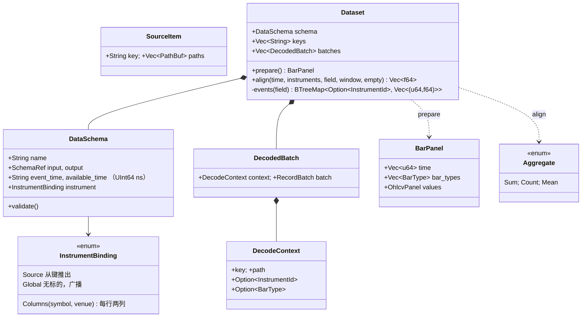
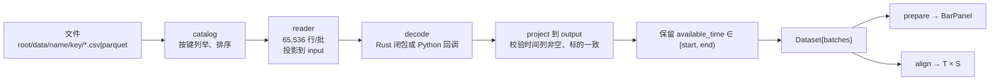

# phasor-data：数据层

`phasor-data` 是模拟器之前的一步：把文件变成 `BarPanel`（里面是 [phasor-model](../crates/phasor-model.md) 的 `OhlcvPanel`），再把资金费率、新闻这类辅助数据按"什么时候能被看到"对齐上去。Python 的 `phasor.data` 是它的薄壳，在 [phasor-py](../crates/phasor-py.md) 里。

## 定位

`phasor-data` 把本地的 CSV / Parquet 读成 Arrow 批次，再变成 `BarPanel`（时间 × 标的的 OHLCV 面板），并把任意辅助数据（资金费率、新闻、基本面）**按发布时间**对齐到面板的时间轴上。
它**从不下载、从不写文件**；下载器在 [`examples/`](https://github.com/nivalume/vbt/tree/81a1d5f238f2d583bad187a9ab6e1e6170316f11/examples) 里。
整个 crate 是一个 560 行的 `lib.rs`，没有内联测试，行为由 [`crates/phasor-py/tests/test_data.py`](https://github.com/nivalume/vbt/blob/81a1d5f238f2d583bad187a9ab6e1e6170316f11/crates/phasor-py/tests/test_data.py) 钉住。

读它的收获：理解"按时点"（point-in-time）数据为什么必须用 `available_time` 而不是 `event_time`，以及一个 O(T + E) 的[双指针对齐](../algorithms/pit-alignment.md)怎么写。

## 文件与阅读顺序

| 顺序 | 位置 | 读什么 |
|---|---|---|
| 1 | `lib.rs:21-78` | 类型：`InstrumentBinding`、`DataSchema` + `validate`、`DecodeContext`、`SourceItem` |
| 2 | `lib.rs:80-123` | `component` 路径守卫、`catalog` 目录列举 |
| 3 | `lib.rs:125-201` | `project`（按名取列、校验类型和可空性、从不转换）、`reader`（Parquet 按根索引投影；CSV 把未知列当 `Utf8`） |
| 4 | `lib.rs:217-332` | `load`：逐批次 读 → 投影到 input → 解码 → 投影到 output → 校验 → 按 `available_time` 过滤 |
| 5 | `lib.rs:343-414` | `prepare`：时间轴 = `available_time` 的有序并集 |
| 6 | `lib.rs:456-484` | `events`：按标的分桶并稳定排序 |
| 7 | `lib.rs:487-552` | `align`：双指针 as-of / 窗口聚合 |
| 8 | [`crates/phasor-py/python/phasor/data.py`](https://github.com/nivalume/vbt/blob/81a1d5f238f2d583bad187a9ab6e1e6170316f11/crates/phasor-py/python/phasor/data.py) | 薄壳：`Catalog`、`files`、`Source`、`Dataset.asof/window`、`BarPanel._from_native` 的 `order="F"` |
| 9 | [`crates/phasor-py/src/data.rs`](https://github.com/nivalume/vbt/blob/81a1d5f238f2d583bad187a9ab6e1e6170316f11/crates/phasor-py/src/data.rs) | 在哪里 `py.detach` 释放 GIL，解码器怎么按批次重新拿 GIL |
| 10 | [`examples/multi_data.py`](https://github.com/nivalume/vbt/blob/81a1d5f238f2d583bad187a9ab6e1e6170316f11/examples/multi_data.py) | 端到端：K 线 + 资金费 + 新闻 → 因子 → `from_signals(column_map=…)` |

第一遍可跳过 `reader` 的 CSV 分支和 `instrument_at`。

## 类图

## 核心算法与概念

- [加载 load 与面板 prepare](../algorithms/data-loading.md)：逐批次读、解码、投影、校验，解码之后才按 `available_time` 过滤；`prepare` 以 `available_time` 的有序并集为行轴拼出列主序面板。
- [按时点对齐 align](../algorithms/pit-alignment.md)：按标的分桶稳定排序，再用双指针做 as-of 与左开右闭窗口聚合，每个标的 O(T + E)。

## 调用链

## 阅读陷阱

1. **一切都用 `available_time`**：过滤、面板行轴、对齐。`event_time` 只校验类型和非空，从不读取。`test_availability_ties_...` 把所有 `event_time` 设成 0 来证明这一点。
2. 带 `start` 加载会**丢掉**更早的历史，`start` 附近的 as-of 结果是 NaN。
3. `Count` 把 NaN 行也数进去；`Sum`/`Mean` 跳过 NaN；as-of 若最新事件值为 null 返回 NaN。
4. `prepare` 要求每个键都是 `BarType`；用普通 `InstrumentId` 当键的数据集名叫 `bars` 也会报 `expected SYMBOL.VENUE-STEP-...`。
5. `project` 从不转换类型：CSV 推断成 `Int64` 而 schema 写 `Float64` 是硬错误；非空字段里有一个 null 也是错误。
6. `events()` 每次 `align` 都重新排序（`lib.rs:455` 的注释标记了缓存是将来的事）。
7. `Columns` 绑定下每行分配一个 `InstrumentId`（两个 `Arc<str>`），大表上很贵。
8. 错误类型是 `ArrowError::InvalidArgumentError`，不是 `phasor_core::Error`。

为什么数据层必须用发布时间，见 [延迟与前视偏差](../concepts/look-ahead.md)。

## 与参考实现的对应

| phasor | 对应 |
|---|---|
| 目录 `root/data/<name>/<key>/*.parquet` | NautilusTrader `ParquetDataCatalog` 的 `<root>/data/<data_cls>/<instrument_id>/*.parquet` |
| `available_time` / `event_time` | Nautilus `Bar.ts_init` / `ts_event`；回放按 `ts_init`，因为只有它不泄露未来 |
| `align` as-of | pandas `merge_asof(direction="backward")`、`DataFrame.asof`；vectorbt `generic/nb.py::realign_nb` |
| `align` 窗口 | pandas `rolling("20ns", closed="right")` |
| 解码器回调 | 无直接对应；是 phasor 把"schema、字符串、回调留在循环外"原则在数据层的体现 |

## 延伸资料

- 前视偏差与按时点数据：Marcos López de Prado, *Advances in Financial Machine Learning* 第 2 章（数据结构）与 第 11 章（回测的危险）；pandas `merge_asof` 文档；kdb+ 的 `aj`（as-of join）概念。
- Apache Arrow：官方 "Arrow Columnar Format" 与 Rust `arrow-rs` 文档（`RecordBatch`、`ProjectionMask`、`take`、`cast`）；Arrow C Data Interface（[phasor-py](../crates/phasor-py.md) 的 `arrow.rs` 用到）。
- 双指针 / 滑动窗口：LeetCode "Sliding Window" 标签任意一题；OI Wiki "尺取法"（<https://oi-wiki.org/>）。
- PyO3 的 `Python::detach` / `attach`：PyO3 用户指南 "Parallelism" 一节。
- 更多见 [延伸资料](../reference/further-reading.md#数据层)。

## 自测

1. 面板时间 `[0,10,20,30]`，事件 `(5, 1.0)、(20, 2.0)、(20, NaN)`，as-of 在 t=20 返回什么？`Count` 窗口宽 15 在 t=20 返回什么？
2. 为什么过滤 `[start, end)` 要放在解码之后？
3. 把双指针改成对每个 `t` 二分查找 `rows`，复杂度变成多少？窗口聚合还能 O(1) 吗？
4. 一个数据集的 `instrument` 绑定是 `Global`，三个标的的面板对齐后三列是否相同？在代码里指出原因。
