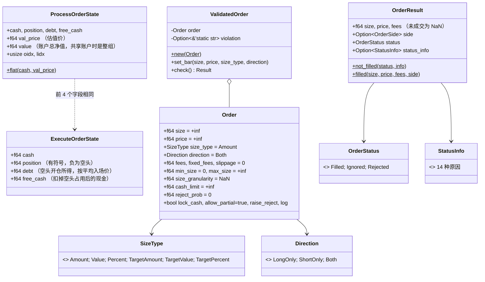
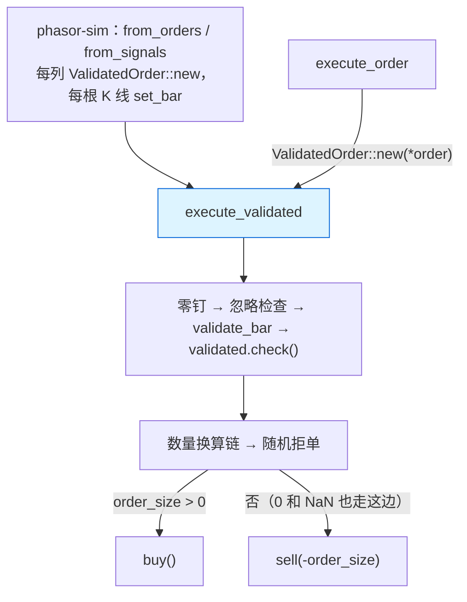

# phasor-exec：撮合内核

引擎里语义最密集的一层。它把 vectorbt `execute_order_nb` 的全部规则（数量换算、买卖分支、做空保证金、14 种拒单原因）收进一个纯函数，供 [phasor-sim](../crates/phasor-sim.md) 的两条模拟循环逐列调用。

## 定位

`phasor-exec` 只做一件事：**一笔订单，对一个账户，在一根 K 线上，算出成交或不成交**。
它不知道时间轴、不知道别的列、不知道止损和信号；这些都在 `phasor-sim`。
把它单独拆出来的原因写在 [`crates/phasor-exec/src/lib.rs:3-10`](https://github.com/nivalume/vbt/blob/81a1d5f238f2d583bad187a9ab6e1e6170316f11/crates/phasor-exec/src/lib.rs#L3-L10)：向量化层和将来的事件驱动层都调用同一个 `execute_order`，
所以两层的结果才可以逐列互相验证。

读这个 crate 的收获：理解 vectorbt `execute_order_nb` 的全部语义，包括 14 种拒单原因、做空的保证金记账和费用反解。
它也是仓库里**对浮点容差最敏感**的地方（[buy](../algorithms/buy-leg.md)；另见[浮点容差与零钉](../concepts/float-tolerance.md)）。

## 文件与阅读顺序

| 顺序 | 文件 | 行数 | 读什么 |
|---|---|---:|---|
| 1 | [`src/lib.rs`](https://github.com/nivalume/vbt/blob/81a1d5f238f2d583bad187a9ab6e1e6170316f11/crates/phasor-exec/src/lib.rs) | 53 | 模块文档：两种失败、确定性、验证策略 |
| 2 | [`src/types.rs`](https://github.com/nivalume/vbt/blob/81a1d5f238f2d583bad187a9ab6e1e6170316f11/crates/phasor-exec/src/types.rs) | 190 | 四个类型；重点是 `ExecuteOrderState` 的 `debt` / `free_cash` 注释（`types.rs:5-17`）和 `Order::default` 里的哨兵值（`types.rs:118-139`） |
| 3 | [`src/kernel.rs:528-701`](https://github.com/nivalume/vbt/blob/81a1d5f238f2d583bad187a9ab6e1e6170316f11/crates/phasor-exec/src/kernel.rs#L528-L701) | — | `execute_order` → `execute_validated`：零钉、忽略检查、校验、换算链、随机拒单、分发。先读这一段再读买卖 |
| 4 | [`src/kernel.rs:41-221`](https://github.com/nivalume/vbt/blob/81a1d5f238f2d583bad187a9ab6e1e6170316f11/crates/phasor-exec/src/kernel.rs#L41-L221) | — | `buy`：现金预算、费用反解、同一笔成交里如何平空 |
| 5 | [`src/kernel.rs:223-379`](https://github.com/nivalume/vbt/blob/81a1d5f238f2d583bad187a9ab6e1e6170316f11/crates/phasor-exec/src/kernel.rs#L223-L379) | — | `sell`：可卖数量、开空时如何记 `debt` |
| 6 | [`src/kernel.rs:381-526`](https://github.com/nivalume/vbt/blob/81a1d5f238f2d583bad187a9ab6e1e6170316f11/crates/phasor-exec/src/kernel.rs#L381-L526) | — | `validate_bar` / `param_violation` / `ValidatedOrder`（性能优化，可最后读） |
| 7 | [`tests/parity.rs`](https://github.com/nivalume/vbt/blob/81a1d5f238f2d583bad187a9ab6e1e6170316f11/crates/phasor-exec/tests/parity.rs)、[`tests/parity_sequence.rs`](https://github.com/nivalume/vbt/blob/81a1d5f238f2d583bad187a9ab6e1e6170316f11/crates/phasor-exec/tests/parity_sequence.rs) | — | 看 fixture 怎么被重放、`agree` 怎么比较 |
| 8 | [`tests/fixtures/execute_order.tsv`](https://github.com/nivalume/vbt/blob/81a1d5f238f2d583bad187a9ab6e1e6170316f11/tests/fixtures/execute_order.tsv) | 474 行 | 挑 `buy_plain`、`*fees*`、`*granularity*`、`*short*` 几行手算 |

第一遍可以跳过 `ValidatedOrder`，把 `execute_validated` 当 `execute_order` 读。

## 类图

## 核心算法与概念

- [execute_order 的固定顺序](../algorithms/execute-order-pipeline.md)：零钉、忽略检查、校验、换算链、随机拒单、分发，顺序不能换。
- [数量换算链与 percent](../algorithms/size-cascade.md)：每一级把 `size_type` 改写成更低级的类型，只有 `Amount` 进入买卖分支。
- [buy：买入、平空与 lock_cash 预算](../algorithms/buy-leg.md)：现金预算、费用反解，以及同一笔买单里如何平空。
- [sell：卖出与开空](../algorithms/sell-leg.md)：可卖数量的上限，以及卖穿 0 的那一段怎么开空。
- [空头保证金：debt 与 free_cash](../concepts/short-margin.md)：为什么开空让 `free_cash` 减少 `2 × short_value`，平空如何对称释放。
- [ValidatedOrder：按列提升参数校验](../concepts/validated-order.md)：把整列不变的参数校验提到 K 线循环外。

另见：[拒单原因 StatusInfo](../reference/status-info.md)（14 种原因的触发点）、[浮点容差与零钉](../concepts/float-tolerance.md)（容差为什么在这里最要命）、[错误与拒单](../concepts/errors-vs-rejections.md)（`Err` 与拒单的分界）。

## 调用链

`execute_order(&ProcessOrderState, &Order, Option<f64>) -> Result<(ExecuteOrderState, OrderResult)>` 是唯一入口；
`execute_validated` 是跳过参数校验的同义入口（`kernel.rs:559`）。

## 与参考实现的对应（vectorbt 1.1.0）

| phasor | vectorbt (`vectorbt/portfolio/nb.py`) | 差异 |
|---|---|---|
| `execute_order` | `execute_order_nb(state, order)` | 多了 `reject_draw` 参数；随机拒单提前到分发前 |
| `buy` / `sell` | `buy_nb` / `sell_nb` | `cash_limit` 是新增字段，不进日志 |
| `validate_bar` + `param_violation` | `execute_order_nb` 开头的校验 | 拆成两半以便每列只做一次 |
| `ExecuteOrderState` / `ProcessOrderState` | `ExecuteOrderState` / `ProcessOrderState` | 同名同义 |
| `Order` 默认值 | `order_nb` 的默认参数 | 同 |
| `StatusInfo` 14 项 | `OrderStatusInfo` | 顺序和判别值一致 |

## 延伸资料

- vectorbt 文档 `Portfolio` 一节对 `size_type`、`direction`、`lock_cash`、`allow_partial` 的解释：<https://vectorbt.dev/api/portfolio/base/>；`nb` 模块：<https://vectorbt.dev/api/portfolio/nb/>。读 phasor 的 `buy`/`sell` 前先把这两页的参数表看一遍。
- PEP 485（`math.isclose` 的相对 / 绝对容差定义）：<https://peps.python.org/pep-0485/>。
- 做空保证金的直观解释：Investopedia "Short Selling: Margin Requirements"，以及 Reg T 的 150% 规则；phasor 的 `2 × short_value` 就是"收到的钱 + 等额保证金"的简化模型。
- 变异测试入门：Pitest 的 "Basic concepts" 页（概念与 Rust 无关）；Rust 工具 `cargo-mutants`。
- 更多见 [延伸资料](../reference/further-reading.md)。

## 自测

1. `ShortOnly` 列里 `size = 5` 的订单走的是 `buy` 还是 `sell`？（提示：`kernel.rs:615-618` 翻一次符号，[from_signals 的决策顺序](../algorithms/prepare-order.md)里的 `prepare_order` 还翻一次。）
2. `percent = 0.5`、`cash = 100`、`cash_limit = 60` 时，买入最多花多少？（先 `min(100, 60)` 再乘 0.5 → 30。）
3. 为什么 `is_close(adj_size, 0.0)` 测的是粒度取整之后、反解之前的 `adj_size`？去 fixture 里找一行 `granularity` 的案例验证你的答案。
4. 平掉一半空头时 `free_cash` 变化多少？用 `avg_entry_price` 写出式子。
5. 持仓 −5 时一笔买 8 且买得起。`OrderRecords` 里有几条？`debt` 按多少股释放？若要看到「平掉的 5 股」和「剩下的 3 股」分成两段，该读 `buy` 还是[三种交易视图](../algorithms/trade-views.md)里的 `exit_trades`？
