# phasor-expr：因子表达式引擎

因子引擎把一组公式字符串变成一组因子矩阵：先解析、再把整组因子编译成一张共享节点的图、最后按标的并行求值。它与模拟器之间只隔着 `Matrix`，因子是信息，不是决策。

## 定位

`phasor-expr` 把 Qlib 风格的表达式字符串（`"$close / Mean($close, 20) - 1"`）变成时间 × 标的的因子矩阵。四个阶段：

1. **解析**（`parse.rs`）：[Pratt 解析器](../algorithms/pratt-parser.md) → `Expression` 语法树。
2. **编译**（`graph.rs`）：整组因子合并成一张[去重的依赖图](../algorithms/factor-graph.md)，常量折叠，`Ref` 视图，暂存槽位调度。
3. **求值**（`eval.rs` + `window.rs` + `order.rs`）：[按标的（列）用 rayon 并行走图](../algorithms/native-evaluation.md)，每个算子一个 O(1)/行或 O(log n)/行的核。
4. **Polars 后端**（`polars_backend.rs`，可选特性）：[独立交叉验证](../concepts/polars-backend.md)。

它是仓库里**算法密度最高**的 crate：一个 Pratt 解析器、一个带寄存器分配味道的调度器、[八个增量累加器](../algorithms/rolling-accumulators.md)、一个[单调队列](../algorithms/monotonic-queue.md)、一个[有序环和一棵树状数组](../algorithms/order-statistics.md)。读完它等于读完一本小型"数值计算 + 编译器"实践教材。

```rust
let factors = FactorSet::compile([("trend", "$close / Mean($close, 20) - 1")])?;
let values  = factors.evaluate(&FactorInputs::from_ohlcv(&panel)?)?;
let trend: &Matrix = values.get("trend").unwrap();     // time × symbol
```

## 文件与阅读顺序

| 顺序 | 文件 | 行数 | 读什么 | 第一遍可跳过 |
|---|---|---:|---|---|
| 0 | [`ARCHITECTURE.zh-CN.md §5`](https://github.com/nivalume/vbt/blob/81a1d5f238f2d583bad187a9ab6e1e6170316f11/docs/ARCHITECTURE.zh-CN.md#5-%E5%9B%A0%E5%AD%90%E8%A1%A8%E8%BE%BE%E5%BC%8F-phasor-expr) | — | 作者自己的两页总结；先读它，代码就是印证而不是惊讶 | — |
| 1 | [`src/lib.rs`](https://github.com/nivalume/vbt/blob/81a1d5f238f2d583bad187a9ab6e1e6170316f11/crates/phasor-expr/src/lib.rs) | 378 | `FactorSet` 四个入口 34–128；测试 131–378 钉住的算子语义（`Ref(x,0)` 恒等、`Mean(x,0)` 扩展、`If` 与 `&`） | — |
| 2 | [`src/parse.rs`](https://github.com/nivalume/vbt/blob/81a1d5f238f2d583bad187a9ab6e1e6170316f11/crates/phasor-expr/src/parse.rs) | 291 | 从头到尾；绑定力表 224–232 | — |
| 3 | [`src/graph.rs`](https://github.com/nivalume/vbt/blob/81a1d5f238f2d583bad187a9ab6e1e6170316f11/crates/phasor-expr/src/graph.rs) | 629 | 类型 37–154 → `Builder::node`/`call` 288–451 → `intern`/`fold` 251–286 → **`schedule` 185–240** → 5 个测试 541–629（调度器最清楚的规格） | — |
| 4 | [`src/eval.rs`](https://github.com/nivalume/vbt/blob/81a1d5f238f2d583bad187a9ab6e1e6170316f11/crates/phasor-expr/src/eval.rs) | 1,133 | `evaluate` 169–216 → `run_column` 318–403 → `Arg`/`Seg`/`segments` 238–315 → `step` 420–472 → `binary_series` 510–546 → `rolling_into` 556–588 | 参考归约器 590–849（但它们是每个增量核必须匹配的"可执行定义"，第二遍务必回来读）；压力测试 851–1133 |
| 5 | [`src/window.rs`](https://github.com/nivalume/vbt/blob/81a1d5f238f2d583bad187a9ab6e1e6170316f11/crates/phasor-expr/src/window.rs) | 564 | 模块文档 1–22 → `slide_into` 49–70 → `Moments` 75–163 → `Sum`/`Count` → `Deviation` → `Wma` → `Regression` → `Pair` → `Shape` | — |
| 6 | [`src/order.rs`](https://github.com/nivalume/vbt/blob/81a1d5f238f2d583bad187a9ab6e1e6170316f11/crates/phasor-expr/src/order.rs) | 354 | 文档 1–28 → `ordered_into` 40–62 → `ring` 69–118 → `Ordered` 120–241 → `rolling_arg_extreme_into` 246–298 | 树状数组只在窗口 > 256 时用，Alpha158 永远碰不到 |
| 7 | [`src/alpha158.rs`](https://github.com/nivalume/vbt/blob/81a1d5f238f2d583bad187a9ab6e1e6170316f11/crates/phasor-expr/src/alpha158.rs)、[`src/alpha360.rs`](https://github.com/nivalume/vbt/blob/81a1d5f238f2d583bad187a9ab6e1e6170316f11/crates/phasor-expr/src/alpha360.rs)、[`tests/parity_qlib.rs`](https://github.com/nivalume/vbt/blob/81a1d5f238f2d583bad187a9ab6e1e6170316f11/crates/phasor-expr/tests/parity_qlib.rs) | 130、118 | 特征集怎么生成、Qlib 预言机怎么用 | — |
| 8 | [`src/polars_backend.rs`](https://github.com/nivalume/vbt/blob/81a1d5f238f2d583bad187a9ab6e1e6170316f11/crates/phasor-expr/src/polars_backend.rs) | 466 | 最后读；[路线图](../guides/roadmap.md)说它"只在下游需要 Polars 时存在" | — |
| 9 | [`crates/phasor-py/src/expr.rs`](https://github.com/nivalume/vbt/blob/81a1d5f238f2d583bad187a9ab6e1e6170316f11/crates/phasor-py/src/expr.rs)、`python/phasor/__init__.py:64-176` | — | Python 路径 | — |

## 类图

```mermaid
classDiagram
  direction TB
  class Expression {
    <<enum>>
    Number(u64 bits)
    Field(String 小写)
    Unary(char, Box)
    Binary(String, Box, Box)
    Call(String, Vec)
    +fields() uses_future()
  }
  class FactorSet {
    -Vec~(String, Expression)~ factors
    -Graph graph
    +compile(iter)$ names() required_fields() uses_future()
    +evaluate(&FactorInputs) FactorValues
    +evaluate_with(&dyn ComputeBackend)
  }
  class FactorInputs~'a~ { -n_rows, n_cols; -HashMap~String, &[f64]~ fields; +new()$ from_ohlcv()$ with_field() }
  class FactorValues { -Vec~String~ names; -Vec~Arc~Matrix~~ values; +get(name) iter() into_matrices() }
  class Graph { +Vec~Node~ nodes（依赖序）; +Vec~NodeId~ outputs; +Vec~String~ fields; +usize slots; +compile()$ -schedule() }
  class Node { +Op op; +Vec~NodeId~ inputs; +Option~usize~ slot; +Vec~usize~ outputs; +bool read; +Option~(NodeId, usize)~ view }
  class Op {
    <<enum>>
    Field(usize)
    Const(u64)
    Unary(UnaryOp) Binary(BinaryOp) If
    Ref(i64) Delta(usize)
    Ema(Option~u64~)
    Rolling(Rolling, Window)
    Pair(corr, window)
  }
  class Builder { -nodes; -HashMap~(Op, Vec~NodeId~), NodeId~ interned; -fields; +intern() fold() node() call() }
  class ComputeBackend { <<trait>> +name() +evaluate(&FactorSet, &FactorInputs) }
  class NativeBackend
  class PolarsBackend
  class Scratch { +Vec~Vec~f64~~ slots（graph.slots 个）; +Vec~Vec~f64~~ spare（2 个） }
  class Accumulator~T~ { <<trait>> +rebuild(window, start) +push(row, v) +pop(row, v) +value(window, start) }
  class Moments { +shift; +count; +sum; +sum_sq; +last; +run; +constant() centered_sq() std(ddof) }
  class Ordered { +Vec~f64~ sorted; +Vec~Option~usize~~ position; +Vec~u32~ counts（BIT）; +Vec~f64~ sums（BIT）; +kth(k) prefix(end) quantile(q) rank(v) mad() }

  FactorSet *-- Expression
  FactorSet *-- Graph
  Graph *-- Node
  Node --> Op
  Builder ..> Graph : compile
  FactorSet ..> FactorInputs
  FactorSet ..> FactorValues
  ComputeBackend <|.. NativeBackend
  ComputeBackend <|.. PolarsBackend
  NativeBackend ..> Scratch : for_each_init
  Accumulator <|.. Sum
  Accumulator <|.. Count
  Accumulator <|.. Deviation
  Accumulator <|.. Wma
  Accumulator <|.. Regression
  Accumulator <|.. Pair
  Accumulator <|.. Shape
  Deviation *-- Moments
  Regression *-- Moments
  Pair *-- Moments : ×4
  Shape *-- Moments
```



## 核心算法与概念

- [Pratt 解析器](../algorithms/pratt-parser.md)：`(left_bp, right_bp)` 绑定力表决定优先级与结合性，深度上限防爆栈。
- [依赖图编译：哈希合并、Ref 视图与槽位调度](../algorithms/factor-graph.md)：`(Op, inputs)` 哈希合并、常量折叠、`Ref` 视图与"先分配再释放"的线性扫描槽位调度。
- [原生求值：按标的并行走图](../algorithms/native-evaluation.md)：每个标的列一个 rayon 任务，借用拆分写输出，`segments` 让平移操作数不物化。
- [O(1) 滚动累加器](../algorithms/rolling-accumulators.md)：`slide_into` 每 `window` 行重建一次，`Moments` 平移求和并精确识别常量窗口。
- [单调队列：窗口极值与极值位置](../algorithms/monotonic-queue.md)：`Max`/`Min` 与 Qlib 语义的 `IdxMax`/`IdxMin`，均摊 O(1)。
- [顺序统计量：有序环与树状数组](../algorithms/order-statistics.md)：`Quantile`/`Med`/`Rank`/`Mad` 按窗口长度在有序环和两棵 BIT 之间二选一。
- [Alpha158 与 Alpha360](../concepts/alpha-feature-sets.md)：Qlib 两套特征集怎样生成、编译后有多大。
- [Polars 后端](../concepts/polars-backend.md)：直接编译语法树的第二个后端，用于独立交叉验证。
- [因子算子与 Qlib 对照](../reference/qlib-operators.md)（参考页）：语言速览、EMA，以及每个算子与 Qlib `ops.py` 的对应。

## 阅读陷阱

1. **优先级与 Python 不同**：这里比较比 `&`/`|` 绑得紧，`$a>=2&$a<4` 是 `($a>=2)&($a<4)`；Python/Qlib 里 `&` 更紧，所以 Qlib 公式都加了括号，照搬即可。
2. **`Ref(x,0)` 是恒等、`Delta(x,0)` 是 0**；Qlib 里 `Ref(x,0)` 是广播首日值。有意偏离，测试钉住。
3. **参数必须是数字字面量**（可带负号）：`Mean($close, 2*5)`、`Ref($close, $n)` 编译失败。
4. **布尔是 1.0/0.0**，`Not` 是精确 `== 0`，`&`/`|` 是逻辑而非按位；`If(NaN, a, b)` 选 `a`（`NaN != 0`），同 `np.where`。
5. **`min_periods = 1`**：60 日 `Std` 的第 0 行是 NaN（要 2 个样本），第 1 行是两样本标准差，没有警告。
6. **`Rank` 是时间序列百分位**，不是截面排名；没有截面算子。
7. **`IdxMax` 遇到 NaN 就指向 NaN**；`Mad` 是关于均值；`Corr` 看的是任一边**自身**的标准差。
8. **`Ref(常量, k≥0)` 不是视图**，掉进"未来 `Ref`"分支，NaN 出现在末尾而不是开头。真实公式不会写 `Ref(5,1)`。
9. **`run_column` 依赖调度器不变量**：目标槽被 `mem::take` 掏空，节点若拿到输入的槽就读到空 `Vec`。
10. **增量核与重扫不逐位相同**（`Sum Std Var Skew Kurt WMA Slope Rsquare Resi Corr Cov` 允许 1e-9），但同一标的的结果与面板宽度无关、逐位相同。
11. `eval.rs:590-849` 的参考归约器只在 `cfg(any(test, feature = "polars"))` 下编译。
12. **WMA 的权重定义请对照你的 Qlib 版本**：phasor 用 `(i+1)/(N(N+1)/2)` 再除以 `count`；某些 Qlib 版本用 `0..N−1`。WMA 不在 Alpha158 里，fixture 没有钉它。

## 与参考实现的对应

参考实现是 Qlib 的 `qlib/data/ops.py`。逐算子的对照表、Qlib 与 phasor 求值模型的差别（按字符串缓存 vs 哈希合并的图；没有 `get_extended_window_size`，预热行要调用方自己补）见[因子算子与 Qlib 对照](../reference/qlib-operators.md#与-qlib-的对应)。

## 延伸资料

**解析**
- Vaughan Pratt, "Top Down Operator Precedence"（1973）。
- Alex Kladov（matklad），"Simple but Powerful Pratt Parsing"（2020 博客）：`parse.rs:224-232` 的 `(left_bp, right_bp)` 写法直接来自这篇。
- Bob Nystrom, *Crafting Interpreters* 第 17 章 "Compiling Expressions"（在线免费，有中译）。

**图与调度**
- Filliâtre & Conchon, "Type-Safe Modular Hash-Consing"（ML Workshop 2006）。
- 龙书 *Compilers: Principles, Techniques, and Tools* §6.1.2（表达式的 DAG 表示）、§9.4（常量折叠）。
- Poletto & Sarkar, "Linear Scan Register Allocation"（TOPLAS 1999）：`schedule` 的"最后读者释放"就是线性扫描的活跃区间到期。

**滚动统计数值**
- Welford 在线方差；Chan, Golub & LeVeque, "Algorithms for Computing the Sample Variance"（1983）；Wikipedia "Algorithms for calculating variance → Computing shifted data"（`Moments.shift` 的来源）。
- Higham, *Accuracy and Stability of Numerical Algorithms* 第 4 章（求和的误差）。
- pandas `_libs/window/aggregations.pyx`（同样是加减 + 周期校正）；pandas 文档 "Windowing operations"、"Exponentially weighted windows"（`adjust`、`ignore_na`）。
- Joanes & Gill, "Comparing measures of sample skewness and kurtosis"（1998）：pandas 的 G1/G2。
- Hyndman & Fan（1996）type 7；`scipy.stats.percentileofscore` 文档。

**数据结构**
- 单调队列：OI Wiki "单调队列"（<https://oi-wiki.org/ds/monotonous-queue/>）；LeetCode 239 Sliding Window Maximum。
- Fenwick, "A New Data Structure for Cumulative Frequency Tables"（1994）；OI Wiki "树状数组"（含"第 k 小"的倍增）；cp-algorithms "Fenwick Tree"。
- `f64::total_cmp`（IEEE 754 totalOrder）、`Vec::partition_point`。

**Rust 并行**
- Niko Matsakis, "Rayon: data parallelism in Rust"（2015 博客）；rayon 文档 `for_each_init`。
- `slice::chunks_mut`、`split_at_mut`、`std::mem::take`：无 `unsafe` 的借用拆分。

**Qlib**
- Qlib 文档 "Data Layer → Feature → Operators"；源码 `qlib/data/ops.py`、`qlib/data/_libs/rolling.pyx`、`qlib/contrib/data/loader.py`。
- Yang et al., "Qlib: An AI-oriented Quantitative Investment Platform"（arXiv 2020）。
- Kakushadze, "101 Formulaic Alphas"（2016）：因子表达式库这一体裁；路线图 H4 的目标。

更多见[延伸资料](../reference/further-reading.md)的 F 节（因子引擎）。

## 自测

1. 画出 `($close - Mean($close, 5)) / Std($close, 5)` 的图：几个节点？哪些占槽？哪个直写输出？
2. `Ref(Ref($close, 2), 3) * 2` 里视图的 `(base, shift)` 是什么？乘法在哪一行之前读到的是 NaN 标量？
3. 窗口 `[1, 1, 1, 1]` 的 `Std` 为什么能精确返回 0？去掉 `run` 字段会发生什么？
4. 用手跑一遍 `kth(2)`：`sorted = [1,2,3,4,5,6,7]`，窗口里有 `{2,3,5,7}`。
5. `a ** b ** c` 和 `-a ** b` 各解析成什么？在绑定力表上指出原因。
6. 为什么 `evaluate` 不能在并行区里报"缺字段"错误？
