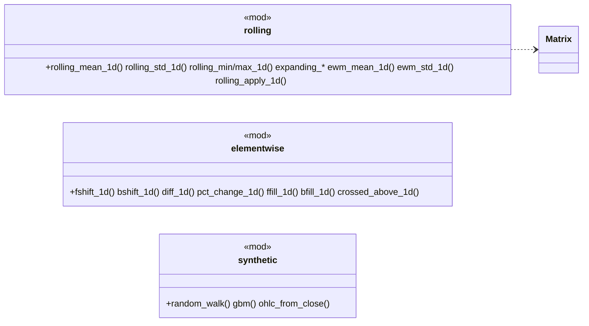

# phasor-generic：通用窗口算子

`phasor-generic` 是窗口算子的唯一实现：[phasor-expr](../crates/phasor-expr.md) 的 `Mean`/`Max`/`Min`、[phasor-analysis](../crates/phasor-analysis.md) 的滚动指标和 [phasor-indicators](../crates/phasor-indicators.md) 的每个指标都调用这里的函数。`min_periods`、NaN 和前视的语义在这里决定一次，上层全部继承。

## 定位

三个小 crate，都是"数组进、数组出"的纯函数库，没有状态、没有并行：

| crate | 做什么 | 被谁用 |
|---|---|---|
| `phasor-generic` | 滚动 / 扩展 / 指数加权窗口，平移、填充、差分、交叉；带种子的合成价格 | [`phasor-expr`](../crates/phasor-expr.md)（Mean/Max/Min）、[`phasor-analysis`](../crates/phasor-analysis.md)（滚动指标）、[`phasor-indicators`](../crates/phasor-indicators.md)、[`phasor-py`](../crates/phasor-py.md)（`crossed_above`） |

另外两个是 [phasor-indicators](../crates/phasor-indicators.md) 和 [phasor-signals](../crates/phasor-signals.md)，它们的定位写在各自的页面上。

三条贯穿的语义约定写在 [`phasor-generic/src/lib.rs`](https://github.com/nivalume/vbt/blob/81a1d5f238f2d583bad187a9ab6e1e6170316f11/crates/phasor-generic/src/lib.rs) 的 40 行里：`min_periods` 默认等于窗口；**NaN 让窗口缩小，不污染窗口**；**[前视是被标注的，不是被阻止的](../concepts/look-ahead.md)**。

## 文件与阅读顺序

| 顺序 | 文件 | 行数 | 读什么 | 第一遍可跳过 |
|---|---|---:|---|---|
| 1 | [`phasor-generic/src/lib.rs`](https://github.com/nivalume/vbt/blob/81a1d5f238f2d583bad187a9ab6e1e6170316f11/crates/phasor-generic/src/lib.rs) | 40 | 三条语义决定 | — |
| 2 | [`phasor-generic/src/rolling.rs`](https://github.com/nivalume/vbt/blob/81a1d5f238f2d583bad187a9ab6e1e6170316f11/crates/phasor-generic/src/rolling.rs) | 698 | 1–45 模块文档与 `resolve_minp`；`rolling_mean_1d` 107–141（前缀和模式，`std` 与 `apply` 复用）；`rolling_extremum_1d` 221–258；`ewm_mean_1d` 329–377；测试 607–675 讲相等守卫和故意不融合的乘加 | `matrix_wrapper!` 宏、`expanding_*` |
| 3 | [`phasor-generic/src/elementwise.rs`](https://github.com/nivalume/vbt/blob/81a1d5f238f2d583bad187a9ab6e1e6170316f11/crates/phasor-generic/src/elementwise.rs) | 338 | `crossed_above_1d` 110–156：文档里的三条规则就是整个函数 | 平移/填充 |
| 10 | [`phasor-signals/src/random.rs`](https://github.com/nivalume/vbt/blob/81a1d5f238f2d583bad187a9ab6e1e6170316f11/crates/phasor-signals/src/random.rs) + [`phasor-generic/src/synthetic.rs`](https://github.com/nivalume/vbt/blob/81a1d5f238f2d583bad187a9ab6e1e6170316f11/crates/phasor-generic/src/synthetic.rs) | 276 + 457 | 一起读：同一个 SplitMix64 思路，两个略不同的 `uniform` | — |

顺序编号是三个小 crate 共用的一条路线：4–5 在 [phasor-indicators](../crates/phasor-indicators.md#文件与阅读顺序)，6–11 在 [phasor-signals](../crates/phasor-signals.md#文件与阅读顺序)。

输入输出约定：`phasor-generic` 的 `*_1d` 收 `&[f64]` 回 `Vec<f64>`，无后缀版本按列套在 `&Matrix` 上。

## 类图

## 核心算法与概念

- [前缀和与 EWM 窗口核](../algorithms/generic-windows.md)：`rolling_mean/std` 的前缀和、极值的单调队列、EWM 每根衰减与故意不融合的乘加，全部为了与参考实现逐位一致。
- [crossed_above 的交叉规则](../algorithms/crossover.md)：严格、相等、只有 NaN 清除记忆三条规则，就是整个函数。
- [带种子的合成价格](../algorithms/synthetic-prices.md)：无状态 SplitMix64 加 salt，`random_walk`、精确一步的 `gbm` 与 `ohlc_from_close`。

窗口极值用的单调队列与因子引擎同款，见 [单调队列：窗口极值与极值位置](../algorithms/monotonic-queue.md)。

## 阅读陷阱

1. **`min_periods` 默认因调用方而异**：`phasor-generic` 默认 `window`，指标硬编码 `window`，[`phasor-expr`](../crates/phasor-expr.md) 传 `Some(1)`。`Mean($close,20)` 与 `ma(window=20)` 前 19 根不同。
2. **NaN 让窗口缩小**，这不是 pandas `rolling().mean()` 的默认；全 NaN 或 `cnt < minp` 才 NaN；EWM 的权重穿过 NaN 继续衰减；`ewm_std` 第 0 根恒 NaN。
3. `clippy::float_cmp` 全局 deny，`ewm_*` 和 `crossed_above_1d` 里的精确相等守卫带 `#[allow]` 和理由——别"修"成[容差](../concepts/float-tolerance.md)。

`ddof` 的陷阱（`rolling_std`/`mstd`/`bbands` 显式传、`ewm_std` 不看）在 [phasor-indicators](../crates/phasor-indicators.md#阅读陷阱)；`bshift`、`bfill` 读未来见 [延迟与前视偏差](../concepts/look-ahead.md)；随机数与三份 SplitMix64 副本见 [phasor-signals](../crates/phasor-signals.md#阅读陷阱)。

## 与参考实现的对应

| phasor | vectorbt | 差异 |
|---|---|---|
| `rolling_mean_1d` / `rolling_std_1d` / `rolling_min/max_1d` / `expanding_*` / `ewm_mean_1d` / `ewm_std_1d` | `generic/nb.py` 同名 `*_1d_nb` | 极值用单调队列（逐位一致）；`ewm_std` 去掉未读的 `ddof` |
| 平移/填充/差分/交叉 | `fshift_1d_nb` 等、`crossed_above_1d_nb` | 同 |
| `random_*`、`synthetic.rs`、`labels.rs` | `generate_rand_*_nb`、无、`vectorbt.labels`（概念邻居） | **有意不移植**，性质测试 |

## 延伸资料

- pandas 文档 "Windowing operations"、"Exponentially weighted windows"（`span`/`com`/`alpha`、`adjust`、`ignore_na`、`bias`）；pandas `_libs/window/aggregations.pyx` 的 `ewma`/`ewmcov`（vectorbt 移植的源头）。
- 单调队列：OI Wiki "单调队列"。
- Box–Muller 变换；GBM 的精确离散化与 Euler–Maruyama 的区别：Glasserman, *Monte Carlo Methods in Financial Engineering*（2003）第 3 章。
- White, "A Reality Check for Data Snooping"（*Econometrica*, 2000）：随机基线与零漂移 GBM 上的回测为什么是必要的对照。
- 更多见 [延伸资料](../reference/further-reading.md#通用算子指标信号)。

## 自测

1. `rolling_mean_1d([1, NaN, 3, 4], 2, None)` 返回什么？把 `minp` 改成 `Some(1)` 呢？
2. 为什么 `ewm_mean_1d` 里 `weighted_avg != cur` 的精确比较不能换成 `is_close`？
