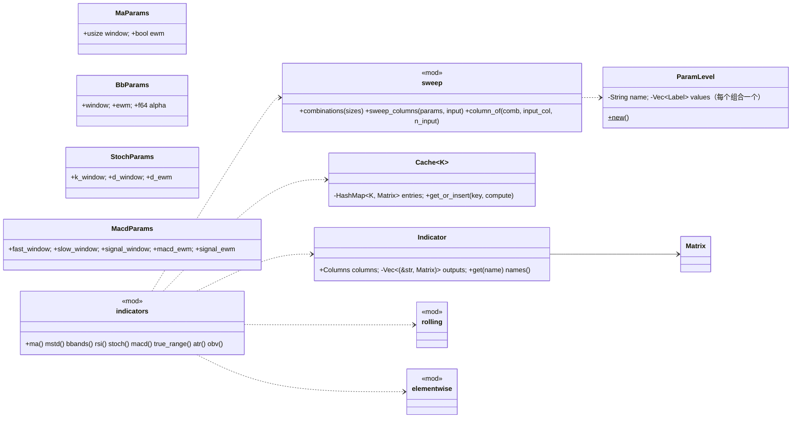

# phasor-indicators：技术指标

`phasor-indicators` 把 [phasor-generic](../crates/phasor-generic.md) 的窗口算子组合成有名字的技术指标，并在调用方展开好的参数组合上一次算完整个网格。列布局与全仓库的[列轴](../concepts/column-axis.md)同一个公式；只有 Rust 接口，经 [phasor](../crates/phasor.md) 门面导出。

## 定位

三个小 crate，都是"数组进、数组出"的纯函数库，没有状态、没有并行：

| crate | 做什么 | 被谁用 |
|---|---|---|
| `phasor-indicators` | MA、MSTD、BBANDS、RSI、STOCH、MACD、ATR、OBV 与参数网格 | [`phasor`](../crates/phasor.md) 门面、测试；Python 未接（`plan.md` H1） |

另外两个是 [phasor-generic](../crates/phasor-generic.md) 和 [phasor-signals](../crates/phasor-signals.md)，它们的定位写在各自的页面上；三条贯穿的语义约定（`min_periods`、NaN、前视）见 [phasor-generic](../crates/phasor-generic.md#定位)。

## 文件与阅读顺序

| 顺序 | 文件 | 行数 | 读什么 | 第一遍可跳过 |
|---|---|---:|---|---|
| 4 | [`phasor-indicators/src/sweep.rs`](https://github.com/nivalume/vbt/blob/81a1d5f238f2d583bad187a9ab6e1e6170316f11/crates/phasor-indicators/src/sweep.rs) | 242 | 全部：`col = comb × n_input + input_col` 的契约、`combinations`、`sweep_columns` | — |
| 5 | [`phasor-indicators/src/indicators.rs`](https://github.com/nivalume/vbt/blob/81a1d5f238f2d583bad187a9ab6e1e6170316f11/crates/phasor-indicators/src/indicators.rs) | 902 | `Indicator`/`Cache`/`per_column`/`place` 29–133；`ma` 149–169 是模板；再 `bbands` 237–292、`rsi` 306–353、`macd` 451–511 看缓存键共享 | `true_range`/`obv` 最后 |

顺序编号是三个小 crate 共用的一条路线：1–3 在 [phasor-generic](../crates/phasor-generic.md#文件与阅读顺序)，6–11 在 [phasor-signals](../crates/phasor-signals.md#文件与阅读顺序)。

输入输出约定：`phasor-indicators` 收 `&Matrix` + 已展开的参数组合切片 + 可选标签，回 `Indicator`。

## 类图

`rolling` 与 `elementwise` 是 [phasor-generic](../crates/phasor-generic.md#类图) 的模块，成员画在那张图里。

## 核心算法与概念

- [指标参数网格与共享缓存](../algorithms/indicator-sweep.md)：`column_of = comb × n_input + input_col` 的列布局契约、按 `(window, ewm)` 等键共享中间量的 `Cache`，以及每个指标的公式。

## 阅读陷阱

1. **`ddof`**：`rolling_std`/`mstd`/`bbands` 显式传，vectorbt 默认 0，pandas 默认 1；`ewm_std` 完全不看 ddof。
2. **RSI 不是 Wilder 的**；`rs = +inf` 是活值，用 parity 测试里的 `agree` 而不是 `is_close` 比较。

`min_periods` 因调用方而异（指标硬编码 `window`，`phasor-expr` 传 `Some(1)`）和 NaN 让窗口缩小这两条，见 [phasor-generic](../crates/phasor-generic.md#阅读陷阱)。

## 与参考实现的对应

| phasor | vectorbt | 差异 |
|---|---|---|
| `ma mstd bbands rsi stoch macd atr obv` | `indicators/nb.py` 的 `*_nb`、`*_cache_nb`/`*_apply_nb`；`vbt.MA.run` 等 | 扫描用显式组合而不是 `IndicatorFactory` 的 `param_product`；标签用 `Columns` 而不是 `MultiIndex` |

## 延伸资料

- J. Welles Wilder, *New Concepts in Technical Trading Systems*（1978）：RSI、TR/ATR 的原始定义，对照这里的 Cutler/EMA 变体；John Bollinger, *Bollinger on Bollinger Bands*（2001）；Gerald Appel 的 MACD；Joseph Granville 的 OBV。
- vectorbt 文档 `IndicatorFactory`。
- 更多见 [延伸资料](../reference/further-reading.md#通用算子指标信号)。

## 自测

1. `combinations(&[3, 2])` 的顺序是什么？`column_of(4, 1, 2)` 是哪一列？它对应哪组参数？
