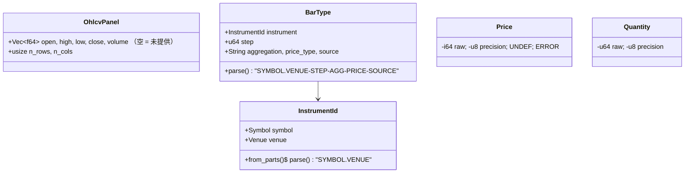

# phasor-model：领域模型

撮合、数据和标识共用的领域词汇。撮合语义跟随 vectorbt，数值和标识类型跟随 NautilusTrader；第一阶段真正用到的是枚举、标识和面板，定点数只是为第二阶段预留的形状。

## 定位

`phasor-model` 只依赖 [phasor-core：基础类型](../crates/phasor-core.md)。
`phasor-model` 在它之上放领域词汇：撮合用的枚举（来自 vectorbt）、标的与 K 线标识（来自 NautilusTrader）、面板 `OhlcvPanel`，以及为第二阶段预留的定点数。

## 文件与阅读顺序

顺序接着 [phasor-core 的 1–5 号文件](../crates/phasor-core.md#文件与阅读顺序)。

| 顺序 | 文件 | 行数 | 读什么 | 第一遍可跳过 |
|---|---|---:|---|---|
| 6 | [`phasor-model/src/enums.rs`](https://github.com/nivalume/vbt/blob/81a1d5f238f2d583bad187a9ab6e1e6170316f11/crates/phasor-model/src/enums.rs) | 366 | 当表查：16 个 `#[repr(i8)]` 枚举，判别值是磁盘格式 | — |
| 7 | [`phasor-model/src/ids.rs`](https://github.com/nivalume/vbt/blob/81a1d5f238f2d583bad187a9ab6e1e6170316f11/crates/phasor-model/src/ids.rs) → `bar.rs` → `types.rs` | 116 / 148 / 134 | `InstrumentId` 的 `rsplit_once('.')`、`BarType` 的 `rsplitn(5,'-')`、`OhlcvPanel` 的 SoA | `Bar` 结构体（无人使用）、`Price`/`Quantity`（第二阶段才用，**没有算术**） |

## 类图

## 领域模型要点

- **枚举**（`enums.rs`）：16 个，全部 `#[repr(i8)]`、判别值显式写出，因为记录数组里存的是整数（`trades.rs:217` 的 `direction as i8`）。`StatusInfo::from_discriminant(-1) == None` 表示"成交了，没有原因"。判别值与 vectorbt `portfolio/enums.py` 1:1 对应，否则对照 fixture 无法重放。测试 `discriminants_are_pinned`（330 行）。
- **`InstrumentId`**（`ids.rs:85-99`）：`rsplit_once('.')`，所以 venue 是最后一段，symbol 可以含点；`from_parts` 明确拒绝含点的 venue，避免 `("ADA", "BINANCE.SPOT")` 被重新解释。模块文档承诺的 interning 还没做（ARCHITECTURE §17.4）。
- **`BarType`**（`bar.rs:75-119`）：`rsplitn(5, '-')` 从右切最多 5 段，后四段词汇固定（STEP / AGGREGATION / PRICE / SOURCE），所有前导的 `-` 都留在第 5 段给 `InstrumentId`，所以 `BTC-USDT.BINANCE-1-MINUTE-LAST-EXTERNAL` 能正确解析。它是数据目录的键（[phasor-data](../crates/phasor-data.md)）。
- **`OhlcvPanel`**（`bar.rs:48-63`）：五个独立的列主序 `Vec<f64>`，空 `Vec` 表示"未提供"。结构体数组（SoA）而不是数组结构体（AoS），因为止损引擎分别扫 O/H/L。
- **`Price` / `Quantity`**（`types.rs`）：按 NautilusTrader 的形状做的定点数（`raw × 10^precision`，`PRECISION = 9`），用 `i64::MAX`/`MIN` 做 `UNDEF`/`ERROR` 哨兵而不是 `Option`（内层循环省一个分支）。**目前没有任何算术、没有 `from_f64`，也没人构造它**；第一阶段全是 `f64`。

## 阅读陷阱

1. 枚举判别值是磁盘格式；加新变体只能追加在末尾（`plan.md` B4 的 `NoCashLeverage` 就是"追加在 14 个之后"）。

## 与参考实现的对应

| phasor | vectorbt 1.1.0 | NautilusTrader |
|---|---|---|
| `enums.rs` 的 15 个撮合/记录枚举 | `portfolio/enums.py` 同名枚举，判别值一致；`CashFlowKind` 是 phasor 新增 | — |
| `Price`、`Quantity`、`UNDEF`/`ERROR` | — | `nautilus_core/model/src/types/{price,quantity}.rs`，`FIXED_PRECISION = 9` |
| `Symbol`、`Venue`、`InstrumentId` | — | `identifiers/*.rs`（Nautilus 用 `Ustr` interning） |
| `BarType` 字符串语法 | — | `data/bar.rs::BarType`，同样 `rsplitn(5, '-')` |
| `OhlcvPanel` | `simulate_from_signals_nb` 接收分开的 open/high/low/close 二维数组 | — |

## 延伸资料

- 结构体数组 vs 数组结构体：Mike Acton, "Data-Oriented Design and C++"（CppCon 2014，视频）；Richard Fabian, *Data-Oriented Design*（免费在线书）。
- NautilusTrader 文档 "Instruments"、"Bars"（`BarType` 语法）、"Precision modes"。
- 更多见 [延伸资料](../reference/further-reading.md)。
