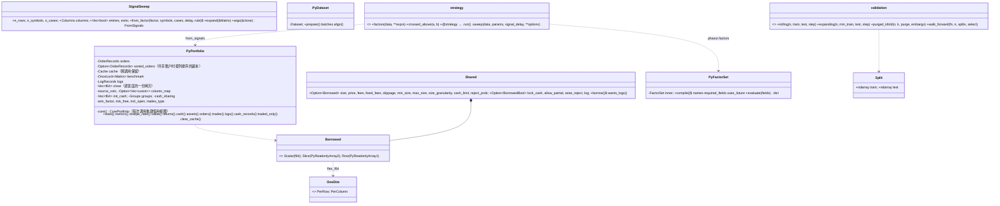
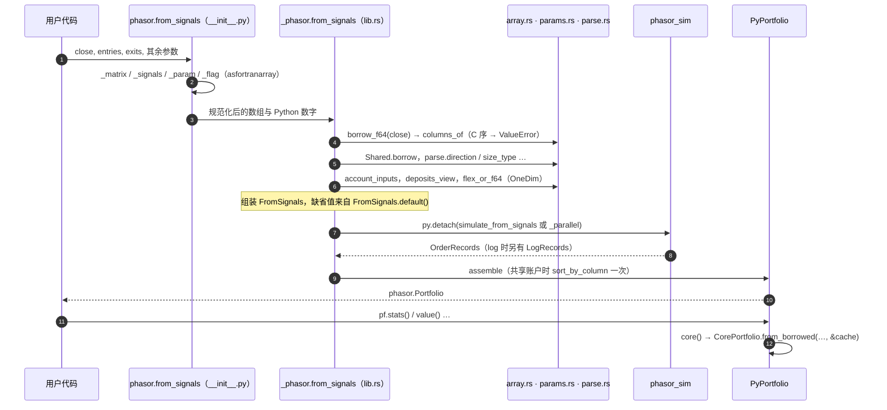

# phasor-py：Python 层

`phasor-py` 是 Python 用户看到的 phasor：Rust 侧是 PyO3 扩展 `phasor._phasor`，Python 侧是包 `phasor`。它不重新实现任何计算，只负责把 NumPy 数组安全地交给引擎、把结果包成能跨调用复用的 `Portfolio`，再加上两样纯 Python 的工具：`@phasor.strategy` 扫描和时间序列交叉验证。Rust 用户的入口见 [phasor：门面 crate](../crates/phasor.md)。

## 定位

- **`phasor-py`**：PyO3 扩展 `phasor._phasor` + Python 包 `phasor`。Rust 侧只做三件事：**零拷贝借用 NumPy 数组**（拒绝 C 序）、**把标量 / 一维 / 二维翻译成 `FlexArray`**、**在 GIL 释放的情况下调引擎**。Python 侧做参数规范化、`@phasor.strategy` 扫描、纯 NumPy 的时间序列交叉验证。

前两件见 [Python 边界：F 序与一维的三种含义](../concepts/python-boundary.md)，第三件见 [PyPortfolio 的跨调用缓存与 GIL](../concepts/portfolio-cache.md)。

读这一层的收获：理解 Python 用户的一次 `phasor.from_signals(...)` 调用在 Rust 里经过了什么，以及为什么 `Portfolio` 对象能跨调用复用派生结果。

## 文件与阅读顺序

| 顺序 | 文件 | 行数 | 读什么 | 第一遍可跳过 |
|---|---|---:|---|---|
| 1 | [`phasor-py/python/phasor/__init__.py:1-32`](https://github.com/nivalume/vbt/blob/81a1d5f238f2d583bad187a9ab6e1e6170316f11/crates/phasor-py/python/phasor/__init__.py#L1-L32)、[`phasor-py/src/array.rs:1-37`](https://github.com/nivalume/vbt/blob/81a1d5f238f2d583bad187a9ab6e1e6170316f11/crates/phasor-py/src/array.rs#L1-L37) | — | 两段文档：引擎列主序、NumPy 行主序、Rust 侧**拒绝而不是转置** | — |
| 2 | [`phasor/src/lib.rs`](https://github.com/nivalume/vbt/blob/81a1d5f238f2d583bad187a9ab6e1e6170316f11/crates/phasor/src/lib.rs) | 71 | crate 地图与 `prelude` | — |
| 3 | [`phasor/src/sweep.rs`](https://github.com/nivalume/vbt/blob/81a1d5f238f2d583bad187a9ab6e1e6170316f11/crates/phasor/src/sweep.rs) | 293 | `SignalSweep::from_factor` 42–123：`out_col = case_idx × n_symbols + symbol`；标签 107–113；`args` 170–186 | `expand` |
| 4 | [`phasor-py/src/array.rs`](https://github.com/nivalume/vbt/blob/81a1d5f238f2d583bad187a9ab6e1e6170316f11/crates/phasor-py/src/array.rs)、`params.rs`、`parse.rs` | 321、118、154 | 三个翻译模块：`columns_of` 82–108、`flex_f64` 117–145、`OneDim`、`Shared::borrow`、枚举解析 | — |
| 5 | [`phasor-py/src/lib.rs:732-1027`](https://github.com/nivalume/vbt/blob/81a1d5f238f2d583bad187a9ab6e1e6170316f11/crates/phasor-py/src/lib.rs#L732-L1027) | — | `from_signals`，配 `account_inputs`/`deposits_view` 649–719 和 `market_array` 1270–1305；`from_orders` 1043–1268 形状相同 | — |
| 6 | [`phasor-py/src/lib.rs:75-197`](https://github.com/nivalume/vbt/blob/81a1d5f238f2d583bad187a9ab6e1e6170316f11/crates/phasor-py/src/lib.rs#L75-L197) | — | `PyPortfolio` 拥有什么、`core()` 127–151、`assemble()` 159–196 | `#[pymethods]` 的 getter、`logs()` 字段表 469–521 |
| 7 | [`phasor-py/python/phasor/__init__.py:64-274`](https://github.com/nivalume/vbt/blob/81a1d5f238f2d583bad187a9ab6e1e6170316f11/crates/phasor-py/python/phasor/__init__.py#L64-L274)、`:277-454` | — | 规范化函数；`from_signals` 包装器的 docstring 是用户手册 | — |
| 8 | [`phasor-py/python/phasor/strategy.py`](https://github.com/nivalume/vbt/blob/81a1d5f238f2d583bad187a9ab6e1e6170316f11/crates/phasor-py/python/phasor/strategy.py) | 149 | 全部 | — |
| 9 | [`phasor-py/python/phasor/validation.py`](https://github.com/nivalume/vbt/blob/81a1d5f238f2d583bad187a9ab6e1e6170316f11/crates/phasor-py/python/phasor/validation.py) | 345 | 全部，纯 NumPy | — |
| 10 | [`phasor-py/src/expr.rs`](https://github.com/nivalume/vbt/blob/81a1d5f238f2d583bad187a9ab6e1e6170316f11/crates/phasor-py/src/expr.rs)、`data.rs`、`arrow.rs` | 128、253、67 | 因子与数据边界；`arrow.rs` 是整个工作区唯一的 `unsafe` | 不用数据层可跳过 |

第 2、3 行属于 Rust 门面，见 [phasor](../crates/phasor.md) 与 [SignalSweep](../algorithms/signal-sweep.md)。

## 类图

## 核心算法与概念

- [Python 边界：F 序与一维的三种含义](../concepts/python-boundary.md)：`columns_of` 只接受列主序并零拷贝借用，C 序报错而不是转置；一维数组按调用点声明为按行、按列或按组。
- [PyPortfolio 的跨调用缓存与 GIL](../concepts/portfolio-cache.md)：`PyPortfolio` 拥有记录与收盘价拷贝，每次调用经 `from_borrowed` 借出同一个 `Cache`；引擎计算全程释放 GIL。
- [@phasor.strategy 的参数扫描](../algorithms/strategy-sweep.md)：每组参数调一次函数、延迟信号、横向拼接，`column_map` 把逻辑列 `p × S + s` 映回源列，价格不平铺。
- [时间序列交叉验证](../algorithms/ts-cross-validation.md)：`rolling`、`expanding`、`purged_kfold` 与 `walk_forward`，纯 NumPy，训练分数选参、只记录被选参数的测试分数。

## 调用链

一次 `phasor.from_signals(...)` 从 Python 到引擎再回来（`__init__.py:277-454`、`lib.rs:732-1027`、`lib.rs:75-197`）：

规范化与借用见 [Python 边界](../concepts/python-boundary.md)；模拟本身见 [phasor-sim](../crates/phasor-sim.md)；`core()` 之后的派生链见 [从记录重建净值](../algorithms/rebuild-chain.md)。

## 阅读陷阱

1. **一维的含义有三种**（见 [Python 边界](../concepts/python-boundary.md#一维数组由调用点声明) 的表）；`init_cash` 共享时按组、二维被拒绝。
2. `direction` 默认：`from_signals` 是 `longonly`，`from_orders` 是 `both`；`from_signals` 拒绝三种 target 仓位类型（vectorbt 也拒绝）。
3. 止损需要 `high` 和 `low`，否则报错而不是无声地不止损。
4. [未交易列 `+inf` Sharpe](../concepts/sweep-aggregation.md) 赢 `argmax`：`pf.traded_only(...)` 再 `np.nanargmax`。
5. [`phasor-py/README.md:394-398`](https://github.com/nivalume/vbt/blob/81a1d5f238f2d583bad187a9ab6e1e6170316f11/crates/phasor-py/README.md#L394-L398) 说"缓存每次从空开始"已**过时**：代码把一个 `Cache` 跨调用出借，`clear_cache()` 正因此存在。
6. 共享运行内存翻倍（`sorted_orders` 是整份克隆）；`price_nbytes` 只数源收盘价。
7. `load_data` 的 Python 解码器每批重新拿 GIL，重 Python 逻辑会在那里串行化。
8. `@phasor.strategy` 直接调用返回**未延迟**的信号，`sweep` 默认 `signal_delay=1`；[`uses_future`](../concepts/look-ahead.md) 只检查 DSL 表达式，不检查策略里的任意 Python。
9. 会跳过的测试：vectorbt [差分测试](../tooling/parity-testing.md)（`needs_reference`）、pyarrow、[研究层](../tooling/research-protocol.md) `importorskip("phasor")`；`test_validation.py` 按路径加载，不需要 Rust 构建。
10. wheel 是 `abi3-py39`，但开发环境固定 Python 3.14，`research` 要 ≥ 3.10。

## 延伸资料

- PyO3 用户指南（0.29）：`#[pyclass]`、`Bound<'py, T>`、`Python::detach`/`attach`、`abi3`：<https://pyo3.rs>。
- rust-numpy（`numpy` crate）：`PyReadonlyArray`、`to_slice_memory_order`、`IntoPyArray`。
- maturin 用户指南（`maturin develop`、混合 Rust/Python 布局）；uv 工作区与 `[tool.uv.sources]`。
- NumPy 文档 "Internal memory layout of an ndarray"、"Indexing / views vs copies"；`np.asfortranarray`、strides。
- Apache Arrow C Data Interface 与 PyCapsule 协议（`__arrow_c_schema__`/`__arrow_c_array__`）：<https://arrow.apache.org/docs/format/CDataInterface.html>。
- López de Prado, *Advances in Financial Machine Learning* 第 7 章（purged k-fold、embargo）；Robert Pardo, *The Evaluation and Optimization of Trading Strategies*（2008）第 11 章（walk-forward analysis）。
- 中文：《Rust 语言圣经》"Rust 与 Python 互操作"相关章节；PyO3 中文翻译（搜索 "PyO3 用户指南 中文"）。
- 更多见 [延伸资料](../reference/further-reading.md) 的 Python 层与门面部分。

## 自测

1. 一个 `(100, 3)` 的 C 序 `close` 传进 `phasor.from_signals` 会发生什么？Python 包装器做了什么让它通常不会发生？（[Python 边界](../concepts/python-boundary.md)）
2. `size=[1, 2, 3]`（一维）和 `cash_deposits=[1, 2, 3]`（一维）分别被解释成什么形状？（[Python 边界](../concepts/python-boundary.md)）
3. 4 组参数 × 3 个标的、`cash_sharing=True`：`column_map`、`group_lens`、输出列数各是什么？（[@phasor.strategy 的参数扫描](../algorithms/strategy-sweep.md)）
4. `purged_kfold(100, 5, purge=3, embargo=2)` 第 2 折的训练集去掉了哪些行？（[时间序列交叉验证](../algorithms/ts-cross-validation.md)）
5. `walk_forward` 为什么丢掉未选中参数的测试分数？不丢会出什么问题？（[时间序列交叉验证](../algorithms/ts-cross-validation.md)）
