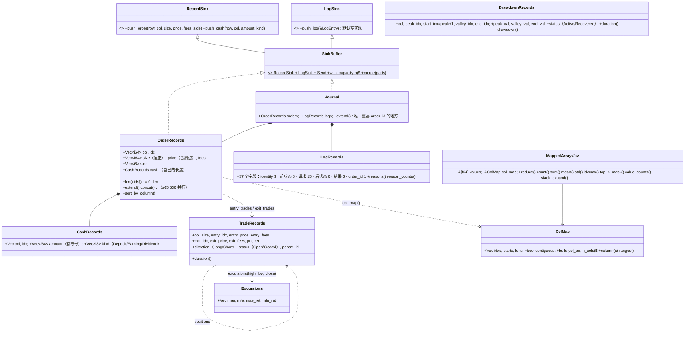

# phasor-records：记录与派生视图

[模拟循环](../crates/phasor-sim.md)写出的每一笔成交和现金流都落在这里定义的结构体数组里，[分析层](../crates/phasor-analysis.md)只读这些结构。这一页是 crate 的总览；合并、按列分组、交易视图、回撤段与 MAE/MFE 各有自己的页面。

## 定位

`phasor-records` 是模拟层和分析层之间的**契约**，也是将来[事件驱动层](../guides/roadmap.md)与向量化层之间的契约：两层都只产出这里定义的记录格式，分析层只读这里定义的格式。
里面有两类东西：

- **原始记录**：`OrderRecords`（成交）、`CashRecords`（非成交的现金流）、`LogRecords`（每笔被考虑的订单的前后状态），以及把它们收进去的 `RecordSink` / `SinkBuffer` trait。
- **派生视图**：`TradeRecords`（[三种交易视图](../algorithms/trade-views.md)）、`DrawdownRecords`（[回撤段](../algorithms/drawdowns.md)）、`Excursions`（每笔交易的 [MAE/MFE](../algorithms/excursions.md)），以及按列分组的工具 [`ColMap` / `MappedArray`](../algorithms/colmap.md)。

全部是结构体数组（SoA），列主序发出，**id 就是下标**（`lib.rs:1-29`）。

## 文件与阅读顺序

| 顺序 | 文件 | 行数 | 读什么 | 第一遍可跳过 |
|---|---|---:|---|---|
| 1 | [`src/lib.rs`](https://github.com/nivalume/vbt/blob/81a1d5f238f2d583bad187a9ab6e1e6170316f11/crates/phasor-records/src/lib.rs) | 383 | 1–29 行三个契约（SoA、列主序发出、`id == index`）；`RecordSink`/`SinkBuffer` 55–94；`OrderRecords` 136–157；`extend` 210–218；`sort_by_column` 220–243；`concat` 252–305 | — |
| 2 | [`src/cash.rs`](https://github.com/nivalume/vbt/blob/81a1d5f238f2d583bad187a9ab6e1e6170316f11/crates/phasor-records/src/cash.rs) | 135 | 全部；`CashRecords` 藏在 `OrderRecords.cash` 里的理由（19–23） | — |
| 3 | [`src/mapped.rs`](https://github.com/nivalume/vbt/blob/81a1d5f238f2d583bad187a9ab6e1e6170316f11/crates/phasor-records/src/mapped.rs) | 991 | `ColMap::build` 72–110、`ranges` 175–181、`MappedArray::for_each_column`/`reduce` 240–269 | `extreme_n_mask` 358–458、`arg_extreme` 607–627（第二遍） |
| 4 | [`src/trades.rs`](https://github.com/nivalume/vbt/blob/81a1d5f238f2d583bad187a9ab6e1e6170316f11/crates/phasor-records/src/trades.rs) | 957 | 先 `trade_stats` 78–94（PnL 公式），再 `exit_trades` 502–628（默认视图）、`entry_trades` 368–486、`positions` 639–697 | — |
| 5 | [`src/drawdowns.rs`](https://github.com/nivalume/vbt/blob/81a1d5f238f2d583bad187a9ab6e1e6170316f11/crates/phasor-records/src/drawdowns.rs) | 462 | `find_drawdowns` 247–324，再访问器 137–206 | — |
| 6 | [`src/excursions.rs`](https://github.com/nivalume/vbt/blob/81a1d5f238f2d583bad187a9ab6e1e6170316f11/crates/phasor-records/src/excursions.rs) | 375 | 57–146 | — |
| 7 | [`src/logs.rs`](https://github.com/nivalume/vbt/blob/81a1d5f238f2d583bad187a9ab6e1e6170316f11/crates/phasor-records/src/logs.rs) | 729 | 只读 `Journal::extend` 464–474（`order_id` 重基）；37 个字段当表查 | 其余 |
| 8 | [`tests/parity_trades.rs`](https://github.com/nivalume/vbt/blob/81a1d5f238f2d583bad187a9ab6e1e6170316f11/crates/phasor-records/tests/parity_trades.rs)、[`tests/parity_mapped.rs`](https://github.com/nivalume/vbt/blob/81a1d5f238f2d583bad187a9ab6e1e6170316f11/crates/phasor-records/tests/parity_mapped.rs) | — | 看 28,367 行 mapped fixture 怎么钉住平局规则 | — |

测试名是最好的边界说明：`a_break_even_round_trip_has_exactly_zero_pnl`、`an_exit_one_ulp_short_closes_the_whole_position`。

## 类图

## 核心算法与概念

- [合并每线程缓冲与 order_id 重基](../algorithms/record-merge.md)：`OrderRecords::concat` 用 `split_at_mut` 无 `unsafe` 并行拷贝，`Journal::extend` 是唯一给日志 `order_id` 加偏移的地方。
- [ColMap 稳定计数排序与 MappedArray](../algorithms/colmap.md)：三趟 O(n + n_cols) 的按列分组，连续时零拷贝；`MappedArray` 归约的 NaN 与平局规则。
- [三种交易视图](../algorithms/trade-views.md)：`entry_trades` / `exit_trades` / `positions` 的分配规则，容差加法让平手往返的 PnL 精确为 0。
- [回撤段识别](../algorithms/drawdowns.md)：`find_drawdowns` 的峰、谷、恢复状态机与 Recovered / Active 两种时长规则。
- [MAE / MFE 与 edge ratio](../algorithms/excursions.md)：每笔交易在持有区间内的最大不利与最大有利偏移。

## 阅读陷阱

1. **id 是隐式的**：四种记录的 `ids()` 都是 `0..len`，任何过滤或重排都改 id。`LogRecords.order_id` 是唯一存储的交叉引用，相对于写入它的缓冲区（见[合并每线程缓冲与 order_id 重基](../algorithms/record-merge.md)）。
2. **共享组重排后日志失配**：[`Portfolio::from_grouped_records`](../crates/phasor-analysis.md) 对订单按 `(col, idx)` 重排，日志不动，之后 `order_id` 不再索引排序后的订单。
3. **拒单的日志 `res_*` 是 NaN**，`LogRecords: PartialEq` 因此在任何有拒单的运行里对自己都不相等；`res_side`、`res_status_info` 用 −1 表示无。
4. **默认交易视图是 `ExitTrades`**（`Scoring.trades_type`），`Positions` 从出场视图构建（见[三种交易视图](../algorithms/trade-views.md)）。
5. **未平仓交易**计入 `Total Trades` 和 `Σ pnl`，但除非 `incl_open` 否则不进质量指标；`duration` 对开仓交易加 1（见[指标公式表](../reference/metrics.md)）。
6. `top_n` 平局从末尾取、`bottom_n` 从开头取（见 [ColMap 与 MappedArray](../algorithms/colmap.md)）。
7. 回撤段在末尾 NaN 处被丢弃（见[回撤段识别](../algorithms/drawdowns.md)）。
8. `Journal::with_capacity` 不预分配日志（理由在 `lib.rs:111-116`）。

## 与参考实现的对应（vectorbt 1.1.0）

| phasor | vectorbt | 证据 |
|---|---|---|
| `entry_trades` / `exit_trades` / `positions` | `portfolio/nb.py::get_entry_trades_nb` / `get_exit_trades_nb` / `get_positions_nb` | [`tests/parity/generate_trades.py`](https://github.com/nivalume/vbt/blob/81a1d5f238f2d583bad187a9ab6e1e6170316f11/tests/parity/generate_trades.py) |
| `find_drawdowns` | `generic/nb.py::drawdowns_nb` | `generate_drawdowns.py` |
| `ColMap::build` | `records/nb.py::col_map_nb` | `generate_mapped.py` |
| `MappedArray::reduce` / `reduce_to_idx` / `top_n_mask` / `bottom_n_mask` / `idxmax` | `reduce_mapped_nb` / `reduce_mapped_to_idx_nb` / `top_n_inout_map_nb` / `bottom_n_inout_map_nb` / `argmax_reduce_nb` | 同上，28,367 行 |
| `LogRecords` 37 字段 | `log_dt` 的 38 字段去掉 `id` | `logs.rs:681-728` |
| `CashRecords`、`Excursions`、`edge_ratio` | 无 | phasor 新增 |
| `reduce_to_idx` 全 NaN 列返回 `fill` | 参考实现抛异常 | `mapped.rs:278-281` |

生成脚本与 fixture 的重放方式见[差分测试与 fixture](../tooling/parity-testing.md)。

## 延伸资料

- vectorbt 文档 "Trades"（EntryTrades / ExitTrades / Positions 的区别）与 "Records / MappedArray"：<https://vectorbt.dev/api/portfolio/trades/>、<https://vectorbt.dev/api/records/>。
- FIFO 与平均成本的交易匹配：任何券商的盈亏计算说明（例如 Interactive Brokers 的 "FIFO vs. LIFO vs. Average Cost"）。
- John Sweeney, *Maximum Adverse Excursion*（1996）；Curtis Faith, *Way of the Turtle*（2007）的 E-ratio 一节（`edge_ratio` 的来源）。中译本《海龟交易法则》。
- 计数排序：CLRS 第 8.2 节；OI Wiki "计数排序"。CSR（compressed sparse row）布局是 `ColMap` 的同构物。
- Rust `split_at_mut` 与作用域线程做无 `unsafe` 的并行拷贝：Rust 标准库文档。
- 更多见[延伸资料](../reference/further-reading.md)。

## 自测

1. 一列成交：买 10@100、卖 4@110、卖 6@90。写出 [`entry_trades` 与 `exit_trades`](../algorithms/trade-views.md) 各有几条记录、各自的 `pnl` 和 `ret`。
2. 同一列：买 10@100、卖 15@110（反向）。两种视图里 `parent_id` 怎么分配？第二笔的费用怎么拆？
3. 净值 `[100, 110, 105, 110, 120, 115]`：[`find_drawdowns`](../algorithms/drawdowns.md) 产生几段？各自的 `duration`？
4. 为什么 [`ColMap::build`](../algorithms/colmap.md) 要三趟而不是直接 `sort_by_key`？稳定性在哪一趟保证？
5. 两个线程各产生 3 条日志，第二个线程的 `order_id = [0, −1, 1]`，[合并](../algorithms/record-merge.md)后变成什么？
