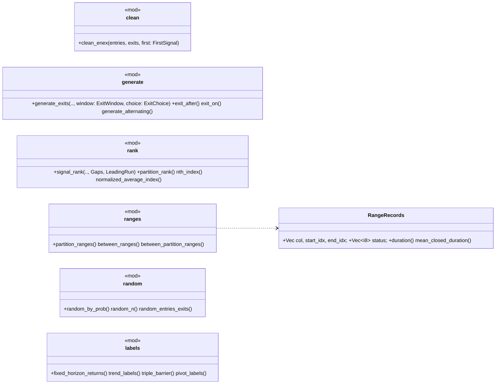

# phasor-signals：信号工具箱

`phasor-signals` 收发的都是扁平列主序的布尔或浮点数组：把进出场整理成严格交替、给每个进场生成出场、给信号和信号段编号、把段落成 `RangeRecords`、按 `(seed, row, col)` 抽随机信号。`labels.rs` 是例外：它读未来，只能做训练目标，见 [延迟与前视偏差](../concepts/look-ahead.md)。

## 定位

三个小 crate，都是"数组进、数组出"的纯函数库，没有状态、没有并行：

| crate | 做什么 | 被谁用 |
|---|---|---|
| `phasor-signals` | 信号清洗、出场生成、排名、区间、带种子的随机信号、ML 标签 | [`phasor`](../crates/phasor.md) 门面、[`crates/phasor/tests/factor_path.rs`](https://github.com/nivalume/vbt/blob/81a1d5f238f2d583bad187a9ab6e1e6170316f11/crates/phasor/tests/factor_path.rs)；Python 未接（P2） |

另外两个是 [phasor-generic](../crates/phasor-generic.md) 和 [phasor-indicators](../crates/phasor-indicators.md)，它们的定位写在各自的页面上；三条贯穿的语义约定（`min_periods`、NaN、前视）见 [phasor-generic](../crates/phasor-generic.md#定位)。

## 文件与阅读顺序

| 顺序 | 文件 | 行数 | 读什么 | 第一遍可跳过 |
|---|---|---:|---|---|
| 6 | [`phasor-signals/src/lib.rs`](https://github.com/nivalume/vbt/blob/81a1d5f238f2d583bad187a9ab6e1e6170316f11/crates/phasor-signals/src/lib.rs)、`clean.rs` | 55、190 | `clean_enex_1d` 37–62：最小的状态机 | — |
| 7 | [`phasor-signals/src/generate.rs`](https://github.com/nivalume/vbt/blob/81a1d5f238f2d583bad187a9ab6e1e6170316f11/crates/phasor-signals/src/generate.rs) | 395 | `generate_exits` 72–133；`exit_after`/`exit_on` 是 10 行特化；`generate_alternating` 201–249 | — |
| 8 | [`phasor-signals/src/rank.rs`](https://github.com/nivalume/vbt/blob/81a1d5f238f2d583bad187a9ab6e1e6170316f11/crates/phasor-signals/src/rank.rs) | 303 | 先读测试 `a_reset_inside_a_run_renumbers_from_that_bar`（257–266），语义反直觉；再 `rank_columns` 39–80 和两个 `step` | `nth_index`、`normalized_average_index` |
| 9 | [`phasor-signals/src/ranges.rs`](https://github.com/nivalume/vbt/blob/81a1d5f238f2d583bad187a9ab6e1e6170316f11/crates/phasor-signals/src/ranges.rs) | 305 | `duration` 89–97 是唯一微妙处 | — |
| 10 | [`phasor-signals/src/random.rs`](https://github.com/nivalume/vbt/blob/81a1d5f238f2d583bad187a9ab6e1e6170316f11/crates/phasor-signals/src/random.rs) + [`phasor-generic/src/synthetic.rs`](https://github.com/nivalume/vbt/blob/81a1d5f238f2d583bad187a9ab6e1e6170316f11/crates/phasor-generic/src/synthetic.rs) | 276 + 457 | 一起读：同一个 SplitMix64 思路，两个略不同的 `uniform` | — |
| 11 | [`phasor-signals/src/labels.rs`](https://github.com/nivalume/vbt/blob/81a1d5f238f2d583bad187a9ab6e1e6170316f11/crates/phasor-signals/src/labels.rs) | 497 | 先读模块文档 1–23 和每个函数的 "Look-ahead" 段 | — |

顺序编号是三个小 crate 共用的一条路线：1–3 在 [phasor-generic](../crates/phasor-generic.md#文件与阅读顺序)，4–5 在 [phasor-indicators](../crates/phasor-indicators.md#文件与阅读顺序)。

输入输出约定：`phasor-signals` 全是扁平列主序 `&[bool]`/`&[f64]` + 显式 `n_rows, n_cols`，形状不符回 `Error::Broadcast`。

## 类图

## 核心算法与概念

- [信号清洗与出场生成](../algorithms/signal-generation.md)：`clean_enex_1d` 的三相状态机（同根双信号两个都不发），`generate_exits` 的三种 `ExitWindow` 与 `generate_alternating`。
- [信号排名与区间](../algorithms/signal-rank-ranges.md)：`signal_rank`/`partition_rank` 共用的走表与段内 reset，`partition_ranges` 的排他/包含终点与 `duration`。
- [带种子的随机信号](../algorithms/random-signals.md)：`random_by_prob`、部分 Fisher–Yates 的 `random_n`、严格交替的 `random_entries_exits`。
- [机器学习标签](../algorithms/ml-labels.md)：`fixed_horizon_returns`、`trend_labels`、`triple_barrier`、`pivot_labels`，每个都读未来。
- [延迟与前视偏差](../concepts/look-ahead.md)：在 `t` 决定、在 `t+1` 交易；哪些函数读未来，哪些机制挡住它。

## 阅读陷阱

1. **标签里 0 一词多义**：`trend_labels` 的"未定义"也是 0，`triple_barrier` 的"没碰到"也是 0；用 `fixed_horizon_returns` 或 `decided == −1` 区分。
2. `bshift`、`bfill`、整个 `labels.rs` 读未来；`pivot_labels` 的前视无界；即使因果因子变信号也要延迟一根。
3. `clean_enex` 丢掉同根双信号；[`SignalSweep`](../algorithms/signal-sweep.md) 根本不清洗——先搞清你的信号走了哪条路再推理 `from_signals` 的[冲突模式](../algorithms/signal-conflicts.md)。
4. 随机数不是 NumPy 的流，无法复现 vectorbt 的随机信号；三份 SplitMix64 副本待合并（P3，见 [无状态随机数 SplitMix64](../concepts/stateless-rng.md)）；两个 `uniform` 一个带 salt 在 `(0,1)`、一个不带在 `[0,1)`。

## 与参考实现的对应

| phasor | vectorbt | 差异 |
|---|---|---|
| `clean_enex` | `signals/nb.py::clean_enex_1d_nb(entry_first)` | `FirstSignal` 枚举 |
| `generate_exits` | `generate_ex_nb(wait, until_next, skip_until_exit, pick_first, choice)` | `ExitWindow` 三个变体对应 `(until_next, skip_until_exit)` 的三种组合；回调是 Rust 泛型 |
| `generate_alternating` | `generate_enex_nb` | 未钉 fixture |
| `signal_rank` / `partition_rank` / `nth_index` / `normalized_average_index` | `rank_nb(sig_pos_rank_nb / part_pos_rank_nb)`、`nth_index_nb`、`norm_avg_index_nb` | `Gaps::Allow ↔ allow_gaps`，`LeadingRun::Skip ↔ after_false` |
| `partition_ranges` 等 | `partition_ranges_nb`、`between_ranges_nb`、`between_partition_ranges_nb` | 无 `id` 字段 |
| `random_*`、`synthetic.rs`、`labels.rs` | `generate_rand_*_nb`、无、`vectorbt.labels`（概念邻居） | **有意不移植**，性质测试 |

## 延伸资料

- Fisher–Yates：Knuth TAOCP 卷 2 算法 P（Durstenfeld 版本）；对照蓄水池抽样（Algorithm R）。
- López de Prado, *Advances in Financial Machine Learning*（Wiley, 2018）第 3 章（三重障碍、元标签）、第 7 章（purge 与 embargo）。
- Zig-zag 指标与"重绘"问题：任何技术分析教材；关键词 "ZigZag indicator repainting"。
- White, "A Reality Check for Data Snooping"（*Econometrica*, 2000）：随机基线与零漂移 GBM 上的回测为什么是必要的对照。
- vectorbt 文档 `signals.accessors`（`pos_rank`、`partition_ranges`、`between_ranges`）。
- 更多见 [延伸资料](../reference/further-reading.md#通用算子指标信号)。

## 自测

1. `entries = [T, F, T, T, F]`、`exits = [F, T, T, F, T]`，`clean_enex_1d(EntryFirst)` 输出什么？
2. `triple_barrier` 为什么要返回决定行？它和[时间序列交叉验证](../algorithms/ts-cross-validation.md)里 `purged_kfold` 的 `purge` 参数是什么关系？
3. `random_n(seed, n=3)` 的结果为什么是 `random_n(seed, n=5)` 的前缀？
