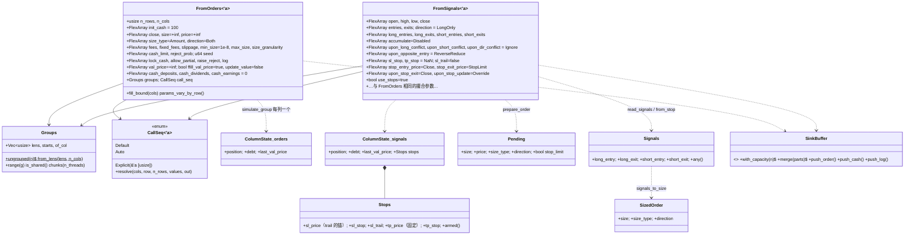

# phasor-sim：模拟循环

模拟层位于[撮合内核](../crates/phasor-exec.md)之上、[记录](../crates/phasor-records.md)之下：它决定每根 K 线、每一列在什么时候、以什么参数调用内核，并把成交与现金流写成记录，交给[分析层](../crates/phasor-analysis.md)。

## 定位

`phasor-sim` 驱动[撮合内核](../crates/phasor-exec.md)：沿时间轴、沿列、沿账户组，把输入数组变成成交记录。两条循环：

- **`from_orders`**：被告知"交易什么"——每个 `(row, col)` 一个订单请求（`size` 为 NaN 表示没有）。简单，是另一条的模板。
- **`from_signals`**：被告知"什么时候交易"——进出场布尔信号，它自己算出方向、数量、止损、冲突。复杂，是仓库里最难的文件之一。

两条循环各有 plain / logged / serial / parallel 四种入口，并行单位是**账户组**（共享现金的相邻列）。
读这个 crate 的收获：[一根 K 线内的事件顺序](../algorithms/bar-loop.md)（入金 → 定价 → 止损 → 信号 → 排序 → 执行 → 收盘收支），以及["线程数不改变结果"](../algorithms/parallel-simulation.md)是怎么做到的。

## 文件与阅读顺序

| 顺序 | 文件 | 行数 | 读什么 | 第一遍可跳过 |
|---|---|---:|---|---|
| 1 | [`src/lib.rs`](https://github.com/nivalume/vbt/blob/81a1d5f238f2d583bad187a9ab6e1e6170316f11/crates/phasor-sim/src/lib.rs) | 121 | crate 文档：为什么账户组是并行单位、为什么不用 SIMD；`DEFAULT_MIN_SIZE = 1e-8`（112 行）；`count_where`（57–93） | `count_where` 的 `MappedColumns` 分支 |
| 2 | [`src/groups.rs`](https://github.com/nivalume/vbt/blob/81a1d5f238f2d583bad187a9ab6e1e6170316f11/crates/phasor-sim/src/groups.rs) | 465 | `Groups`（47–175）、`CallSeq::resolve`（213–249）、`approx_order_value`（262–297）、`insert_argsort`（309–322） | `CallSeq::Explicit`（230–246） |
| 3 | [`src/from_orders.rs`](https://github.com/nivalume/vbt/blob/81a1d5f238f2d583bad187a9ab6e1e6170316f11/crates/phasor-sim/src/from_orders.rs) | 1,151 | 参数结构与默认值 29–240、`updated_value` 254–275、**`simulate_group` 328–591**、驱动 615–757 | 测试 759–1151（挑名字看） |
| 4 | [`src/cash.rs`](https://github.com/nivalume/vbt/blob/81a1d5f238f2d583bad187a9ab6e1e6170316f11/crates/phasor-sim/src/cash.rs) | 240 | 顶部的时序表、`apply`、`at_open`、`earn` | — |
| 5 | [`src/random.rs`](https://github.com/nivalume/vbt/blob/81a1d5f238f2d583bad187a9ab6e1e6170316f11/crates/phasor-sim/src/random.rs) | 43 | 全部 | — |
| 6 | [`src/signals.rs`](https://github.com/nivalume/vbt/blob/81a1d5f238f2d583bad187a9ab6e1e6170316f11/crates/phasor-sim/src/signals.rs) | 734 | 1–401 按文件顺序读：文件顺序就是流水线顺序 | 测试 |
| 7 | [`src/from_signals.rs`](https://github.com/nivalume/vbt/blob/81a1d5f238f2d583bad187a9ab6e1e6170316f11/crates/phasor-sim/src/from_signals.rs) | 1,504 | 参数 64–256、`stop_price` 276–316、`Stops` 329–353、`read_signals` 356–385、**`prepare_order` 502–704**、**`simulate_group` 711–993**、驱动 995–1107 | 测试 1109–1504（但 `a_trailing_stop_follows_the_high_but_only_from_the_next_bar` 等名字值得全读一遍） |
| 8 | [`tests/parity_cash_sharing.rs`](https://github.com/nivalume/vbt/blob/81a1d5f238f2d583bad187a9ab6e1e6170316f11/crates/phasor-sim/tests/parity_cash_sharing.rs)、[`tests/parity_signals.rs`](https://github.com/nivalume/vbt/blob/81a1d5f238f2d583bad187a9ab6e1e6170316f11/crates/phasor-sim/tests/parity_signals.rs) | — | 看共享账户 fixture 怎么分别按布局顺序和 `Auto` 顺序重放；看 5,088 行穷举怎么钉住纯函数 | — |

## 类图

关键的一句话在 `from_orders.rs:282-296` 的注释：**一个账户组 = 每列一个 `ColumnState` + 一对共享的 `cash`/`free_cash`**。共享现金在类型层面就是这个意思。

## 核心算法与概念

- [from_orders 的一根 K 线](../algorithms/bar-loop.md)：`simulate_group` 的两遍扫描——先解析全组价格与 `group_value`，再按调用顺序逐列执行，`value` 在 K 线内穿线。
- [call_seq=auto：共享账户内的执行顺序](../algorithms/call-seq-auto.md)：`approx_order_value` 估算订单金额，`insert_argsort` 稳定升序、NaN 最后，先卖后买。
- [from_signals 的决策顺序](../algorithms/prepare-order.md)：`prepare_order` 的固定流程——价格、估值价、止损、信号、定量，产出 `Pending`。
- [止损引擎：触发、跟踪与重新布防](../algorithms/stop-engine.md)：`stop_price` 的跳空分支、先测后 trail、成交后才重新布防、无滑点的止损限价单。
- [信号冲突解析链与 signals_to_size](../algorithms/signal-conflicts.md)：`signals.rs` 里顺序固定的纯函数，把四个布尔信号变成一个有符号数量。
- [按账户组并行与确定性合并](../algorithms/parallel-simulation.md)：按列数切块、作用域线程、按块顺序合并并重基 `order_id`，串行与并行逐位一致。
- [成交之外的现金流](../concepts/cash-flows.md)：入金、分红、收益的入账时点、读取位置与 `Deposit`/`Dividend`/`Earning` 记录。
- [无状态随机数 SplitMix64](../concepts/stateless-rng.md)：`reject_prob` 的抽样只取决于 `(seed, row, col)`，与分组和线程数无关。

## 阅读陷阱

1. **`min_size` 默认值不一致**：循环默认 `DEFAULT_MIN_SIZE = 1e-8`（参考实现的值），内核 `Order::default()` 是 0。`5e-9` 的订单经循环是 `MinSizeNotReached`，直接调内核会成交。这个差异是靠比对日志的 `req_min_size` 发现的。
2. **共享组的记录是执行顺序**，不是列主序；分析层用 `sort_by_column` 按 `(col, idx)` 稳定重排。id 是位置，排序会改变 id；`Journal.order_id` 指向排序前的缓冲下标（见[合并每线程缓冲与 order_id 重基](../algorithms/record-merge.md)）。
3. **`price = −inf` 在两条循环里含义不同**：`from_orders` 是前收，`from_signals` 是本根开盘（缺开盘再退到前收）。第 0 根 `−inf` 解析成 NaN → `Ignored·PriceNaN`（见[拒单原因 StatusInfo](../reference/status-info.md)）。
4. **`val_price` 在止损之前解析**，止损成交不改变本根估值（见[from_signals 的决策顺序](../algorithms/prepare-order.md)）。
5. **`Direction::Both` 下 `exits` 是空头进场**，默认 `upon_opposite_entry = ReverseReduce` 使它成为反向（见[信号冲突解析链](../algorithms/signal-conflicts.md)）。
6. **ShortOnly 翻两次号**：`prepare_order` 翻一次，内核再翻一次（照参考实现）；`approx_order_value` 也翻。
7. **`params_vary_by_row` 必须包含 `log`**，否则按行变化的 log 标志会一直用第 0 根的值（测试 969–998）。
8. **`from_signals` 的日志只记到达内核的订单**，安静的 K 线没有日志行；`from_orders` 每个格子都有。
9. **`CallSeq::Explicit` 的校验是惰性的**，坏序列可能跑到一半才报错。
10. **`free_cash` 可以是负的**（高于入场价平空之后），此时出金被截到 0 且不记录（见[空头保证金](../concepts/short-margin.md)与[成交之外的现金流](../concepts/cash-flows.md)）。
11. `Journal` 派生的 `PartialEq` 在有拒单时永远是 false（NaN 字段），测试通过 `Debug` 比较。

## 与参考实现的对应（vectorbt 1.1.0）

| phasor | vectorbt `portfolio/nb.py` | 差异 |
|---|---|---|
| `from_orders::simulate_group` + 驱动 | `simulate_from_orders_nb` | 两遍扫描结构相同；`ValidatedOrder` 提升；现金流钩子 |
| `from_signals::simulate_group` + `prepare_order` | `simulate_from_signals_nb` | `−inf` 价格 → 开盘；不保留 `sl_init_i` 等回调层状态 |
| `signals.rs` 的 `from_stop` / `resolve_*` / `signals_to_size` | `generate_stop_signal_nb` / `resolve_signal_conflict_nb` / `resolve_dir_conflict_nb` / `resolve_opposite_entry_nb` / `signals_to_size_nb` | 逐行穷举对照 |
| 第二遍的订单处理 | `process_order_nb` | 结构镜像 |
| `updated_value` | `update_value_nb` | 同 |
| `approx_order_value` + `insert_argsort` | `approx_order_value_nb` + `sort_call_seq_nb` / `insert_argsort_nb` | NaN 最后的写法照抄 |
| `stop_price` + 重新布防 | `simulate_from_signals_nb` 内联的 SL/TP 逻辑 | 抽成函数 |
| `should_update_stop` | `should_update_stop_nb` | 同 |
| `Groups` / `CallSeq` | `group_lens` + `cash_sharing` / `call_seq` 数组 + `CallSeqType` | 同 |
| `cash.rs`、`random.rs`、`cash_limit` | 无 | phasor 新增，用手算测试和守恒检查验证 |

逐行对照所用的 fixture 与生成脚本见[差分测试与 fixture](../tooling/parity-testing.md)。

## 延伸资料

- vectorbt 文档 "Portfolio" 页的 `from_signals` 参数说明（`accumulate`、`upon_*_conflict`、`upon_opposite_entry`、`sl_stop`/`sl_trail`/`tp_stop`、`stop_entry_price`/`stop_exit_price`/`upon_stop_exit`/`upon_stop_update`）和 "Grouping / cash sharing / call_seq" 小节：<https://vectorbt.dev/api/portfolio/base/>。
- 止损与跳空：Investopedia "Stop-Loss vs. Stop-Limit"、"Gap Risk"；trailing stop 的 high-water mark 概念。
- 按目标仓位再平衡：vectorbt 文档的 `TargetPercent` 示例；Robert Carver, *Systematic Trading*（2015）第 10–11 章讲按波动率定仓位。
- SplitMix64：Steele, Lea & Flood, "Fast Splittable Pseudorandom Number Generators"（OOPSLA 2014）；Salmon et al., "Parallel Random Numbers: As Easy as 1, 2, 3"（SC 2011，计数器式随机数的思想）。
- Rust `std::thread::scope`（RFC 3151，Rust 1.63）的官方文档；`Send`/`Sync` 的中文讲解见《Rust 语言圣经》并发章节。
- 插入排序的稳定性与 NaN 排序：任何算法教材；这里只需知道"稳定"意味着估值相同的列保持布局顺序。
- 更多见[延伸资料](../reference/further-reading.md)。

## 自测

1. 共享账户两列，[`call_seq = Auto`](../algorithms/call-seq-auto.md)，第 0 列要买 `TargetPercent(0.5)`、第 1 列要卖 `Amount(−10)`：写出 `approx_order_value` 的两个值和执行顺序。
2. 多头 `sl_stop = 0.1`、锚 100，下一根 K 线 `open = 95, low = 92, high = 101`：[止损](../algorithms/stop-engine.md)以什么价成交？如果 `open = 88` 呢？
3. 多头持仓，`long_entry` 和 `short_entry` 同时触发，`upon_dir_conflict = Adjacent`、`upon_opposite_entry = Close`：最终的 `Signals` 是什么？（见[信号冲突解析链](../algorithms/signal-conflicts.md)）
4. 两个线程切 `[1,1,1,1,1]` 五个组，[`chunks(2)`](../algorithms/parallel-simulation.md) 返回什么？`[6,1,1,1,1,1,1].chunks(2)` 呢？
5. 把 `random::uniform` 换成共享的 `rand::thread_rng()`，哪条测试会先失败？（见[无状态随机数](../concepts/stateless-rng.md)）
