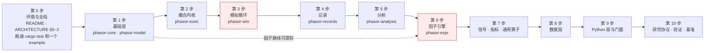

# 阅读路线

这一页回答"按什么顺序读"：先给总路线和两条可选路线，再给用时规划、读一个 crate 的通用方法，最后是一份阅读进度自测。

## 总路线



红色的两步（[`phasor-sim`](../crates/phasor-sim.md) 与 [`phasor-expr`](../crates/phasor-expr.md)）是整个仓库最难的两处，也是花时间最值的两处。

每一步读哪几页、覆盖哪些代码、多难、要多久：

| 步 | 页面 | 覆盖的代码 | 难度 | 预计用时 |
|---|---|---|---|---|
| 0 | [系统全景](../guides/system-map.md)、[贯穿全仓库的约定](../guides/conventions.md)、本页 | 全局地图、阅读路线、通用方法 | — | 1 小时 |
| 1 | [phasor-core](../crates/phasor-core.md)、[phasor-model](../crates/phasor-model.md) | `phasor-core`、`phasor-model` | ★★ | 0.5–1 天 |
| 2 | [phasor-exec](../crates/phasor-exec.md) | `phasor-exec` 撮合内核 | ★★★ | 1 天 |
| 3 | [phasor-sim](../crates/phasor-sim.md) | `phasor-sim` 两条模拟循环、止损、账户组、现金流、并行 | ★★★★ | 2–3 天 |
| 4 | [phasor-records](../crates/phasor-records.md) | `phasor-records` 记录、三种交易视图、回撤、MAE/MFE | ★★★ | 1 天 |
| 5 | [phasor-analysis](../crates/phasor-analysis.md) | `phasor-analysis` 重建链、指标、统计表、过拟合检验、事件研究 | ★★★ | 1.5 天 |
| 6 | [phasor-expr](../crates/phasor-expr.md) | `phasor-expr` 因子表达式引擎（解析、图编译、O(1) 窗口核、顺序统计量） | ★★★★★ | 2–3 天 |
| 7 | [phasor-generic](../crates/phasor-generic.md)、[phasor-indicators](../crates/phasor-indicators.md)、[phasor-signals](../crates/phasor-signals.md) | `phasor-generic`、`phasor-indicators`、`phasor-signals` | ★★ | 1 天 |
| 8 | [phasor-data](../crates/phasor-data.md) | `phasor-data`、`phasor.data` | ★★ | 0.5 天 |
| 9 | [phasor](../crates/phasor.md)、[phasor-py](../crates/phasor-py.md) | `phasor`、`phasor-py`、`phasor.strategy`、`phasor.validation` | ★★★ | 1 天 |
| 10 | [研究协议 phasor_lab](../tooling/research-protocol.md)、[差分测试与 fixture](../tooling/parity-testing.md)、[基准协议](../tooling/benchmarks.md) | [`research/phasor_lab`](https://github.com/nivalume/vbt/tree/81a1d5f238f2d583bad187a9ab6e1e6170316f11/research/phasor_lab)、[`tests/parity`](https://github.com/nivalume/vbt/tree/81a1d5f238f2d583bad187a9ab6e1e6170316f11/tests/parity)、`benchmarks` | ★★ | 0.5–1 天 |
| — | [延伸资料](../reference/further-reading.md) | 延伸资料总表（论文、文档、视频、中英文） | — | 按需 |
| — | [练习与自测](../guides/exercises.md) | 每一层的动手练习与自测题 | — | 穿插 |

## 两条可选路线

| 路线 | 顺序 | 适合谁 |
|---|---|---|
| **交易路线**（推荐先走） | [core](../crates/phasor-core.md) → [model](../crates/phasor-model.md) → [exec](../crates/phasor-exec.md) → [sim](../crates/phasor-sim.md) → [records](../crates/phasor-records.md) → [analysis](../crates/phasor-analysis.md) | 想弄清"一笔信号怎么变成净值曲线"的人；这是主流水线 |
| **因子路线** | [core](../crates/phasor-core.md) → [generic](../crates/phasor-generic.md) → [expr](../crates/phasor-expr.md) → [signals](../crates/phasor-signals.md) → [`phasor::sweep`](../algorithms/signal-sweep.md) → [sim](../crates/phasor-sim.md) | 想弄清"一个表达式怎么变成信号矩阵"的人；可以独立于交易路线 |

两条路线在 `phasor-sim` 汇合：因子路线产出 `FromSignals` 的输入，交易路线消费它。

## 用时规划（甘特图，按一个人全职阅读估计）

```mermaid
gantt
  title phasor 源码阅读计划（约 12 个工作日）
  dateFormat  D
  axisFormat  第%d天
  section 准备
  环境、全局地图、跑通测试          :a0, 1, 1d
  section 交易路线
  phasor-core + phasor-model             :a1, after a0, 1d
  phasor-exec 撮合内核                 :a2, after a1, 1d
  phasor-sim 模拟循环                  :a3, after a2, 3d
  phasor-records                       :a4, after a3, 1d
  phasor-analysis                      :a5, after a4, 1d
  section 因子路线
  phasor-expr 因子引擎                 :b1, after a5, 2d
  generic / indicators / signals     :b2, after b1, 1d
  section 外围
  phasor-data                          :c1, after b2, 1d
  phasor / phasor-py / validation        :c2, after c1, 1d
  research · parity · benchmarks     :c3, after c2, 1d
```



图里每一段对应的页面：

- 准备 · 环境、全局地图、跑通测试：[系统全景](../guides/system-map.md)、[贯穿全仓库的约定](../guides/conventions.md)、[读一个 crate 的通用方法](#读一个-crate-的通用方法)
- 交易路线 · phasor-core + phasor-model：[phasor-core：基础类型](../crates/phasor-core.md)、[phasor-model：领域模型](../crates/phasor-model.md)
- 交易路线 · phasor-exec 撮合内核：[phasor-exec：撮合内核](../crates/phasor-exec.md)
- 交易路线 · phasor-sim 模拟循环：[phasor-sim：模拟循环](../crates/phasor-sim.md)
- 交易路线 · phasor-records：[phasor-records：记录与派生视图](../crates/phasor-records.md)
- 交易路线 · phasor-analysis：[phasor-analysis：分析层](../crates/phasor-analysis.md)
- 因子路线 · phasor-expr 因子引擎：[phasor-expr：因子表达式引擎](../crates/phasor-expr.md)
- 因子路线 · generic / indicators / signals：[phasor-generic：通用窗口算子](../crates/phasor-generic.md)、[phasor-indicators：技术指标](../crates/phasor-indicators.md)、[phasor-signals：信号工具箱](../crates/phasor-signals.md)
- 外围 · phasor-data：[phasor-data：数据层](../crates/phasor-data.md)
- 外围 · phasor / phasor-py / validation：[phasor：门面 crate](../crates/phasor.md)、[phasor-py：Python 层](../crates/phasor-py.md)、[时间序列交叉验证](../algorithms/ts-cross-validation.md)
- 外围 · research · parity · benchmarks：[研究协议 phasor_lab](../tooling/research-protocol.md)、[差分测试与 fixture](../tooling/parity-testing.md)、[基准协议](../tooling/benchmarks.md)

## 读一个 crate 的通用方法

每个 crate 都按同一套步骤读，每个 crate 页的"文件与阅读顺序"表只是把这套方法具体化：

1. **先读 `lib.rs` 顶部的模块文档**。这个仓库的 `//!` 注释写得很认真，往往直接写出设计意图和"为什么不这么做"。
2. **再读类型，不读函数体**。把 `pub struct` / `pub enum` / `pub trait` 的字段抄到纸上，画出谁拥有谁、谁借用谁。每个 crate 页给出的类图就是这一步的结果。
3. **读 [`tests/`](https://github.com/nivalume/vbt/tree/81a1d5f238f2d583bad187a9ab6e1e6170316f11/tests) 里的测试名**。测试名是用英文句子写的（`a_gap_through_the_stop_fills_at_the_open`），一组测试名就是一份行为规格。
4. **挑一个 fixture 行，手工跟一遍**。`tests/fixtures/*.tsv` 的每一行都是参考实现（vectorbt 1.1.0 / Qlib）的真实输出；拿一行当输入，在脑子里（或加 `dbg!`）跑一遍核心函数。fixture 怎么生成见 [差分测试与 fixture](../tooling/parity-testing.md)。
5. **最后才读核心函数体**，带着"它在哪一步会偏离我的预期"的问题读。
6. **用 `cargo doc` 做导航**：`cargo doc --workspace --no-deps --open`，文档注释里的 `[`链接`]` 会把类型和函数串起来。

```bash
# 环境（mise.toml 固定了 Rust / Python / uv 版本）
cargo test --workspace                       # 全部 Rust 测试（含对照 fixture 重放）
cargo test -p phasor-exec -- --nocapture       # 单个 crate
cargo doc --workspace --no-deps --open       # 文档导航
cargo run --release --example factor_sweep -p phasor      # Rust 端到端示例
uv sync && uv run python examples/sweep.py   # Python 端到端示例
```

读代码时随手记三件事：**它调用了谁、谁调用了它、它和参考实现（vectorbt / Qlib / Nautilus）的哪个函数对应**。每个 crate 页的"与参考实现的对应"表可以直接核对。

## 阅读进度自测

把下面每项都能做到，就可以认为读懂了对应层：

- [ ] **基础层**：不看代码写出 `FlexArray::get` 五个分支；解释为什么 `is_close(inf, inf)` 是 `false`。见 [FlexArray 广播与列映射](../concepts/flex-array.md)、[浮点容差与零钉](../concepts/float-tolerance.md)。
- [ ] **内核**：给定 `cash=100, fees=0.1, fixed_fees=1, size=+inf, price=10`，手算成交数量（答案在 [buy：买入、平空与 lock_cash 预算](../algorithms/buy-leg.md)）。
- [ ] **模拟**：画出共享账户一根 K 线的时序图（入金 → 定价 → 止损 → 信号 → 排序 → 执行 → 收盘收支）。见 [from_orders 的一根 K 线](../algorithms/bar-loop.md)、[from_signals 的决策顺序](../algorithms/prepare-order.md)、[成交之外的现金流](../concepts/cash-flows.md)。
- [ ] **记录**：对同一组成交，说出 `entry_trades` 和 `exit_trades` 的胜率为什么可以不同。见 [三种交易视图](../algorithms/trade-views.md)。
- [ ] **分析**：从 `OrderRecords` 手工重建一个两根 K 线、一笔成交的净值序列，并算出收益率。见 [从记录重建净值](../algorithms/rebuild-chain.md)。
- [ ] **因子**：把 `($close - Mean($close, 5)) / Std($close, 5)` 画成依赖图，标出哪些节点占槽位。见 [依赖图编译：哈希合并、Ref 视图与槽位调度](../algorithms/factor-graph.md)。
- [ ] **信号**：解释 `clean_enex` 对"同一根 K 线同时有进有出"的处理。见 [信号清洗与出场生成](../algorithms/signal-generation.md)。
- [ ] **数据**：说出 `event_time` 和 `available_time` 的区别，以及对齐用哪个。见 [按时点对齐 align](../algorithms/pit-alignment.md)、[phasor-data：数据层](../crates/phasor-data.md)。
- [ ] **Python**：说出 C 序数组进 Rust 为什么会被拒绝而不是转置。见 [Python 边界：F 序与一维的三种含义](../concepts/python-boundary.md)。
- [ ] **研究**：复述一个假设从 `propose` 到 `report` 的全部状态，以及为什么 LLM 看不到结果。见 [研究协议 phasor_lab](../tooling/research-protocol.md)。

练习题在 [练习与自测](../guides/exercises.md)。

## 相关

- [系统全景](../guides/system-map.md)：第 0 步要建立的全局地图。
- [贯穿全仓库的约定](../guides/conventions.md)：第 0 步要记住的 7 个约定。
- [核心算法一览](../guides/algorithm-index.md)：读完整条路线后应该能讲清楚的算法。
- [练习与自测](../guides/exercises.md)：每一层的动手练习。
- [延伸资料](../reference/further-reading.md)：看不懂时去哪里补课。
