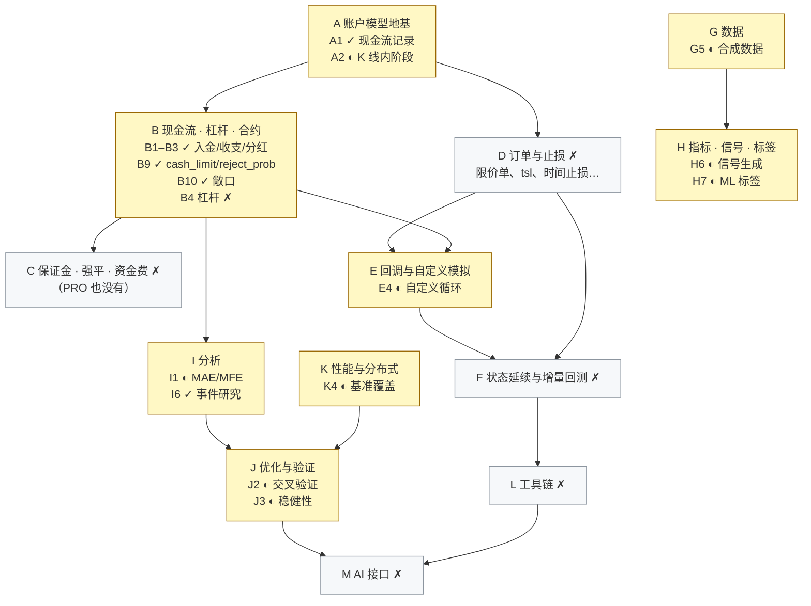

# 路线图与已知缺口

这一页摘要 [docs/plan.md](https://github.com/nivalume/vbt/blob/81a1d5f238f2d583bad187a9ab6e1e6170316f11/docs/plan.md)（任务清单，状态以代码为准）和 [ARCHITECTURE §17](https://github.com/nivalume/vbt/blob/81a1d5f238f2d583bad187a9ab6e1e6170316f11/docs/ARCHITECTURE.zh-CN.md#17-%E8%B7%AF%E7%BA%BF%E5%9B%BE%E4%B8%8E%E5%B7%B2%E7%9F%A5%E7%BC%BA%E5%8F%A3)（设计层面的路线图与已知问题）。
每项任务的"为什么"、子任务、代码位置和验收标准都写在 plan.md 里；这里只给状态，以及已经实现的部分在哪个页面讲。

## 现状

目标：对齐 VectorBT PRO 公开功能清单，并补上 PRO 没有的保证金、强平、资金费。状态以代码为准（2026-10-11）：**7 完成、9 部分、63 未开始**。

| 阶段 | 内容 | 完成 | 部分完成 | 未开始 |
|---|---|---:|---:|---:|
| P | 维护与技术债 | 0 | 0 | 3 |
| A | 账户模型地基 | 1 | 1 | 2 |
| B | 现金流、杠杆、合约 | 5 | 0 | 5 |
| C | 保证金、强平、资金费（PRO 没有） | 0 | 0 | 5 |
| D | 订单与止损 | 0 | 0 | 9 |
| E | 回调与自定义模拟 | 0 | 1 | 4 |
| F | 状态延续与增量回测 | 0 | 0 | 6 |
| G | 数据 | 0 | 1 | 5 |
| H | 指标、信号、标签 | 0 | 2 | 5 |
| I | 分析 | 1 | 1 | 6 |
| J | 优化与验证 | 0 | 2 | 2 |
| K | 性能与分布式 | 0 | 1 | 3 |
| L | 工具链 | 0 | 0 | 5 |
| M | AI 接口 | 0 | 0 | 3 |
| **合计** | | **7** | **9** | **63** |

✓ 完成，◐ 部分完成，✗ 未开始；黄色的阶段里已有任务完成或部分完成，灰色的阶段还没开始。
箭头是依赖：A–F 改的是模拟内核，要按顺序做；G、H、I、J、K 基本不碰内核，可以并行。

## 已完成与部分完成的任务

| 任务 | 状态 | 做到哪一步 | 详见 |
|---|---|---|---|
| A1 现金流记录 | ✓ | `CashRecords { col, idx, amount, kind }` 存在 `OrderRecords.cash`，`kind` 有 `Deposit`、`Earning`、`Dividend`；分析层计入这些记录，入金不算收益 | [成交之外的现金流](../concepts/cash-flows.md)、[从记录重建净值](../algorithms/rebuild-chain.md) |
| A2 K 线内的处理阶段 | ◐ | 已有：开盘入金/出金与分红，收盘 `cash_earnings`，现有 `sl_stop`/`tp_stop` 的跳空按开盘价成交、盘中按 high/low 触发、同一根上止损先于止盈；未做：限价单和新止损类型的阶段处理、止损成交与开盘现金流先后顺序的文档、收盘资金费/利息/强平 | [from_orders 的一根 K 线](../algorithms/bar-loop.md)、[止损引擎](../algorithms/stop-engine.md) |
| B1–B3 入金/出金、现金收支、分红 | ✓ | `cash_deposits` 开盘按账户组入账，`cash_earnings` 收盘按列入账，`cash_dividends` 按当根下单前的持仓开盘入账；扣款最多扣到可用现金 | [成交之外的现金流](../concepts/cash-flows.md) |
| B9 `cash_limit`、`reject_prob` | ✓ | `cash_limit` 只限制买单、在 `percent` 之前生效，不写进日志；随机拒单由 `(seed, row, col)` 经 SplitMix64 算出，内核在买卖之前判断 | [execute_order 的固定顺序](../algorithms/execute-order-pipeline.md)、[无状态随机数](../concepts/stateless-rng.md) |
| B10 敞口指标 | ✓ | `Portfolio` 上的 `allocations`、`long_exposure`、`short_exposure`、`net_exposure`、`gross_long_short`、`position_coverage`；Python 未接 | [从记录重建净值](../algorithms/rebuild-chain.md) |
| E4 自定义模拟循环 | ◐ | 已公开：撮合内核与内核状态（`execute_order`、`execute_validated`、`ValidatedOrder`、`ExecuteOrderState`、`ProcessOrderState`）、止损判定（`stop_price`、`from_stop`）、记录写入（`RecordSink`、`LogSink`）、`Portfolio::from_records`；未公开：现金流入账函数、按 `(seed, row, col)` 取随机数的函数、列和账户组状态（A3）、挂单判定（D1、D2） | [execute_order 的固定顺序](../algorithms/execute-order-pipeline.md)、[ValidatedOrder](../concepts/validated-order.md)、[止损引擎](../algorithms/stop-engine.md)、[phasor-records](../crates/phasor-records.md) |
| G5 合成数据 | ◐ | `random_walk`、`gbm`、`ohlc_from_close` 带种子可复现，某一列的结果不随列数变化；缺对已有序列打乱或扰动的 `randomize`；Python 未接 | [带种子的合成价格](../algorithms/synthetic-prices.md) |
| H6 信号生成 | ◐ | 已有：带种子的 `random_by_prob`、`random_n`、`random_entries_exits`，`ranges.rs` 的信号间隔和连续长度；缺：按日历生成的信号、信号汇总统计表、匹配型随机基线；Python 未接 | [带种子的随机信号](../algorithms/random-signals.md)、[信号排名与区间](../algorithms/signal-rank-ranges.md) |
| H7 机器学习标签 | ◐ | `fixed_horizon_returns`、`trend_labels`、`triple_barrier`、`pivot_labels` 已有，它们读取未来数据，只能作训练目标；缺均值类标签和用模型预测值回测的辅助函数；Python 未接 | [机器学习标签](../algorithms/ml-labels.md) |
| I1 MAE / MFE | ◐ | `excursions`、`edge_ratio` 已有；还不是 `Portfolio` 方法（要自己传 high/low/close），也没有多空分开的统计；Python 未接 | [MAE / MFE 与 edge ratio](../algorithms/excursions.md) |
| I6 事件研究 | ✓ | `forward_paths`、`mean_path`、`median_path`、`hit_rate`；读取未来数据，只用于分析；Python 未接 | [事件研究](../algorithms/event-study.md) |
| J2 交叉验证切分 | ◐ | 已有：`rolling`、`expanding`、`purged_kfold`、`walk_forward`，以及手工构造 `Split(train, test)`；缺：从日期区间或布尔掩码（含日历）生成切分，[`research/phasor_lab`](https://github.com/nivalume/vbt/tree/81a1d5f238f2d583bad187a9ab6e1e6170316f11/research/phasor_lab) 的 walk-forward 改用这个模块 | [时间序列交叉验证](../algorithms/ts-cross-validation.md) |
| J3 稳健性检验 | ◐ | `probabilistic_sharpe`、`deflated_sharpe`、`expected_max_sharpe`、`pbo_cscv` 已有；缺置换检验、邻近参数比较、延迟信号检验函数、在打乱的价格上重跑；Python 未接 | [过拟合检验：PSR、DSR、PBO](../algorithms/overfitting-stats.md) |
| K4 基准覆盖 | ◐ | 现金流、`cash_limit`、`reject_prob` 关闭时和 main 对比过（墙钟时间和 callgrind 指令数）；新功能还没写进 `benchmarks/workloads*.tsv`，指令数回归检查未做 | [基准协议](../tooling/benchmarks.md) |

## 下一步优先级

下一步优先级：**P1**（`from_signals` 性能回到 3% 以内）→ **P2**（新功能接到 Python）→ **B4 → C1–C4**（杠杆、保证金、强平、资金费，资金费套利的关键路径）。

1. **P1**：新功能全部关闭时，和 main 交替跑 6 轮 bench 的中位数是 `from_orders` 慢 1.6%、`from_signals` 慢 3.8%，后者超过约束里的 3%。callgrind 显示撮合内核变大后 `buy`/`sell` 不再被内联；要做的是把只在少数情况下走的分支（`lock_cash` 求解、费用反解）拆成不内联的函数，并在 [`benchmarks/`](https://github.com/nivalume/vbt/tree/81a1d5f238f2d583bad187a9ab6e1e6170316f11/benchmarks) 加按指令数比较的回归检查。见[基准协议](../tooling/benchmarks.md)和 [buy](../algorithms/buy-leg.md)。
2. **P2**：敞口方法（B10）、MAE/MFE（I1）、事件研究（I6）、稳健性（J3）、标签和随机信号（H6、H7）、合成价格（G5），以及 `from_signals` 已有但 Python 不能设的止损参数（`upon_stop_exit`、`stop_entry_price`、`stop_exit_price`、`upon_stop_update`），现在都只有 Rust 接口。见 [phasor-py](../crates/phasor-py.md)。
3. **B4 → C1–C4**：现在做空要冻结 2 倍市值（[空头保证金](../concepts/short-margin.md)），资金占用和真实账户差很多；做完杠杆、保证金、强平、资金费，才能在 phasor 里准确回测现货多 + 永续空。

**P3**（技术债）：[`phasor-sim/src/random.rs`](https://github.com/nivalume/vbt/blob/81a1d5f238f2d583bad187a9ab6e1e6170316f11/crates/phasor-sim/src/random.rs)、[`phasor-signals/src/random.rs`](https://github.com/nivalume/vbt/blob/81a1d5f238f2d583bad187a9ab6e1e6170316f11/crates/phasor-signals/src/random.rs)、[`phasor-generic/src/synthetic.rs`](https://github.com/nivalume/vbt/blob/81a1d5f238f2d583bad187a9ab6e1e6170316f11/crates/phasor-generic/src/synthetic.rs) 各有一份 SplitMix64。三处的混合步骤相同，sim 和 signals 从 `(seed, row, col)` 映射到 `[0, 1)` 的方式也相同；synthetic 多一个 salt 参数，并且映射到开区间 `(0, 1)`，结果不同。计划由 `phasor-core` 提供混合步骤和带 salt 的链式哈希、两种均匀映射各自保留，合并前先加测试固定三处现在的输出。见[无状态随机数](../concepts/stateless-rng.md)。

## 未开始的任务

| 阶段 | 未开始 | 说明 |
|---|---|---|
| P | P1 `from_signals` 性能、P2 新功能接到 Python、P3 合并三份 SplitMix64 | 见上一节 |
| A | A3 显式的模拟状态结构（推迟到 D1）、A4 内核状态加 `locked_cash`（并入 B4） | 两个循环各有一个私有的 `ColumnState`，字段不同、都不能序列化（[from_orders 的一根 K 线](../algorithms/bar-loop.md)） |
| B | B4 杠杆、B5 `valuepercent` 和 `*100` 仓位类型、B6 合约乘数、B7 负价格、B8 初始持仓与 `init_cash="auto"` | B7：撮合内核的价格校验和生成交易记录的 `trades.rs` 都会拒绝非正价格 |
| C | C1 保证金账户模型、C2 强平、C3 资金费、C4 标记价格和借贷利息、C5 外部对照 | PRO 也没有；C3 要把 [`research/phasor_lab`](https://github.com/nivalume/vbt/tree/81a1d5f238f2d583bad187a9ab6e1e6170316f11/research/phasor_lab) 的 `funding_modeled` 改成真实开关（[研究协议 phasor_lab](../tooling/research-protocol.md)） |
| D | D1 挂单状态、D2 限价单与突破单、D3 挂单冲突、D4 价格选项、D5 止损扩展、D6 不经模拟生成止损信号、D7 `from_signals` 的仓位扩展、D8 多分辨率模拟、D9 交易时段 | D5 的现状：止损后反手（`upon_stop_exit=Reverse/ReverseReduce`）和按成交价锚定（`stop_entry_price=FillPrice`）已有，名字沿用 vectorbt 1.x，只在 Rust 里能设（[止损引擎](../algorithms/stop-engine.md)）；D7：`signals_to_size` 现在只接受 Amount/Value/Percent（[信号冲突解析链](../algorithms/signal-conflicts.md)） |
| E | E1 Rust 回调 trait、E2 `from_order_func`、E3 `from_signals` 的回调、E5 Python 回调 | 要和 ARCHITECTURE §17.1 的事件驱动层一起设计 |
| F | F1 状态快照、F2 增量更新、F3 分段拼接、F4 持久化、F5 Stepper、F6 长历史分批 | 依赖 A3、D1、E |
| G | G0 联网代码的包结构、G1 数据源连接器、G2 存储后端、G3 增量更新、G4 多周期重采样与对齐 | G4 复用已有的[按时点对齐](../algorithms/pit-alignment.md) |
| H | H1 现有指标和信号函数接到 Python、H2 指标工厂、H3 第三方指标库、H4 WorldQuant 101、H5 流式指标 | H4 先要截面算子，即 ARCHITECTURE §17.2 的分阶段图计算 |
| I | I2 回撤记录和滚动指标接到 Python、I3 外部收益序列分析、I4 组合切片/拼接/重采样、I5 形态搜索、I7 图表、I8 结果转 pandas | I3：Rust 的 `metrics.rs`、`benchmark.rs` 已能直接评估收益数组，缺 Python 入口和不需要订单记录的统计表（[指标公式表](../reference/metrics.md)） |
| J | J1 通用参数化、J4 组合优化 | — |
| K | K1 分块执行、K2 多进程和 Ray、K3 跨运行缓存 | K3 先测量值不值得做 |
| L | L1 配置文件、L2 持久化、L3 定时任务与通知、L4 CLI、L5 开发者工具 | — |
| M | M1 文档检索、M2 MCP 服务、M3 Agent skills | M2 的回测只用于开发调试，不能接到 `phasor_lab` 的数据和账本上 |

## 七条约束

七条约束（违反即缺陷）：默认行为逐位不变且 fixture 不许重生成；功能全关时吞吐下降 ≤ 3%；不抄 PRO 代码；记录是唯一来源；库不联网；不引入 `Rc`/`RefCell`/全局状态；线程数不影响结果。

| 约束 | 在知识库里 |
|---|---|
| 默认行为逐位不变，fixture 不许重生成 | [差分测试与 fixture](../tooling/parity-testing.md) |
| 功能全关时吞吐下降 ≤ 3% | [基准协议](../tooling/benchmarks.md)；P1 正是这一条被违反了 |
| 不抄 PRO 代码 | PRO 闭源，只按公开文档描述的行为独立实现，用手算 fixture 和性质测试对照（plan.md 的验证策略） |
| 记录是唯一来源 | [从记录重建净值](../algorithms/rebuild-chain.md)、[成交之外的现金流](../concepts/cash-flows.md) |
| 库不联网 | [phasor-data](../crates/phasor-data.md) 只读本地文件，下载脚本在 [`examples/`](https://github.com/nivalume/vbt/tree/81a1d5f238f2d583bad187a9ab6e1e6170316f11/examples)；G0 决定联网代码放进哪个可选包 |
| 不引入 `Rc`/`RefCell`/全局状态 | [按账户组并行与确定性合并](../algorithms/parallel-simulation.md) |
| 线程数不影响结果 | [无状态随机数](../concepts/stateless-rng.md)、[按账户组并行与确定性合并](../algorithms/parallel-simulation.md) |

## 架构文档里的路线图

[ARCHITECTURE §17](https://github.com/nivalume/vbt/blob/81a1d5f238f2d583bad187a9ab6e1e6170316f11/docs/ARCHITECTURE.zh-CN.md#17-%E8%B7%AF%E7%BA%BF%E5%9B%BE%E4%B8%8E%E5%B7%B2%E7%9F%A5%E7%BC%BA%E5%8F%A3) 从设计角度补充 plan.md 之外的方向：

- **阶段 2：事件驱动层**（ARCHITECTURE §17.1）：带 NautilusTrader 兼容 API 的事件驱动层，是设计目标，尚无任何实现；K 线撮合计划用 L1 订单簿，把每根 K 线拆成 O → H → L → C 四个 tick。plan.md 的 E 阶段要和它一起设计，因为 `order_func(OrderContext) -> Order` 和 `on_bar` 是同一种形状。
- **因子引擎**（ARCHITECTURE §17.2）：分批输出到 sink 或 Arrow/Parquet；截面算子（`CSRank`、`CSZScore`、中性化）按图分阶段执行；更多逐元素算子（`Exp`、`Sqrt`、`Clip`、`FillNa`、`IsNan`、掩码）；窄面板上的单标的内部并行。见 [phasor-expr](../crates/phasor-expr.md)。
- **待评估的想法**（ARCHITECTURE §17.3）：带验证期的自动参数搜索；跨运行的因子缓存（先测复用率）；按名字引用因子的声明式交易规则。
- **已知问题**（ARCHITECTURE §17.4）：都不影响结果的正确性。

| 问题 | 在知识库里 |
|---|---|
| `CallSeq::Explicit` 未公开给 Python | [call_seq=auto](../algorithms/call-seq-auto.md) |
| `Symbol` / `Venue` 未驻留，但模块注释说已驻留 | [phasor-model](../crates/phasor-model.md) |
| 过时注释：phasor-analysis 说不支持共享现金；`from_orders.rs` 用镜像不可用来解释作用域线程 | [phasor-analysis](../crates/phasor-analysis.md)、[phasor-sim](../crates/phasor-sim.md) |
| `propose.py` 引用 `tests/test_propose.py`，实际检查在 `research/tests/test_pipeline.py::test_proposals_never_see_results` | [研究协议 phasor_lab](../tooling/research-protocol.md) |
| 两个 Qlib 夹具使用了不同版本的 Qlib/NumPy/pandas | [差分测试与 fixture](../tooling/parity-testing.md) |

## 相关

- [基准协议](../tooling/benchmarks.md)：P1 与 K4 用它测量，3% 约束也在这里检查。
- [phasor-py](../crates/phasor-py.md)：P2 要把 Rust 里已有的新功能接到这一层。
- [无状态随机数](../concepts/stateless-rng.md)：P3 要合并的三份 SplitMix64，以及 B9 随机拒单的做法。
- [成交之外的现金流](../concepts/cash-flows.md)：A1、B1–B3 的实现，C 阶段的资金费、利息、强平也要落成同样的记录。
- [贯穿全仓库的约定](../guides/conventions.md)：七条约束里的大多数是这些约定在扩展功能时的表述。
- [练习与自测](../guides/exercises.md)：综合题 2、3 就是这里列出的任务。
