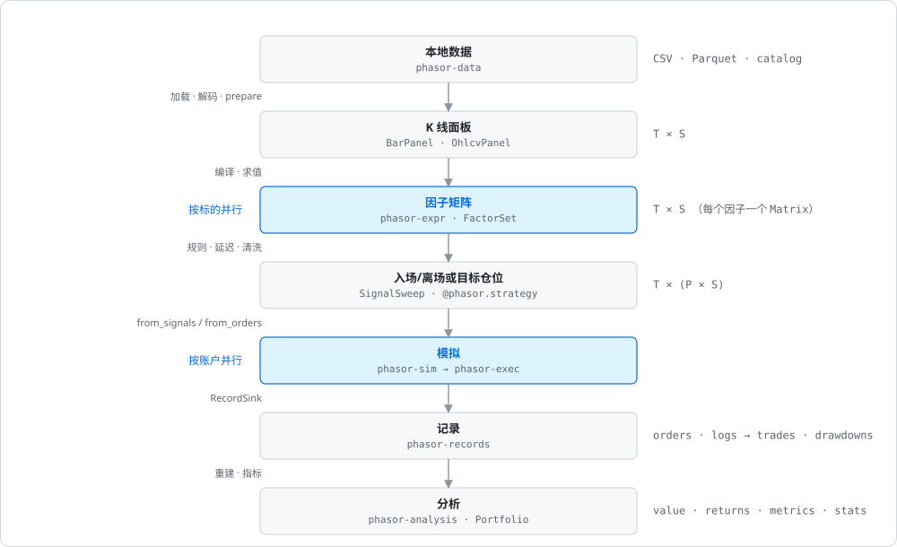
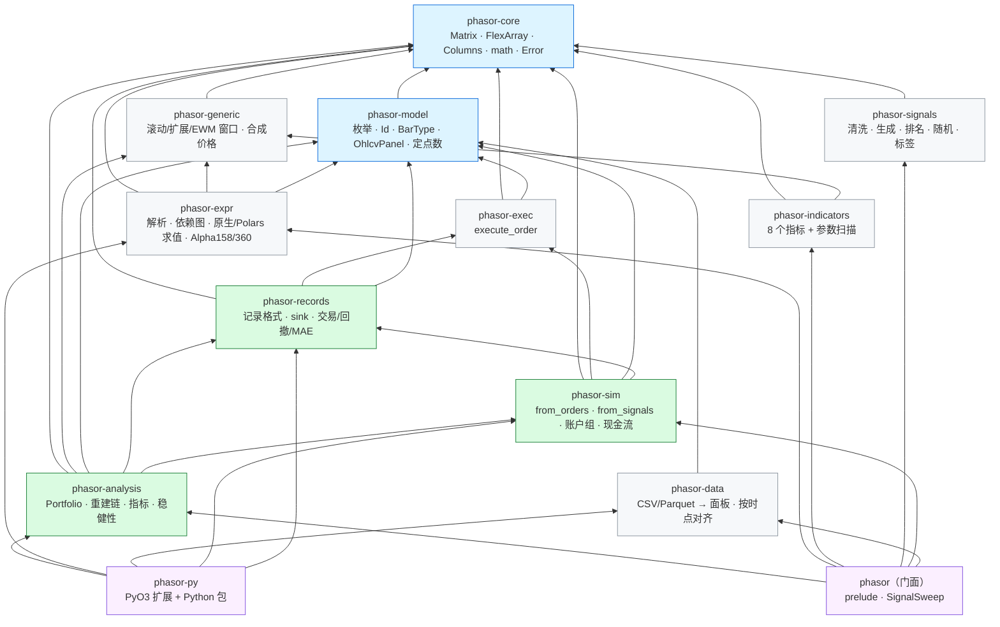

# 系统全景

先建立全局地图。这一页从四个角度看整个仓库：数据流、crate 依赖与分层、代码规模、只画跨 crate 骨架的全局类图。

## 数据流

```
本地文件 ─▶ BarPanel(时间 × 标的) ─▶ 因子矩阵 ─▶ 信号(时间 × 列) ─▶ 模拟循环 ─▶ 记录 ─▶ 分析
   phasor-data        phasor-model      phasor-expr    phasor-signals     phasor-sim    phasor-records  phasor-analysis
                                    (按标的并行)   phasor/sweep      (按账户组并行)   (SoA)      (Portfolio)
```



整条流水线里没有 DataFrame：阶段之间传的是内存里的 `Vec<f64>`（[列主序](../concepts/column-axis.md)）、[`FlexArray`](../concepts/flex-array.md) 借用和结构体数组（SoA）。
这也是为什么几乎每个 crate 都要先读 [`phasor-core`](../crates/phasor-core.md)：它定义了所有阶段共用的"数组长什么样"。

## Crate 依赖与分层



箭头方向是"依赖于"。读的时候**自下而上**：被依赖得越多的 crate，越早读、越值得读透。

图里每个方框是一页，自下而上：

- [phasor-core：基础类型](../crates/phasor-core.md)：Matrix · FlexArray · Columns · math · Error
- [phasor-model：领域模型](../crates/phasor-model.md)：枚举 · Id · BarType · OhlcvPanel · 定点数
- [phasor-generic：通用窗口算子](../crates/phasor-generic.md)：滚动/扩展/EWM 窗口 · 合成价格
- [phasor-signals：信号工具箱](../crates/phasor-signals.md)：清洗 · 生成 · 排名 · 随机 · 标签
- [phasor-indicators：技术指标](../crates/phasor-indicators.md)：8 个指标 + 参数扫描
- [phasor-data：数据层](../crates/phasor-data.md)：CSV/Parquet → 面板 · 按时点对齐
- [phasor-expr：因子表达式引擎](../crates/phasor-expr.md)：解析 · 依赖图 · 原生/Polars 求值 · Alpha158/360
- [phasor-exec：撮合内核](../crates/phasor-exec.md)：execute_order
- [phasor-records：记录与派生视图](../crates/phasor-records.md)：记录格式 · sink · 交易/回撤/MAE
- [phasor-sim：模拟循环](../crates/phasor-sim.md)：from_orders · from_signals · 账户组 · 现金流
- [phasor-analysis：分析层](../crates/phasor-analysis.md)：Portfolio · 重建链 · 指标 · 稳健性
- [phasor：门面 crate](../crates/phasor.md)：prelude · SignalSweep
- [phasor-py：Python 层](../crates/phasor-py.md)：PyO3 扩展 + Python 包

## 代码规模（`src/` 行数，含单元测试）

| crate | 行数 | 文件数 | 一句话 |
|---|---:|---:|---|
| [phasor-core](../crates/phasor-core.md) | 1,258 | 6 | 数组、广播、列标签、浮点容差、错误 |
| [phasor-model](../crates/phasor-model.md) | 793 | 5 | 领域枚举与 Id，和 vectorbt / Nautilus 对齐 |
| [phasor-data](../crates/phasor-data.md) | 560 | 1 | Arrow 读取、面板、按 `available_time` 对齐 |
| [phasor-exec](../crates/phasor-exec.md) | 1,152 | 3 | 一笔订单对一个账户在一根 K 线上的撮合 |
| [phasor-sim](../crates/phasor-sim.md) | 4,258 | 7 | 驱动内核的两条循环、止损、账户组、并行 |
| [phasor-records](../crates/phasor-records.md) | 4,032 | 7 | 记录格式与派生视图 |
| [phasor-analysis](../crates/phasor-analysis.md) | 5,578 | 12 | 从记录重建净值、全部指标 |
| [phasor-expr](../crates/phasor-expr.md) | 4,089 | 10 | 因子 DSL 全链路 |
| [phasor-generic](../crates/phasor-generic.md) | 1,533 | 4 | 通用窗口算子 |
| [phasor-indicators](../crates/phasor-indicators.md) | 1,188 | 3 | 技术指标与参数网格 |
| [phasor-signals](../crates/phasor-signals.md) | 2,021 | 7 | 信号工具箱 |
| [phasor](../crates/phasor.md) | 364 | 2 | 门面 |
| [phasor-py](../crates/phasor-py.md) | 2,367 Rust + 1,257 Python | 7 + 4 | Python 边界 |
| [research/phasor_lab](../tooling/research-protocol.md) | 2,459 Python | 22 | 预注册因子研究协议 |

## 全局类图（只画跨 crate 的骨架）

```mermaid
classDiagram
  direction LR
  class Matrix {
    +Vec~f64~ data
    +usize n_rows
    +usize n_cols
    +column(c) &[f64]
  }
  class FlexArray~T~ {
    <<enum>>
    Scalar(T)
    PerColumn(&[T])
    PerRow(&[T])
    MappedColumns
    Full
    +get(row, col) T
    +varies_by_row() bool
  }
  class OhlcvPanel {
    +Vec~f64~ open/high/low/close/volume
    +n_rows, n_cols
  }
  class FactorSet {
    +compile(exprs)
    +evaluate(&FactorInputs) FactorValues
    -Graph graph
  }
  class FromSignals~'a~ {
    +FlexArray close/open/high/low
    +FlexArray entries/exits/...
    +FlexArray size/fees/sl_stop/...
    +Groups groups
  }
  class FromOrders~'a~ {
    +FlexArray size/price/size_type/...
  }
  class ValidatedOrder {
    -Order order
    -Option~&str~ violation
    +set_bar(size, price, type, dir)
  }
  class execute_order {
    <<fn>>
    (ProcessOrderState, &Order, draw) → (ExecuteOrderState, OrderResult)
  }
  class OrderRecords {
    +Vec col/idx/size/price/fees/side
    +CashRecords cash
    +concat(parts)
  }
  class Journal {
    +OrderRecords orders
    +LogRecords logs
  }
  class RecordSink {
    <<trait>>
    +push_order(...)
    +push_cash(...)
  }
  class Portfolio~'a~ {
    -OrderRecords records
    -&[f64] close
    -Groups groups
    -OnceLock 派生序列...
    +value() returns() sharpe()...
    +stats(Select)
  }
  class TradeRecords
  class DrawdownRecords

  OhlcvPanel --> FactorSet : FactorInputs.from_ohlcv
  FactorSet --> Matrix : FactorValues
  Matrix --> FromSignals : SignalSweep / strategy.sweep
  FromSignals --> ValidatedOrder : build_order 每列一次
  FromOrders --> ValidatedOrder
  ValidatedOrder --> execute_order : execute_validated
  execute_order --> RecordSink : push_order
  RecordSink <|.. OrderRecords
  RecordSink <|.. Journal
  OrderRecords --> Portfolio : from_records
  Portfolio --> TradeRecords : trades()
  Portfolio --> DrawdownRecords : drawdowns()
  FlexArray <.. FromSignals
  FlexArray <.. FromOrders
```



## 相关

- [贯穿全仓库的约定](../guides/conventions.md)：图里每个 crate 都遵守的 7 个约定。
- [阅读路线](../guides/reading-roadmap.md)：按什么顺序自下而上读这些 crate。
- [FlexArray 广播与列映射](../concepts/flex-array.md)：类图里的 `FlexArray` 和 `MappedColumns`。
- [ValidatedOrder：按列提升参数校验](../concepts/validated-order.md)：类图里 `FromSignals` / `FromOrders` 到内核之间的那一层。
- [execute_order 的固定顺序](../algorithms/execute-order-pipeline.md)：类图中央的 `execute_order`。
- [合并每线程缓冲与 order_id 重基](../algorithms/record-merge.md)：`OrderRecords::concat` 与 `Journal`。
- [从记录重建净值](../algorithms/rebuild-chain.md)：`Portfolio` 从 `OrderRecords` 算出净值的那条链。
- [SignalSweep：因子到信号列](../algorithms/signal-sweep.md)：`Matrix --> FromSignals` 这条边。
