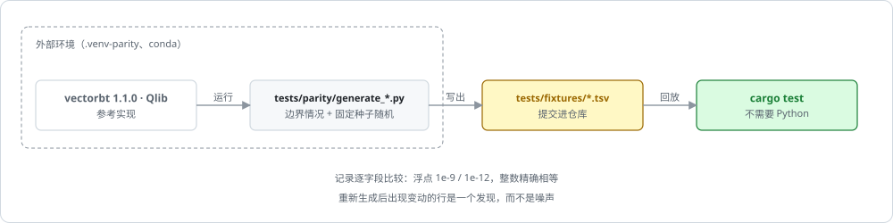

# 差分测试与 fixture

phasor 的正确性是"与参考实现逐字段一致"：vectorbt 1.1.0 和 Qlib 在仓库之外的环境里跑出期望结果，写成 TSV fixture 提交进 [`tests/fixtures/`](https://github.com/nivalume/vbt/tree/81a1d5f238f2d583bad187a9ab6e1e6170316f11/tests/fixtures)，Rust 测试读回来逐条比较。它和[研究协议 phasor_lab](../tooling/research-protocol.md)、[基准协议](../tooling/benchmarks.md)一起，是"围绕引擎的三件外围设施"。

## 定位

- **[`tests/parity`](https://github.com/nivalume/vbt/tree/81a1d5f238f2d583bad187a9ab6e1e6170316f11/tests/parity)**：差分测试基础设施。参考实现（vectorbt 1.1.0 / Qlib）在外部环境里跑出 TSV fixture 提交进仓库，`cargo test` 不需要 Python 就能重放。

## 文件与阅读顺序

| 顺序 | 文件 | 行数 | 读什么 |
|---|---|---:|---|
| 9 | [`tests/parity/README.md:1-104`](https://github.com/nivalume/vbt/blob/81a1d5f238f2d583bad187a9ab6e1e6170316f11/tests/parity/README.md#L1-L104) | — | 框架；之后的变异测试表当参考读 |

第一遍可跳过：[`tests/parity/README.md:104-776`](https://github.com/nivalume/vbt/blob/81a1d5f238f2d583bad187a9ab6e1e6170316f11/tests/parity/README.md#L104-L776) 的逐层变异表。

顺序号沿用研究协议、差分测试与基准的整体阅读顺序（其余各行见 [研究协议 phasor_lab](../tooling/research-protocol.md#文件与阅读顺序)）。

## 差分测试的做法

| 项 | 内容 |
|---|---|
| 生成 | `.venv-parity` 装 `vectorbt==1.1.0` 和 `plotly<6`（这个 pin 是承重的）；每个 `generate_<x>.py` 写恰好一个 fixture；Qlib 的在 conda 环境里用确定性假 provider 生成 |
| 格式 | TSV + `#` 头注释；数组参数带广播前缀 `s:`（标量）、`c:a;b;c`（按列）、`r:`（按行）、`f:`（全矩阵，**列主序**）；浮点用 `repr(float(x))` 让 Rust `from_str` 能往返 `nan`/`inf`；枚举按名字；期望输出 `;` 连接 |
| 三层循环 | `execute_order.tsv`（单次内核调用，能定位到换算链的哪一级）→ `order_sequence.tsv`（链式调用，把自己的输出喂回去，抓状态穿线与残差）→ `from_orders.tsv`（整条循环） |
| 比较 | 每个 Rust 测试定义 `agree(a, b)`：NaN 只与 NaN 一致，无穷只与同号无穷一致，其余 `is_close`（1e-9 / 1e-12）；整数精确 |
| 输入 | 手选边界 + 固定种子 20260918 的随机用例；**不是** property-based，所以重新生成后的 diff 就是发现 |
| 变异测试 | 手工施加变异，幸存者论证不可达或等价；矩阵在 [`tests/parity/README.md`](https://github.com/nivalume/vbt/blob/81a1d5f238f2d583bad187a9ab6e1e6170316f11/tests/parity/README.md)；收获的 bug：内核 `is_close_or_less → <=` 幸存者、`min_size` 默认 0 对 1e-8、`order_id` 跨组未重基、时长差一、毛敞口分母、`max_drawdown` 跳 NaN、Numba 与 NumPy 的 percentile 拼写、`np.sum` 对 `nansum` |
| 不覆盖 | `reject_prob > 0`（消耗 NumPy 全局 RNG；Rust 侧用注入的 draw 测） |

完整的 fixture 表在 `ARCHITECTURE.zh-CN.md §14.3`。

`agree` 里的 `is_close` 见 [浮点容差与零钉](../concepts/float-tolerance.md)；`execute_order.tsv` 逐级检查的是 [execute_order 的固定顺序](../algorithms/execute-order-pipeline.md) 与 [数量换算链与 percent](../algorithms/size-cascade.md)。

## 各层的 fixture

下表摘自 [ARCHITECTURE §14.3](https://github.com/nivalume/vbt/blob/81a1d5f238f2d583bad187a9ab6e1e6170316f11/docs/ARCHITECTURE.zh-CN.md)（测试路径相对 [`crates/`](https://github.com/nivalume/vbt/tree/81a1d5f238f2d583bad187a9ab6e1e6170316f11/crates)，括号里是 fixture 的用例行数）：

| 测试 | 夹具（行数） | 容差 |
|---|---|---|
| [`phasor-exec/tests/parity.rs`](https://github.com/nivalume/vbt/blob/81a1d5f238f2d583bad187a9ab6e1e6170316f11/crates/phasor-exec/tests/parity.rs) | `execute_order.tsv`（474） | `agree` |
| [`phasor-exec/tests/parity_sequence.rs`](https://github.com/nivalume/vbt/blob/81a1d5f238f2d583bad187a9ab6e1e6170316f11/crates/phasor-exec/tests/parity_sequence.rs) | `order_sequence.tsv`（1,504 步） | `agree` |
| [`phasor-sim/tests/parity_from_orders.rs`](https://github.com/nivalume/vbt/blob/81a1d5f238f2d583bad187a9ab6e1e6170316f11/crates/phasor-sim/tests/parity_from_orders.rs) | `from_orders.tsv`（290） | `agree`，逐字段 |
| [`phasor-sim/tests/parity_from_signals.rs`](https://github.com/nivalume/vbt/blob/81a1d5f238f2d583bad187a9ab6e1e6170316f11/crates/phasor-sim/tests/parity_from_signals.rs) | `from_signals.tsv`（181） | `agree` |
| [`phasor-sim/tests/parity_signals.rs`](https://github.com/nivalume/vbt/blob/81a1d5f238f2d583bad187a9ab6e1e6170316f11/crates/phasor-sim/tests/parity_signals.rs) | `signals.tsv`（5,088，穷举） | `is_close` |
| [`phasor-sim/tests/parity_cash_sharing.rs`](https://github.com/nivalume/vbt/blob/81a1d5f238f2d583bad187a9ab6e1e6170316f11/crates/phasor-sim/tests/parity_cash_sharing.rs) | `cash_sharing.tsv`（48） | 相对 1e-9 |
| [`phasor-records/tests/parity_trades.rs`](https://github.com/nivalume/vbt/blob/81a1d5f238f2d583bad187a9ab6e1e6170316f11/crates/phasor-records/tests/parity_trades.rs) | `trades.tsv`（267） | `is_close`，整数精确 |
| [`phasor-records/tests/parity_drawdowns.rs`](https://github.com/nivalume/vbt/blob/81a1d5f238f2d583bad187a9ab6e1e6170316f11/crates/phasor-records/tests/parity_drawdowns.rs) | `drawdowns.tsv`（998） | 相对 1e-12 |
| [`phasor-records/tests/parity_mapped.rs`](https://github.com/nivalume/vbt/blob/81a1d5f238f2d583bad187a9ab6e1e6170316f11/crates/phasor-records/tests/parity_mapped.rs) | `mapped.tsv`（28,367） | 相对 1e-12 |
| [`phasor-generic/tests/parity_generic.rs`](https://github.com/nivalume/vbt/blob/81a1d5f238f2d583bad187a9ab6e1e6170316f11/crates/phasor-generic/tests/parity_generic.rs) | `generic.tsv`（1,650） | `is_close` |
| [`phasor-indicators/tests/parity_indicators.rs`](https://github.com/nivalume/vbt/blob/81a1d5f238f2d583bad187a9ab6e1e6170316f11/crates/phasor-indicators/tests/parity_indicators.rs) | `indicators.tsv`（480） | `is_close`；扫描逐位一致 |
| [`phasor-signals/tests/parity_signals_gen.rs`](https://github.com/nivalume/vbt/blob/81a1d5f238f2d583bad187a9ab6e1e6170316f11/crates/phasor-signals/tests/parity_signals_gen.rs) | `signals_gen.tsv`（5,782） | 精确 / 1e-12 |
| [`phasor-analysis/tests/parity_analysis.rs`](https://github.com/nivalume/vbt/blob/81a1d5f238f2d583bad187a9ab6e1e6170316f11/crates/phasor-analysis/tests/parity_analysis.rs) | `analysis.tsv`（37） | `is_close` |
| [`phasor-analysis/tests/parity_metrics.rs`](https://github.com/nivalume/vbt/blob/81a1d5f238f2d583bad187a9ab6e1e6170316f11/crates/phasor-analysis/tests/parity_metrics.rs) | `metrics.tsv`（2,047） | 相对 1e-9 |
| [`phasor-analysis/tests/parity_stats.rs`](https://github.com/nivalume/vbt/blob/81a1d5f238f2d583bad187a9ab6e1e6170316f11/crates/phasor-analysis/tests/parity_stats.rs) | `stats.tsv`（72） | 相对 1e-9；标题精确 |
| [`phasor-expr/tests/parity_qlib.rs`](https://github.com/nivalume/vbt/blob/81a1d5f238f2d583bad187a9ab6e1e6170316f11/crates/phasor-expr/tests/parity_qlib.rs) | `qlib_alpha158.tsv`（240）、`qlib_alpha360.tsv`（64） | 1e-6（`CORR*/CORD*` 为 1e-4）；两个后端 |

Python 侧的差分测试（[`crates/phasor-py/tests/test_bindings.py`](https://github.com/nivalume/vbt/blob/81a1d5f238f2d583bad187a9ab6e1e6170316f11/crates/phasor-py/tests/test_bindings.py) 对在线 vectorbt，`test_shared_accounts.py` 重放 [`tests/fixtures/shared_accounts.json`](https://github.com/nivalume/vbt/blob/81a1d5f238f2d583bad187a9ab6e1e6170316f11/tests/fixtures/shared_accounts.json) 的 48 个用例）与重新生成 fixture 的命令见 ARCHITECTURE §14.5、§14.6。

## 阅读陷阱

1. 重新生成 fixture 后必须读 diff；`plotly<6` 的 pin；vectorbt 没设频率会无声丢掉四行年化统计。

## 延伸资料

- 差分测试：McKeeman, "Differential Testing for Software"（1998）；变异测试：Jia & Harman, "An Analysis and Survey of the Development of Mutation Testing"（2011）；Rust 工具 `cargo-mutants`。
- 更多见 [延伸资料](../reference/further-reading.md) 的研究协议、验证、基准部分。

## 相关

- [浮点容差与零钉](../concepts/float-tolerance.md)：`agree` 与 `is_close` 的容差从哪里来。
- [execute_order 的固定顺序](../algorithms/execute-order-pipeline.md)：`execute_order.tsv` 一行就是一次内核调用。
- [数量换算链与 percent](../algorithms/size-cascade.md)：单次调用的 fixture 能指出坏在换算链哪一级。
- [基准协议](../tooling/benchmarks.md)：同样"与参考实现对照"，比的是速度而不是结果。
- [研究协议 phasor_lab](../tooling/research-protocol.md)：另一件外围设施，判定同样不许事后修改。
