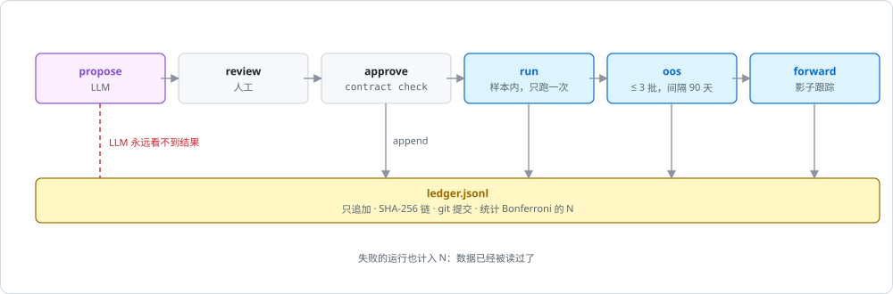
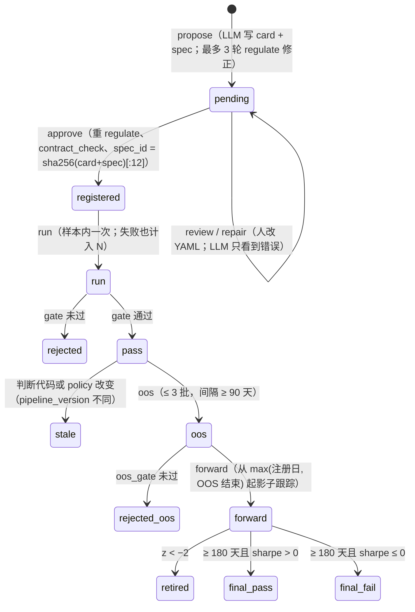

# 研究协议 phasor_lab

[`research/phasor_lab`](https://github.com/nivalume/vbt/tree/81a1d5f238f2d583bad187a9ab6e1e6170316f11/research/phasor_lab) 用 phasor 做因子研究，但把"谁提出假设"和"谁判定结果"拆开：语言模型只负责写假设卡片和因子规格，判定由固定的代码和固定的门槛完成，所有步骤写进一本不可篡改的账本。它和[差分测试与 fixture](../tooling/parity-testing.md)、[基准协议](../tooling/benchmarks.md)一起，是"围绕引擎的三件外围设施"。

## 定位

- **[`research/phasor_lab`](https://github.com/nivalume/vbt/tree/81a1d5f238f2d583bad187a9ab6e1e6170316f11/research/phasor_lab)**（2,459 行 Python）：一个预注册的因子研究协议。LLM 写假设与规格，固定的流程做判断，**模型永远看不到结果**，所以它不可能把数据拟合进去；一个健康的流水线大多数时候在拒绝。

## 文件与阅读顺序

| 顺序 | 文件 | 行数 | 读什么 |
|---|---|---:|---|
| 1 | [`research/README.md`](https://github.com/nivalume/vbt/blob/81a1d5f238f2d583bad187a9ab6e1e6170316f11/research/README.md) | — | 命令与流程 |
| 2 | [`research/phasor_lab/protocol/policy.py`](https://github.com/nivalume/vbt/blob/81a1d5f238f2d583bad187a9ab6e1e6170316f11/research/phasor_lab/protocol/policy.py) | 78 | 全部参数：周期、数据、成本、门槛、OOS 预算、forward 规则；`version()` |
| 3 | `protocol/ledger.py` | 143 | 哈希链 32–34、68–89；`_read` 校验 58–66 |
| 4 | `pipeline.py` | 374 | 阶段：`propose` 78–99、`approve` 101–131、`run` 155–203、`oos` 211–241、`forward` 245–283、`report` 287–338、`calibrate` 352–374 |
| 5 | `types/factor_ts/__init__.py` | 184 | 门槛 115–136、跨资产 96–109 |
| 6 | `types/factor_ts/harness.py` | 454 | `evaluate` 29–39、`zscore` 42–51、`position` 64–83、`composite` 336–353、`targets` 143–155、`backtest` 158–190、`contract_check` 429–454 |
| 7 | `types/factor_ts/spec.py` | 481 | `ARITY` 17–33（镜像 `parse.rs:validate`）、`regulate` 421–481、`common_subtree` 212–249 |
| 8 | `propose.py`、`protocol/cards.py`、`calibration.py`、`llm.py` | — | LLM 看到什么、卡片被拒绝的正则 |
| 11 | [`docs/plan.md`](https://github.com/nivalume/vbt/blob/81a1d5f238f2d583bad187a9ab6e1e6170316f11/docs/plan.md) | 647 | [路线图](../guides/roadmap.md)：做了什么、没做什么、为什么 |

第一遍可跳过：`spec.py:71-173` 的词法/语法分析（只需知道它镜像 `phasor-expr` 的语法并把 `{param}` 变成参数节点）、`harness.py:228-323`（IC 与 Alpha158 相关性，"仅供参考"，从不作为门槛）。

顺序 9、10 是差分测试与基准的文件，见 [差分测试与 fixture](../tooling/parity-testing.md#文件与阅读顺序) 与 [基准协议](../tooling/benchmarks.md#文件与阅读顺序)。`spec.py` 镜像的语法见 [Pratt 解析器](../algorithms/pratt-parser.md)。

## 研究协议的状态机

每一步都向 `ledger.jsonl` 追加一条并 git 提交；账本记录 N（样本内测试数）和 OOS 批次数。

## 核心算法与概念

- [哈希链账本](../algorithms/hash-chain-ledger.md)：每条记录带上一条的哈希，打开时逐行校验；`pipeline_version` 让改判断代码使旧的通过变 stale。
- [评估框架与合同检查](../algorithms/research-harness.md)：一次 phasor 调用算 z 分数、按 card 的方向生成仓位、一次 `from_orders` 回测全部成本倍数；合同检查用"前缀一致"抓前视。
- [门槛、多重比较与原创性检查](../algorithms/research-gates.md)：Bonferroni 随账本里的测试数 N 上调 t 门槛，负对照必须被拒绝，换价格字段不算新因子。

## 阅读陷阱

1. 账本默认在仓库**旁边**的 `../phasor-ledger`；`pending/` 被 git 忽略；改任何判断模块或 `policy.yaml` 会让旧的通过变 stale，重跑算新测试。
2. "OOS 期对流水线是样本外，对 LLM 不是"（`policy.py:19-21`）。
3. `funding_modeled: False` 是文档标志，不是模型（`plan.md` C3 要把它变成真开关，见 [路线图与已知缺口](../guides/roadmap.md)）。
4. 卡片被拒绝的正则包括任何四位年份和月份名，含中文"年"/"月"。
5. `harness.composite` 的 walk-forward 和 `phasor.validation.walk_forward` 是两套（J2 计划合并；后者见 [时间序列交叉验证](../algorithms/ts-cross-validation.md)）。
6. `research/tests/test_pipeline.py::test_proposals_never_see_results` 才是"模型看不到结果"的检查（`propose.py` 的注释引用的路径是旧的，ARCHITECTURE §17.4 列为已知问题）。

## 延伸资料

- 预注册：Nosek et al., "The preregistration revolution"（*PNAS*, 2018）。
- 多重比较：Bonferroni 校正；Harvey, Liu & Zhu, "…and the Cross-Section of Expected Returns"（*RFS*, 2016）对 t 统计量门槛随试验数上调的论证；White, "A Reality Check for Data Snooping"（2000）。
- López de Prado, *Advances in Financial Machine Learning* 第 11 章"回测的危险"、第 12 章"通过交叉验证回测"、第 13 章"合成数据回测"（零漂移 GBM 对照的来源）。
- 哈希链 / 时间戳：Haber & Stornetta, "How to Time-Stamp a Digital Document"（1991）。
- Kakushadze, "101 Formulaic Alphas"（2016）；Yang et al., "Qlib"（2020）——研究层的表达式来源。
- 更多见 [延伸资料](../reference/further-reading.md) 的研究协议、验证、基准部分。

## 自测

1. 账本里已有 9 次样本内测试，新规格的 t 统计量要超过多少才通过（α = 0.05）？（[门槛、多重比较与原创性检查](../algorithms/research-gates.md)）
2. 为什么 `contract_check` 用"前缀一致"而不是直接检查 `uses_future`？举一个 `uses_future` 抓不到但前缀检查能抓到的例子。（[评估框架与合同检查](../algorithms/research-harness.md)）
3. 为什么 PBO（见 [过拟合检验：PSR、DSR、PBO](../algorithms/overfitting-stats.md)）和这里的 Bonferroni 门槛解决的是同一个问题的两个面？
4. 把 `policy.yaml` 里的 `suspicious_t` 从 8 改成 10，之前通过的规格会怎样？（[哈希链账本](../algorithms/hash-chain-ledger.md)）

## 相关

- [过拟合检验：PSR、DSR、PBO](../algorithms/overfitting-stats.md)：引擎分析层里处理同一个多重测试问题的统计量。
- [phasor-expr：因子表达式引擎](../crates/phasor-expr.md)：规格里的表达式由它编译和求值。
- [延迟与前视偏差](../concepts/look-ahead.md)：`uses_future` 与 `contract_check` 是两道前视防线。
- [路线图与已知缺口](../guides/roadmap.md)：[`docs/plan.md`](https://github.com/nivalume/vbt/blob/81a1d5f238f2d583bad187a9ab6e1e6170316f11/docs/plan.md) 的摘要，含研究层计划的条目。
